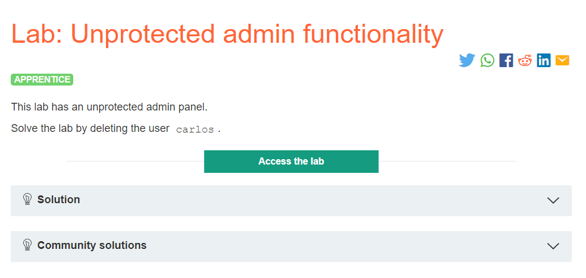
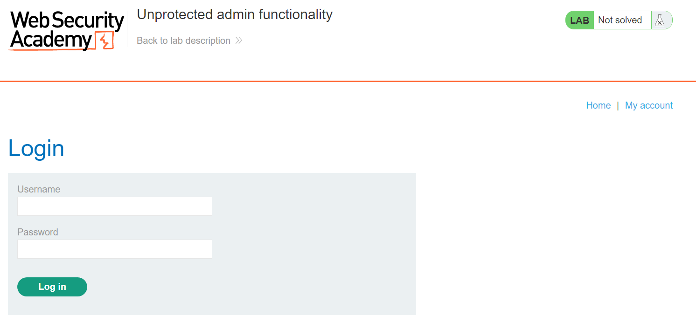
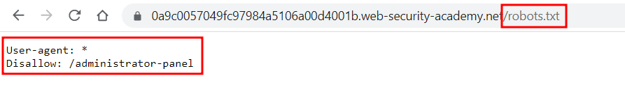
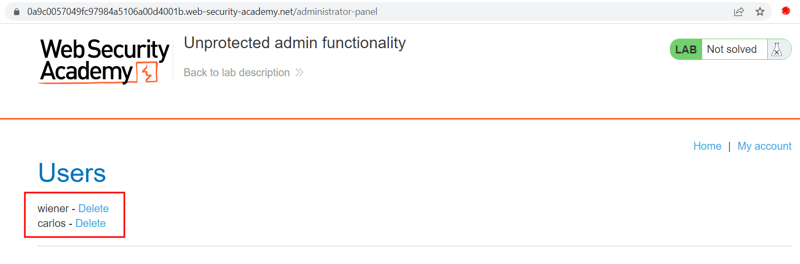
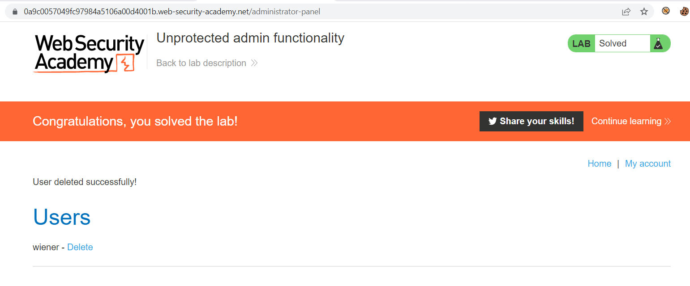

# Unprotected admin functionality

## Lab Description :

## Solution :
When the lab loads, we get the ususal shopping website.

Clicking on My Account page takes us to /login endpoint

Now we need to bypass this login page and directly access the admin page.

For that we can look for one of the common web directories like the robots.txt and sitemap.xml

robots.txt

We see a disallowed login entry here for the admin panel which is /administrator-panel.

On visiting the ``/administrator-panel`` directory, we get the admin panel.

So we click the link to delete the user carlos to solve the lab.

#### Visit The Next Page For The Next Level :)

