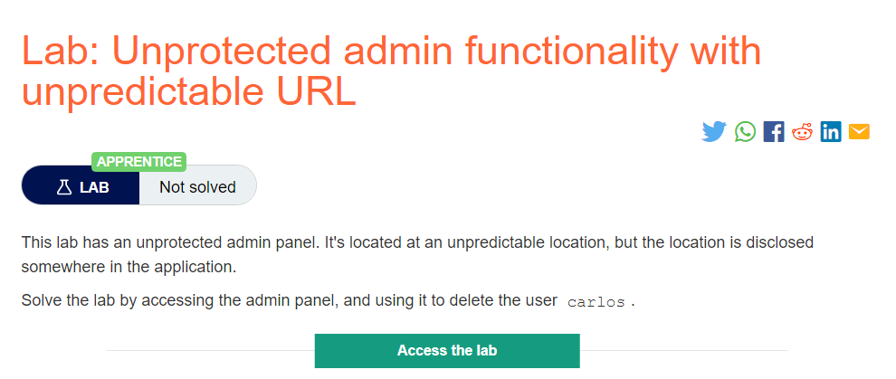
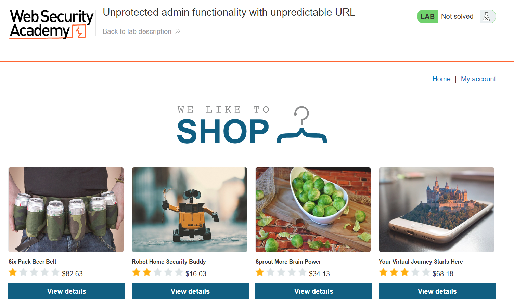
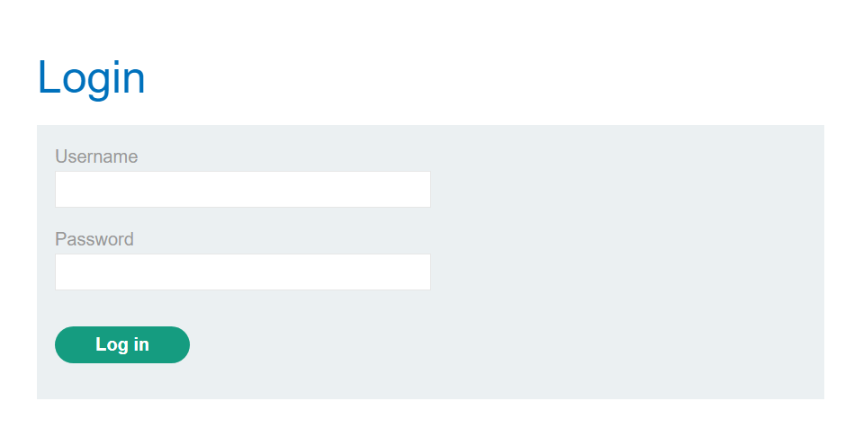
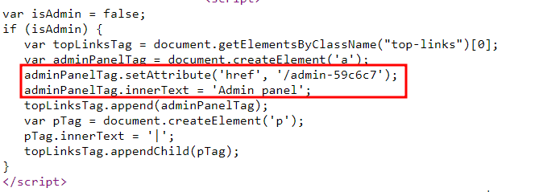
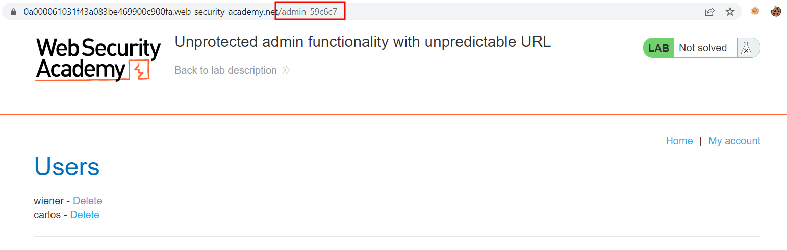
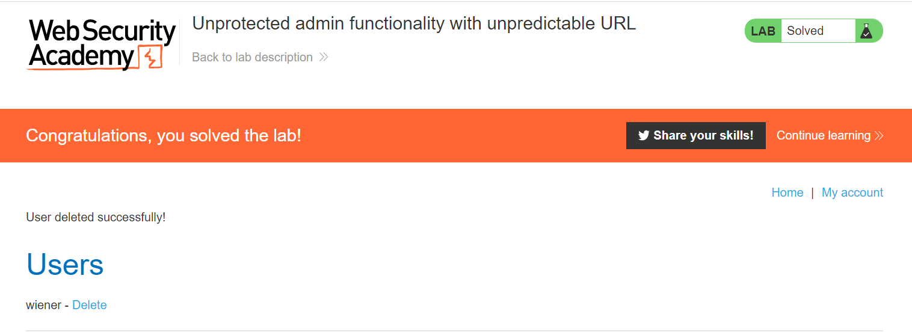

# Unprotected admin functionality with unpredictable URL

## Lab Description :

## Solution :
The lab webpage looks like this,

Clicking on My Account, takes us to the Login page at /login.

On seeing the source code, we see a javascript code which checks if the user is admin, then it redirects us to ``/admin-59c6c7`` endpoint which is the admin panel.

So we could directly browse to that directory to view the admin panel.

Click on ther DELETE link of carlos to delete the carlos user .Thus lab is solved.

#### Visit The Next Page For The Next Level :)

