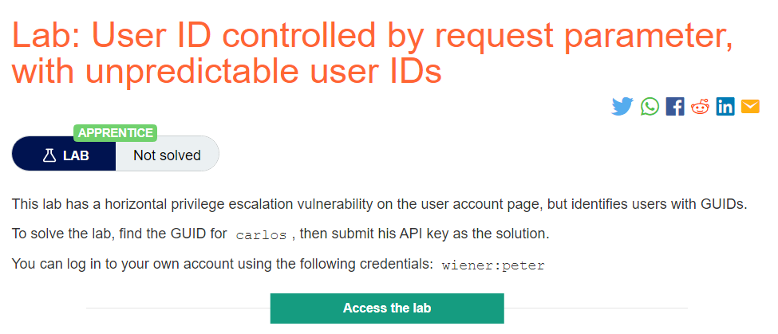
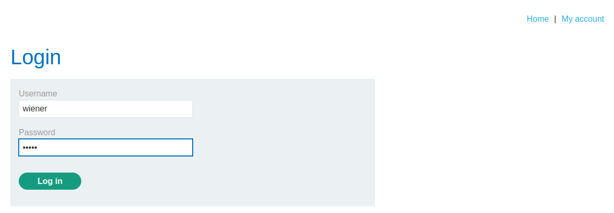
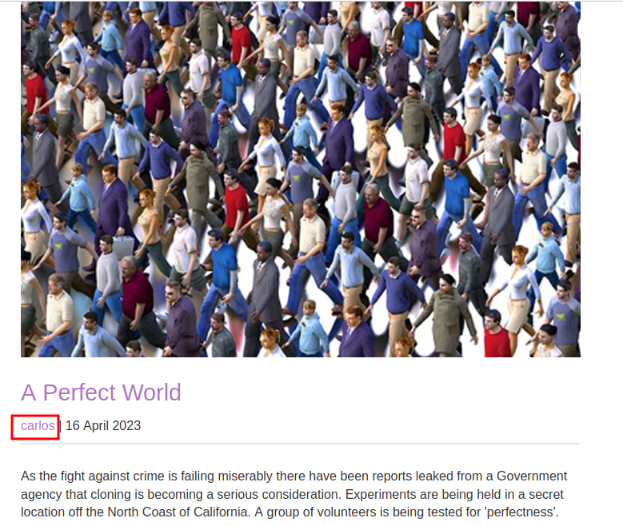
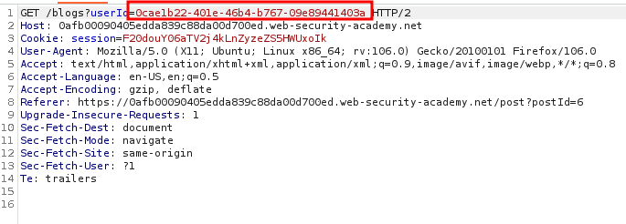
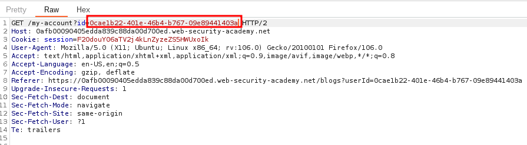
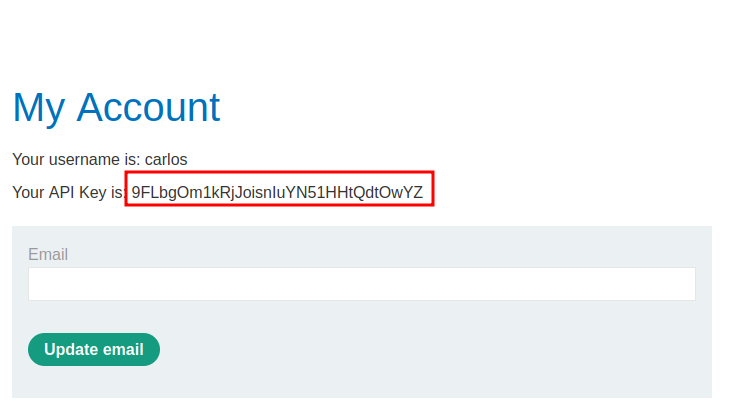
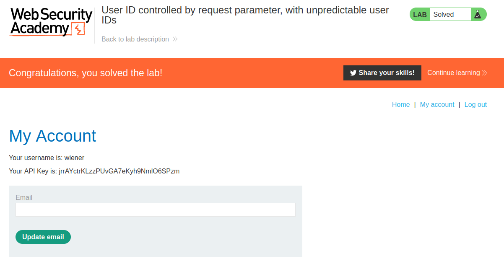

# User ID controlled by request parameter, with unpredictable user IDs

## Lab Description :

## Solution :
In some applications, the exploitable parameter does not have a predictable value. For example, instead of an incrementing number, an application might use globally unique identifiers (GUIDs) to identify users. Here, an attacker might be unable to guess or predict the identifier for another user. However, the GUIDs belonging to other users might be disclosed elsewhere in the application where users are referenced, such as user messages or reviews.

Click on My Account , it takes us to login page. Use the credentials wiener:peter to login.

Once we login, we can see the API key of wiener.

Click on My Account & capture the request.

We have the GUID of wiener in the request. We need to somehow find the GUID of carlos to get his API key.

For that , click on the home page and browse through all the blog posts by carlos, Click on his username

Now we got the GUID of carlos - ``0cae1b22-401e-46b4-b767-09e89441403a``

GUID of wiener - ``jrrAYctrKLzzPUvGA7eKyh9NmlO6SPzm`` GUID of carlos - ``0cae1b22-401e-46b4-b767-09e89441403a``

Now in the My Account page , click on the link , capture the request and modify the GUID of wiener with carlos to get the API key.

In the response now we get the API key of carlos - ``9FLbgOm1kRjJoisnIuYN51HHtQdtOwYZ``

Thus we solved the lab.

#### Visit The Next Page For The Next Level :)
