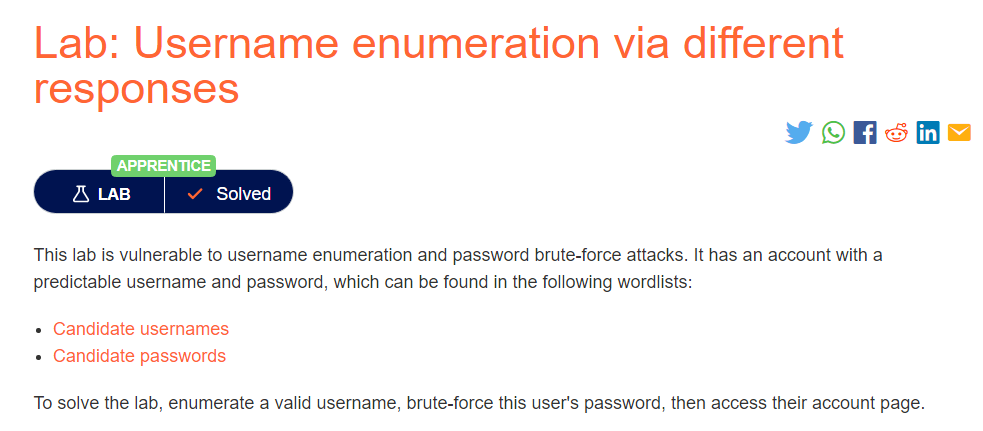
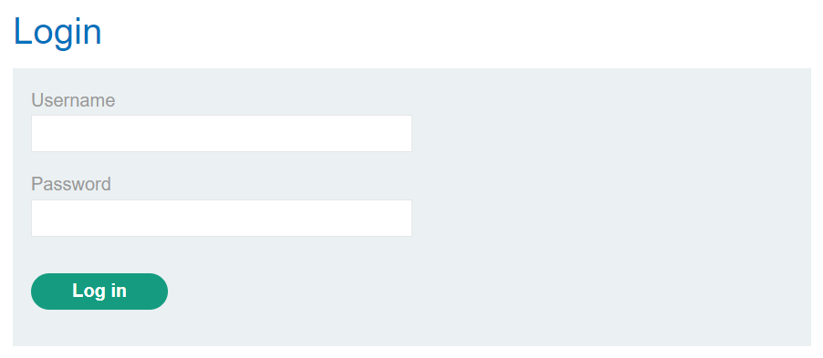
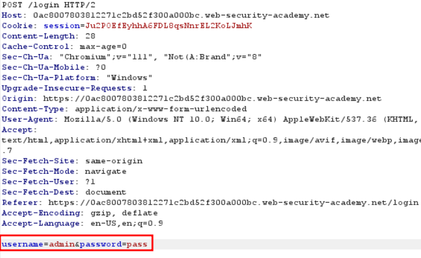
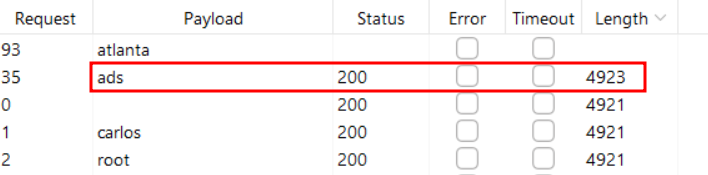
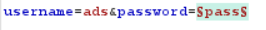
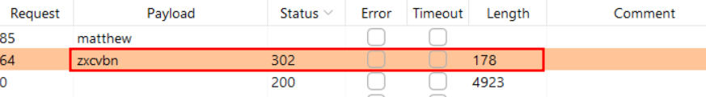

# Username enumeration via different responses

Vulnerabilities in password-based login :

 . Bruteforcing usernames

 . Bruteforcing passwords

 . Username enumeration ( Take note of status code error message & response times)

## Lab Description :

## Solution :
The login looks like this,

Captured request is as follows , it has two parameters - username and password

Now send the intercepted request to Intruder, clear all the selection & add username field. In the payload section, copy paste all the usernames in the given list.Click Start Attack.

Now we can see there is a entry which has different response & length. So ads is the username.

Now change the username to ads and add the password parameter .

Add the given payload in the payload section, Click Start Attack.

We get an entry which has different status code which is 302 redirection which indicates that login is successful and is redireting us to home page

username - ads password - `zxcvbn`

#### Visit The Next Page For The Next Level :)
