# 2FA bypass using a brute-force attack

### Brute-forcing 2FA verification codes :
As with passwords, websites need to take steps to prevent brute-forcing of the 2FA verification code. This is especially important because the code is often a simple 4 or 6-digit number. Without adequate brute-force protection, cracking such a code is trivial.

Some websites attempt to prevent this by automatically logging a user out if they enter a certain number of incorrect verification codes. This is ineffective in practice because an advanced attacker can even automate this multi-step process by creating macros for Burp Intruder. The Turbo Intruder extension can also be used for this purpose.

## Lab Description :
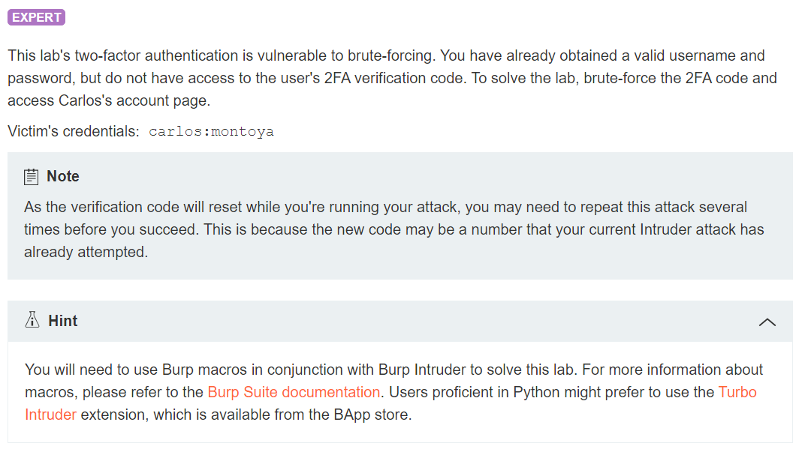

## Solution :
Blog on Burp Macros - ``https://akshita-infosec.medium.com/burp-macros-what-why-how-151df8901641``

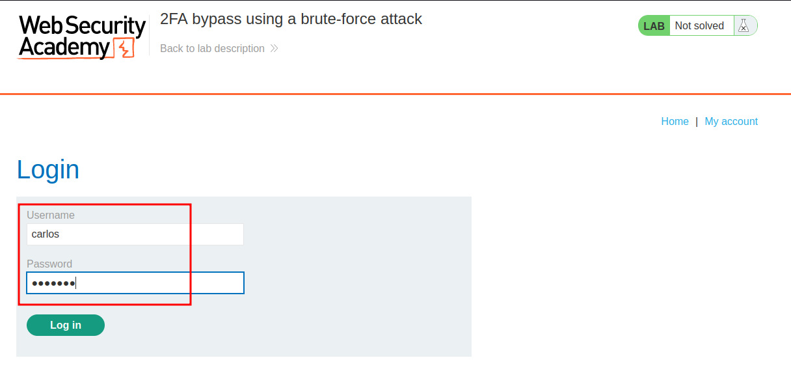 

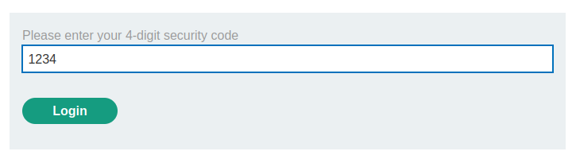 

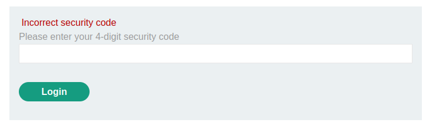

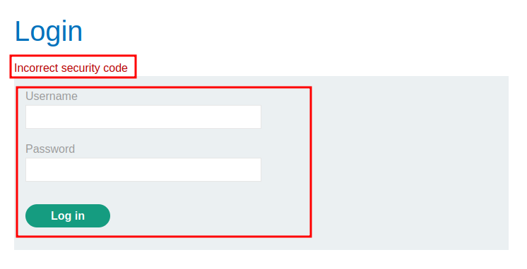

HTTP history

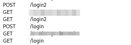

Project options -> Sessions tab

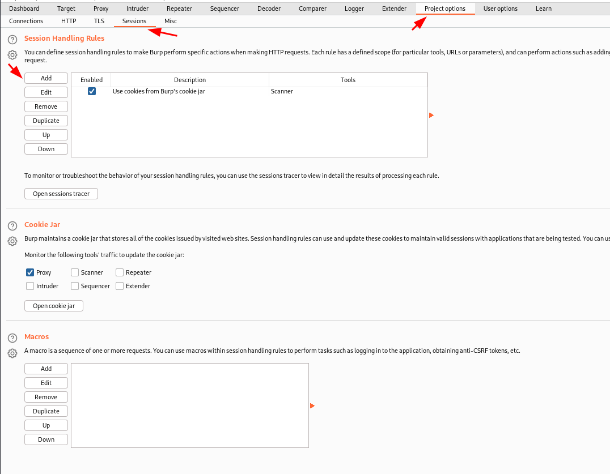

Under Session Handling Rules -> Add

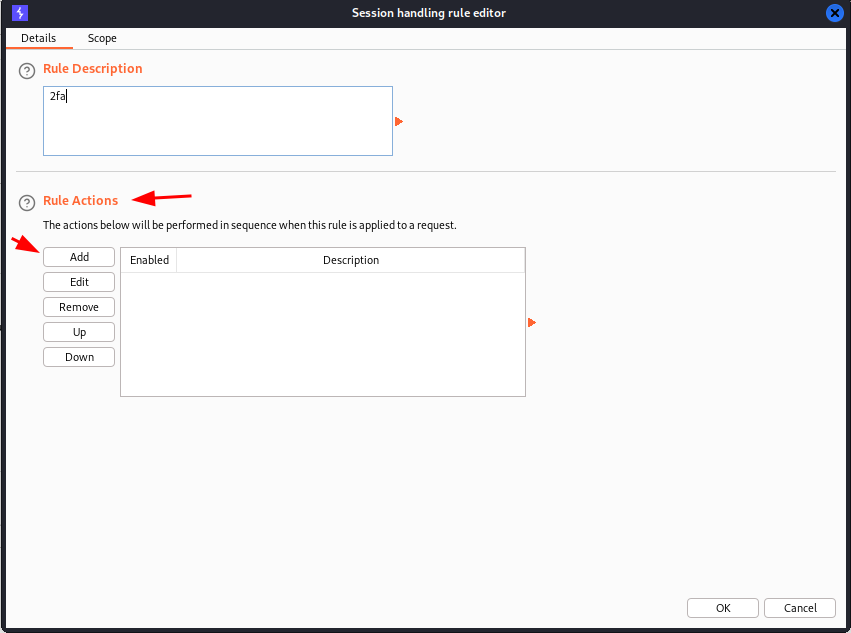

Click scope

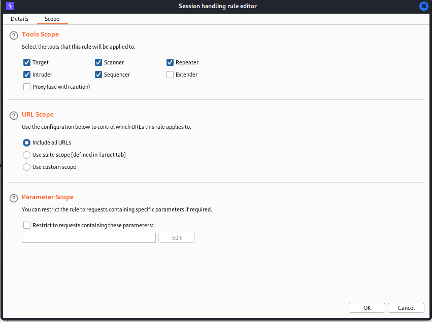

Go back to details tab

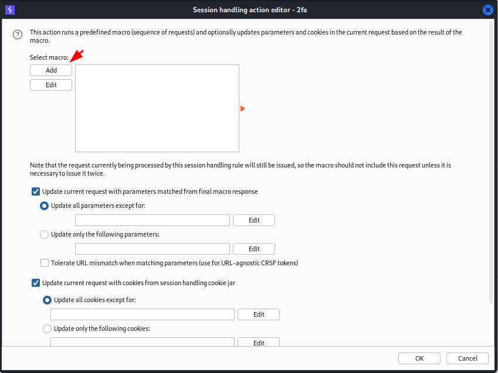

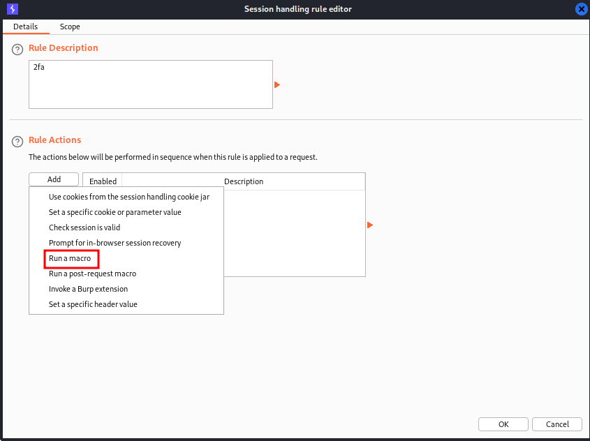

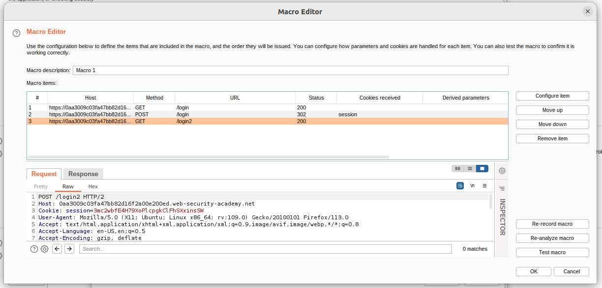

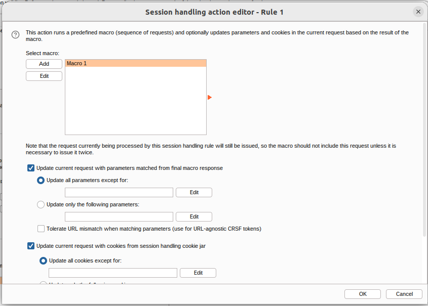

