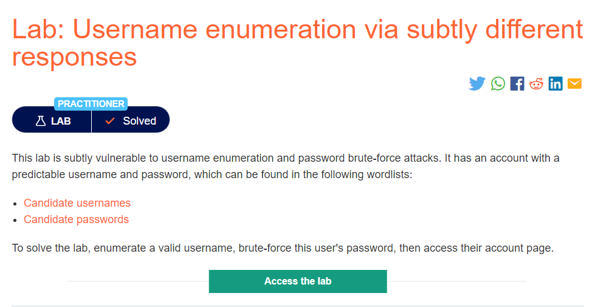
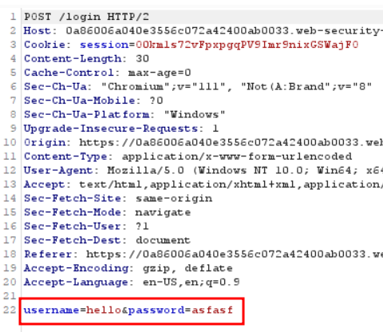
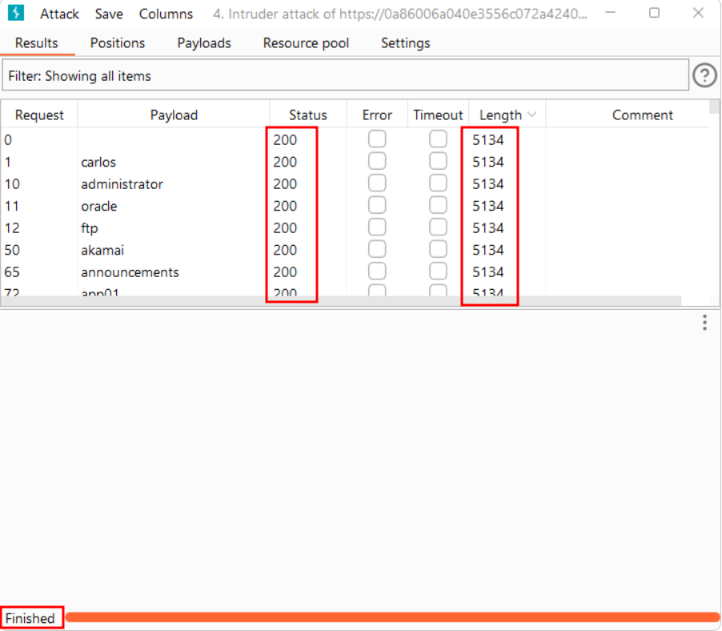
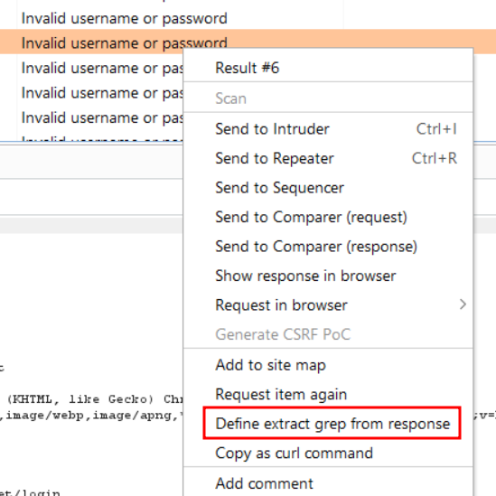
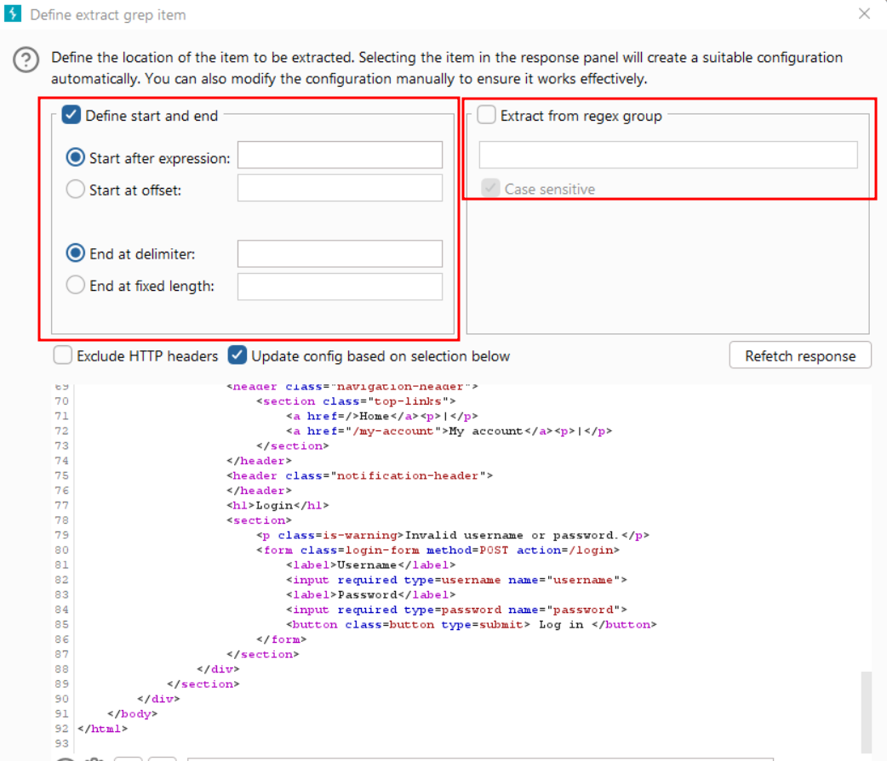
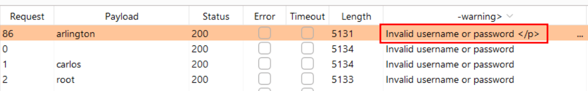
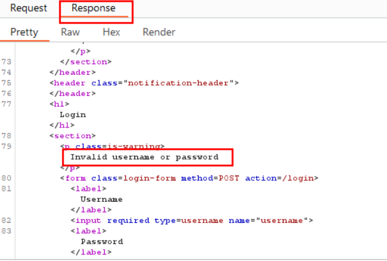
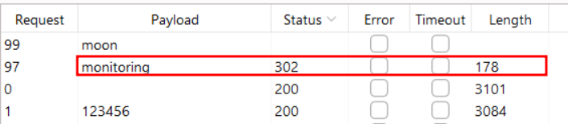

# Username enumeration via subtly different responses

## Lab Description :

## Solution :
Captured request -

All the responses look then same. 

From this right click any one of the request -> Define extract grep from response option. 

A new dialog box appears, 

Scroll down & highlight Invalid username or password , the regex fields automatically gets updated.

Now start the attack,

We can see that there is a typo in only one response 

Here one thing stands out, this response has Invalid username or password  rather than Invalid username or password ie.trailing fullstop & space is missing. 

Now update the username to arlington , add the password field as target , add payload of passwords and start the attack.

We get a 302 status code which indicates that it is the password

#### Visit The Next Page For The Next Level :)

