# Infinite money logic flaw

## Lab Description :
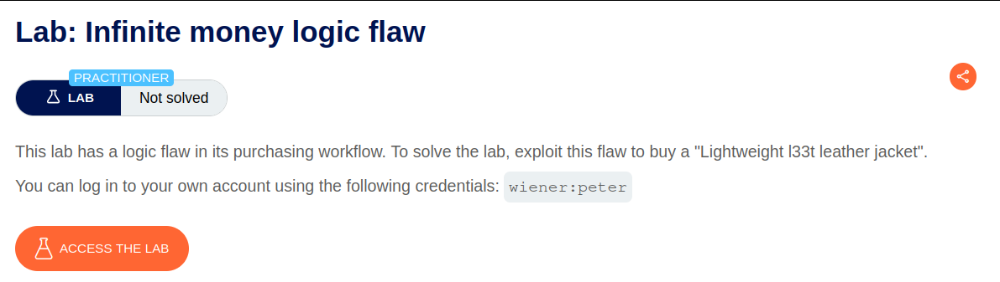

## Solution :
Log in as wiener.

When we scroll down all the products in the home page, we can see that there is a signup feature.

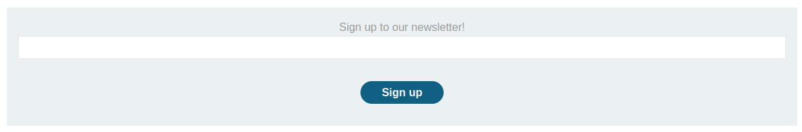

When we signup, then site gives us a coupon code.

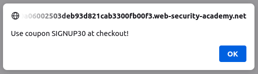

In the home page, we have a product called gift card. Add it to cart

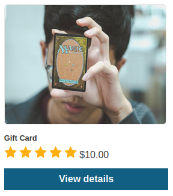

Now in the cart section add the coupon SIGNUP30 to avail discount.

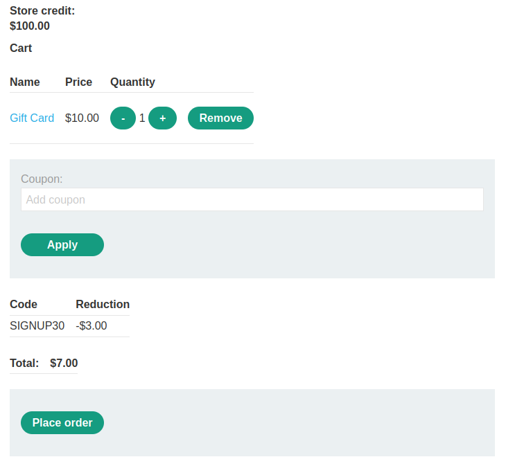

Once we place the order, we get a code to redeem.

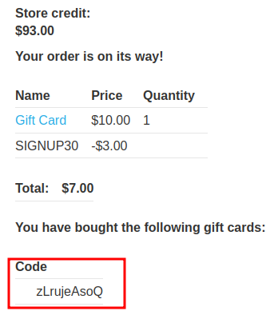

Paste the coupon in the redeem section available at My-Account page to redeem some credits .

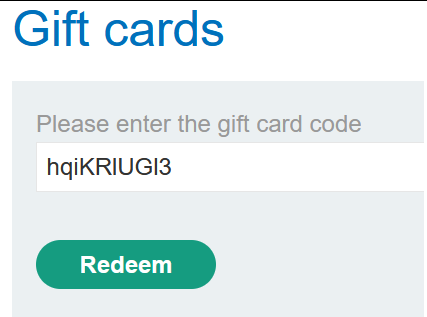

Now we got extra $3 dollars to our store credit.

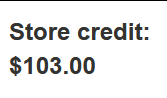

Summary of the steps -

 . Login as wiener .

 . Signup for newsletter to get a discount coupon - SIGNUP30.

 . Add Gift card product to cart .

 . Apply SIGNUP30 coupon .

 . Place the order to get a Gift coupon.

 . Redeem the coupon in My-Account page to get $3 dollars.

On repeating this process again and again, we can gain more and more credits which will help us to buy the leet leather jacket. In order to automate this multi step process, we use macros feature in burp.

Automate the multi step process using macros -

Go to Project options > "Sessions. In the Session handling rules panel, click Add. The Session handling rule editor dialog opens. In the dialog, go to the Scope tab. Under URL Scope, select Include all URLs. Go back to the Details tab. Under Rule actions, click Add > Run a macro. Under Select macro, click Add again to open the Macro Recorder.

Select the following sequence of requests:

```POST /cart
POST /cart/coupon
POST /cart/checkout
GET /cart/order-confirmation?order-confirmed=true
POST /gift-card
```
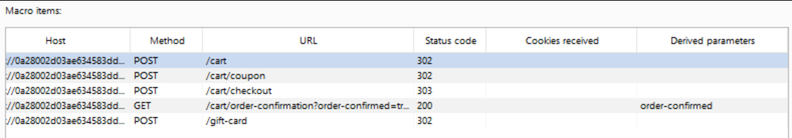

In the list of requests, select GET /cart/order-confirmation?order-confirmed=true. Click Configure item. In the dialog that opens, click Add to create a custom parameter. Name the parameter gift-card and highlight the gift card code at the bottom of the response.

Select the POST /gift-card request and click Configure item again. In the Parameter handling section, use the drop-down menus to specify that the gift-card parameter should be derived from the prior response (response 4). Click OK.

In the Macro Editor, click Test macro. Look at the response to GET /cart/order-confirmation?order-confirmation=true and note the gift card code that was generated. Look at the POST /gift-card request. Make sure that the gift-card parameter matches and confirm that it received a 302 response. Keep clicking "OK" until you get back to the main Burp window.

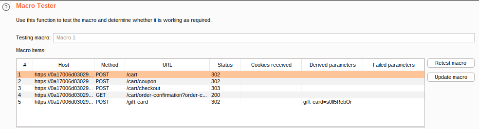

Send the GET /my-account request to Burp Intruder. Use the Sniper attack type.

On the "Payloads" tab, select the payload type Null payloads. Under "Payload settings", choose to generate 420 payloads.

Now start the attack. It takes some time to run.

Once completed, we see that we have $1427 credits.

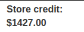

Now we can buy the leet jacket & solve the lab.


#### Visit The Next Page For The Next Level :)
