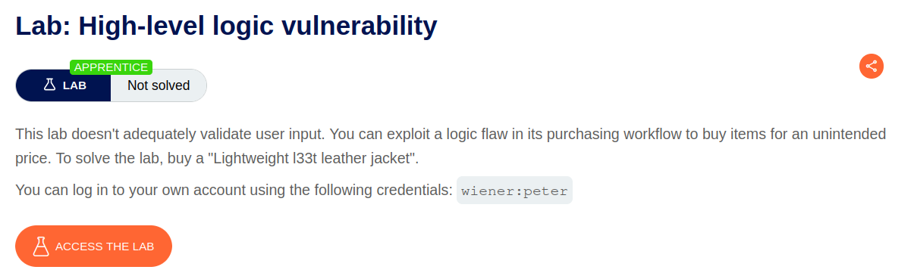
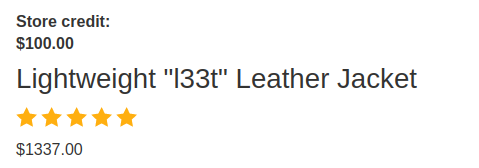
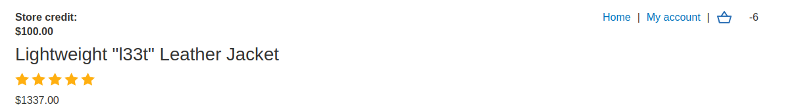
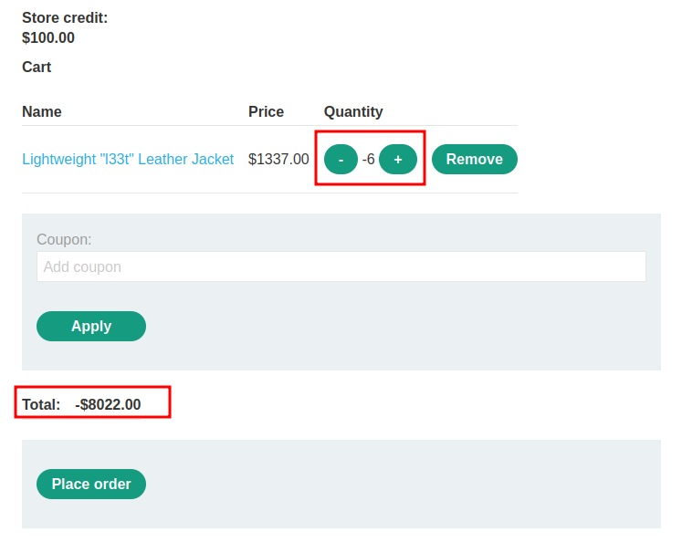
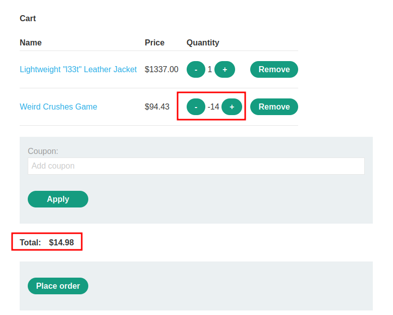
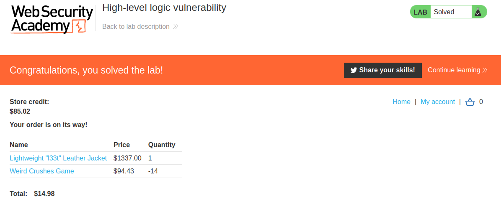

# High-level logic vulnerability

## Lab Description :


## Solution :
Log in to the shopping website as wiener.

The price of the leather jacket is $1337.00 . We need to find a business logic bug to manipulate the price and buy it .



When clicking on add to cart, the following POST Request is sent with a parameter quantity=1337.00 in the request body.
```html
POST /cart HTTP/2
Host: 0a1900d203250b7a80a00d26003a0099.web-security-academy.net
Cookie: session=X2Y6q62XkYRtvkB6D9gHCe1G9pA0gLOL
User-Agent: Mozilla/5.0 (X11; Ubuntu; Linux x86_64; rv:109.0) Gecko/20100101 Firefox/115.0
Accept: text/html,application/xhtml+xml,application/xml;q=0.9,image/avif,image/webp,*/*;q=0.8
Accept-Language: en-US,en;q=0.5
Accept-Encoding: gzip, deflate
Content-Type: application/x-www-form-urlencoded
Content-Length: 36
Origin: https://0a1900d203250b7a80a00d26003a0099.web-security-academy.net
Referer: https://0a1900d203250b7a80a00d26003a0099.web-security-academy.net/product?productId=1
Upgrade-Insecure-Requests: 1
Sec-Fetch-Dest: document
Sec-Fetch-Mode: navigate
Sec-Fetch-Site: same-origin
Sec-Fetch-User: ?1
Te: trailers

productId=1&redir=PRODUCT&quantity=1337.00
```
When we change the value of quantitiy to -5, it gets reflected. It means the value is updated based on user i/p. There is no validation on the server side.



In the checkout page, the value of total has also changed to negative value.



But the logic is we can't make a purchase with negative amount. (The server application/company is not gona pay us for our purchases lol.) So the way to solve this lab is to buy the jacket worth $1337 dollars by spending the amount which is less than what given to us ie < $100 dollars

So I made the purchase as shown below,



The total price of the jacket is $1337 but we were able to buy it just for $14.98 dollars by parameter tampering.

Place the order to solve the lab.



#### Visit The Next Page For The Next Level :)
