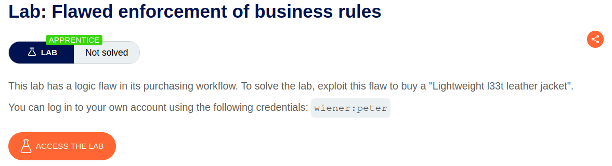
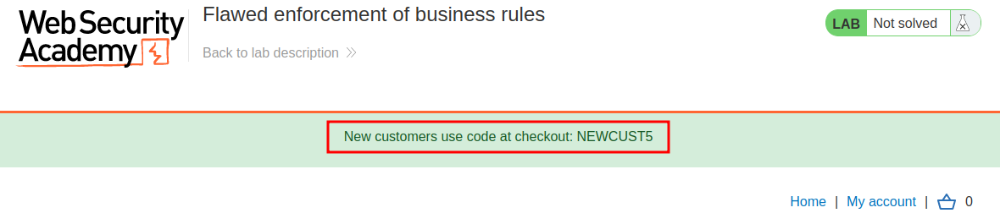
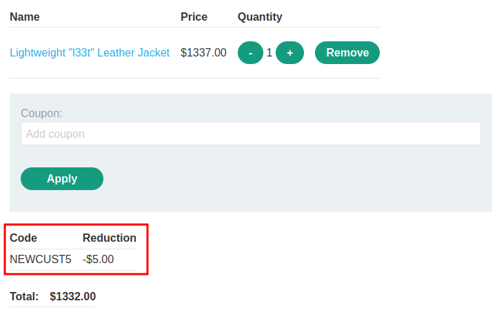
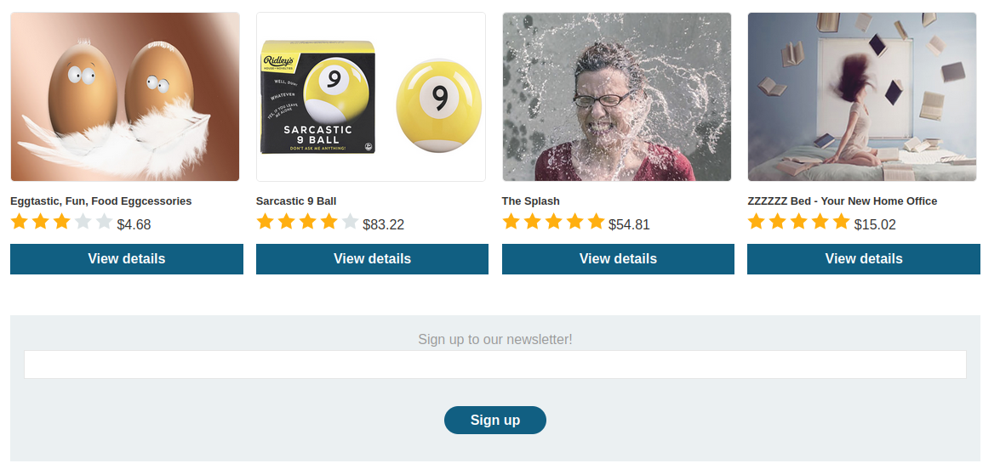
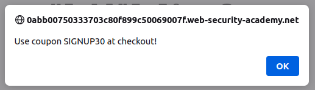
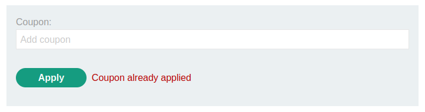
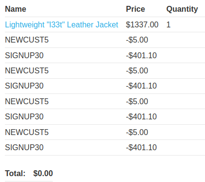
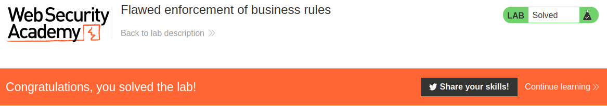

# Flawed enforcement of business rules

## Lab Description :

## Overview :
Domain-specific flaws

In many cases, you will encounter logic flaws that are specific to the business domain or the purpose of the site.

The discounting functionality of online shops is a classic attack surface when hunting for logic flaws. This can be a potential gold mine for an attacker, with all kinds of basic logic flaws occurring in the way discounts are applied.

For example, consider an online shop that offers a 10% discount on orders over $1000. This could be vulnerable to abuse if the business logic fails to check whether the order was changed after the discount is applied.

## Solution :
When the website loads, we see a message from the developers that we can avail discount if we are a new customer.

Log in to the website as wiener & add the leather jacket to cart.

Apply the promo code & we can see that there is $55 discount while purchasing it.

At the bottom of the shopping page we have this signup feature .

Signing up for newsletter gives us another $50 dollar discount.

Clicking on place-order button ,the order is placed sucessfully.

Flawed logic -
At this point after analysing the features of the site, we think from an attacker's perspective on what can possibly go wrong?

Maybe we can try to apply same coupon code again and again till the price decreases to certain limit.
Else we could use both the coupons we got and apply them again & again alternatively.
Case 1 - Apply same coupon code again and again :
When we try to apply the same coupon again and again, we get this message stating that Coupon already applied.

Case 2 - Use both coupons again & again alternatively :
When we try to apply both the coupons again&again in an alternate way, we identify the flaw. The price has now come down to $0 dollars.

Place the order to solve the lab.

#### Visit The Next Page For The Next Level :)
